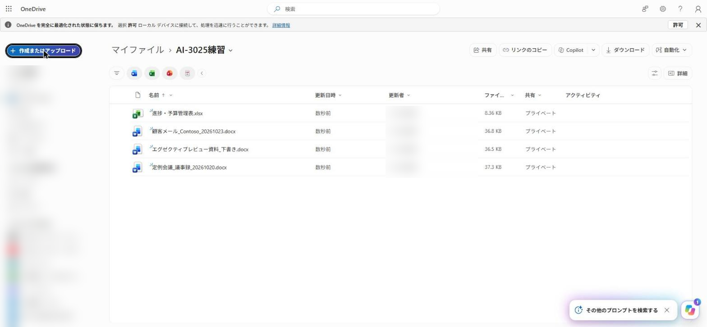
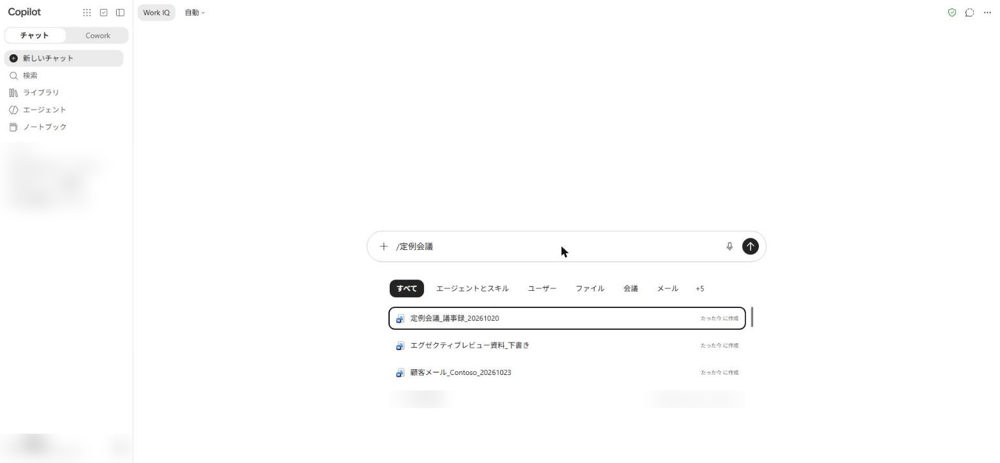

# デモ00：練習用データを準備する

## デモ シナリオ

研修のデモは、次の架空の状況を題材にしています。

- あなたは、Contoso という会社から、Web サイトの作り直しを請け負っているプロジェクト マネージャーです。
- 他の案件で数日間不在にしていた間に、定例会議が開かれ、Contoso の担当者からメールも届いています。
- 11 月 10 日に、Contoso の経営陣が新しい Web サイトの公開を承認するかを決める会議（エグゼクティブ レビュー）があります。

> 注：Contoso は、Microsoft の研修でよく使われる架空の会社名です。実在の企業とは関係ありません。

このデモでは、デモで使ったファイルを練習用データとしてダウンロードし、自分の OneDrive に置きます。OneDrive に置いたファイルは、Copilot の入力欄で「/」を入力して指定できるようになります。

> 注：このデモに必要なのは、Microsoft 365 の職場のアカウントと OneDrive です。タスク3 の「/」でファイルを指定する操作には、Microsoft 365 Copilot のライセンスが必要です。ライセンスがない場合は、各デモでファイルを直接アップロードして試せます。詳しくは README の「必要な環境」をご覧ください。

このデモでは以下のタスクを実施します。

　**タスク１：練習用データをダウンロードする**

　**タスク２：OneDrive に練習用データをアップロードする**

　**タスク３：Copilot からファイルを指定できることを確認する**

## 予想時間: 10分

## タスク1 - 練習用データをダウンロードする

> **このタスクの目的：** デモで使ったファイル（4本）を、自分のパソコンにダウンロードします。

1. 以下のリンクをクリックして、練習用データ（練習用データ.zip）をダウンロードします。

   **[練習用データ.zip をダウンロード](https://github.com/ctct-edu/AI-3025/raw/main/Allfiles/練習用データ.zip)**

   > 注：ダウンロードした 練習用データ.zip は、パソコンの「**ダウンロード**」フォルダーに保存されます。

2. エクスプローラーで「**ダウンロード**」フォルダーを開き、**練習用データ.zip** を右クリックして、「**すべて展開**」をクリックします。

3. 「**練習用データ**」フォルダーが開き、次の4本のファイルが入っていることを確認します。

   | ファイル名 | 内容 | 使うデモ |
   | ---------- | ---- | -------- |
   | 定例会議_議事録_20261020.docx | 不在中に開かれた定例会議の議事録（進捗、決定事項、未決事項） | 01、03、04、05 |
   | 顧客メール_Contoso_20261023.docx | 顧客からのメール（メッセージ更新の依頼、リリース承認の条件） | 02、03、04、05 |
   | 進捗・予算管理表.xlsx | 月別の予算と見込み、表示速度の計測結果、課題一覧 | 03、04、05 |
   | エグゼクティブレビュー資料_下書き.docx | AI が作ったエグゼクティブ レビュー資料の下書き | 05 |

## タスク2 - OneDrive に練習用データをアップロードする

> **このタスクの目的：** Copilot が参照できるように、練習用データを自分の OneDrive に置きます。

1. Microsoft Edge で以下の URL を開き、会社のアカウントでサインインします。

   ```
   https://www.office.com/
   ```

2. 画面左の「**OneDrive**」をクリックし、「**マイ ファイル**」を開きます。「**＋ 作成またはアップロード**」から「**フォルダー**」をクリックし、以下の名前でフォルダーを作成します。

   ```
   AI-3025練習
   ```

3. 作成した「**AI-3025練習**」フォルダーを開き、タスク1で展開した4本のファイルを画面にドラッグ＆ドロップしてアップロードします。

   > 注：共有の設定は変更せず、自分だけが見られる状態（プライベート）のままにしてください。

   

## タスク3 - Copilot からファイルを指定できることを確認する

> **このタスクの目的：** アップロードしたファイルを、Copilot の入力欄から指定できることを確認します。

1. 以下の URL を開き、Microsoft 365 Copilot アプリを表示します。

   ```
   https://m365.cloud.microsoft/chat
   ```

2. 画面上部に「**Work IQ**」が表示され、選択された状態（灰色の背景）になっていることを確認します。

   > 注：Work IQ は、メール、会議、チャット、ファイルなど、自分の仕事の情報を Copilot が参照するための機能です。Microsoft 365 Copilot のライセンスがある場合に表示されます。

3. 入力欄に半角の「**/**」を入力し、続けて「**定例会議**」と入力します。候補に「**定例会議_議事録_20261020**」が表示されることを確認します。

   

   > 注：アップロード直後は、候補に表示されるまで時間がかかる場合があります。表示されない場合は、時間をおいてから再度お試しください。
   >
   > 注：候補に表示されない場合は、入力欄の「**＋**」から「**アップロード**」を選び、ファイルを直接アップロードする方法でも、以降のデモを試せます。

4. 候補を選ばずに、**Esc** キーを押して入力欄を空にします。

以上で本デモは完了です。
