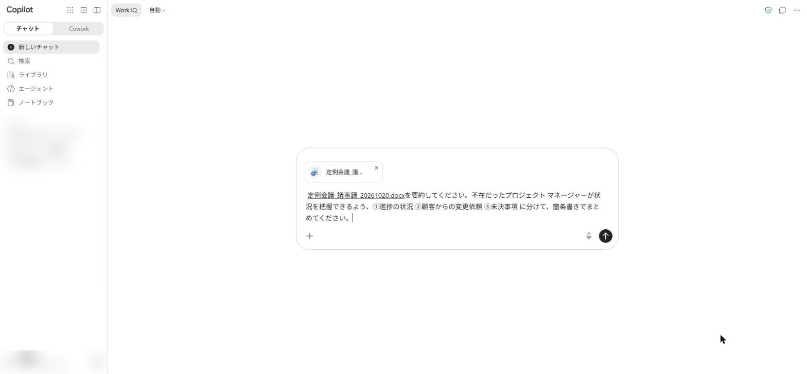
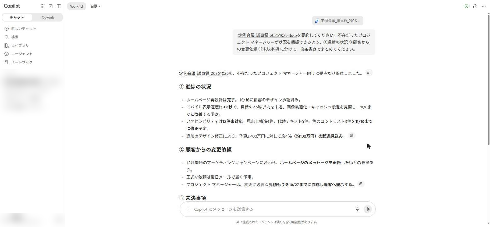
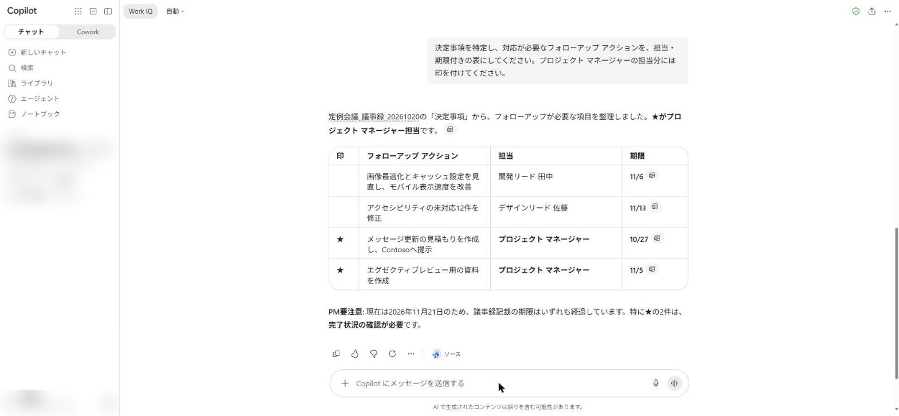
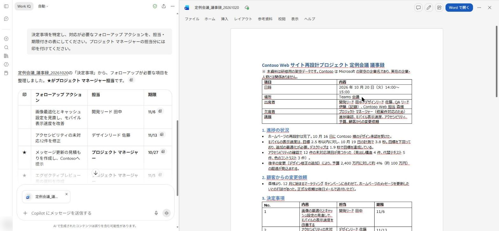

# デモ01：会議を要約する

## デモ シナリオ

数日間ほかの案件に入っていた間に、Contoso Web サイト再設計プロジェクトの定例会議が開かれました。戻った朝に、会議の内容と自分が対応すべきことを短時間で把握します。

このデモは、研修の第 1 章「AI とは」で講師が見せたデモです。議事録の要約を頼み、続けて決定事項と対応すべきことを整理させます。AI は既にある情報を整理するのが得意ですが、書かれていない状況を作り出すわけではありません。要約の結果は、参照元の原文で確かめます。

> 注：このデモでは、Microsoft 365 Copilot のライセンス（Microsoft 365 に追加するアドオン ライセンス）を使います。ライセンスがない場合は、ファイルを「/」で指定する代わりに、入力欄の「**＋**」からファイルをアップロードして試せます。詳しくは README の「必要な環境」をご覧ください。

このデモでは以下のタスクを実施します。

　**タスク１：議事録の要約を依頼する**

　**タスク２：決定事項とフォローアップを特定させる**

　**タスク３：参照元で原文を確認する**

## 予想時間: 10分

## タスク1 - 議事録の要約を依頼する

> **このタスクの目的：** 議事録のファイルを指定し、目的と分け方を伝えて要約させます。

1. Microsoft 365 Copilot アプリ（`https://m365.cloud.microsoft/chat`）を開き、画面左上の「**新しいチャット**」をクリックします。画面上部の「**Work IQ**」が選択された状態（灰色の背景）であることを確認します。

2. 入力欄に半角の「**/**」を入力し、続けて「**定例会議**」と入力します。候補から「**定例会議_議事録_20261020**」をクリックします。

   > 注：ファイルを選んだあとに「定例会議」の文字が入力欄に残った場合は、削除します。

3. ファイル名の後ろに続けて、以下の文章を入力します。

   ```
   を要約してください。不在だったプロジェクト マネージャーが状況を把握できるよう、①進捗の状況 ②顧客からの変更依頼 ③未決事項 に分けて、箇条書きでまとめてください。
   ```

   

4. **Enter** キーを押して送信し、回答に次の内容が含まれていることを確認します。

   | 項目 | 主な内容 |
   | ---- | -------- |
   | 進捗の状況 | ホームページの再設計は完了（10/16 承認）、モバイルの表示速度は 3.8 秒で目標 2.5 秒を未達、アクセシビリティの未対応 12 件、予算は約 4％の超過見込み |
   | 顧客からの変更依頼 | 12 月のマーケティング キャンペーンに合わせたホームページのメッセージ更新（正式な依頼は後日メール） |
   | 未決事項 | 予算超過分の扱い、メッセージ更新を 11/30 のリリースに含めるか |

   

   > 注：回答の内容や表現は毎回異なります。上の内容が含まれていれば問題ありません。

## タスク2 - 決定事項とフォローアップを特定させる

> **このタスクの目的：** 同じ会話の中で続けて依頼し、要約を「すぐに行動に移せる形」に整理させます。

1. 続けて、以下の文章を入力して送信します。

   ```
   決定事項を特定し、対応が必要なフォローアップ アクションを、担当・期限付きの表にしてください。プロジェクト マネージャーの担当分には印を付けてください。
   ```

2. 表に、次の内容が含まれていることを確認します。

   | 内容 | 担当 | 期限 |
   | ---- | ---- | ---- |
   | モバイルの表示速度の改善（画像の最適化、キャッシュ設定の見直し） | 開発リード 田中 | 11/6 |
   | アクセシビリティの未対応 12 件の修正 | デザインリード 佐藤 | 11/13 |
   | メッセージ更新の見積もりを作成し、顧客に提示（印） | プロジェクト マネージャー | 10/27 |
   | エグゼクティブ レビュー用の資料の作成（印） | プロジェクト マネージャー | 11/5 |

   

   > 注：Copilot が「今日の日付では期限が過ぎている」と注意を添えることがあります。練習用データの日付は 2026 年 10 月のため、そのまま進めて構いません。
   >
   > 注：1 回目の回答を踏まえて追加の依頼ができるのは、同じ会話の中で続けているためです。最初からやり直す必要はありません。

## タスク3 - 参照元で原文を確認する

> **このタスクの目的：** 要約の内容が議事録に書かれていることを、参照元で確かめます。

1. 回答の文末にある参照のアイコン（文書のマーク）をクリックします。

2. 画面の右側に議事録が開くことを確認し、表示速度（3.8 秒、目標 2.5 秒）や期限（10/27、11/5）が原文と一致しているかを確かめます。

   

   > 注：AI は議事録の内容を整理しただけで、会議の内容を作り出したわけではありません。数値と期限は、行動に移す前に原文で確認します。

3. 右上の「**×**」をクリックして、議事録を閉じます。

以上で本デモは完了です。
