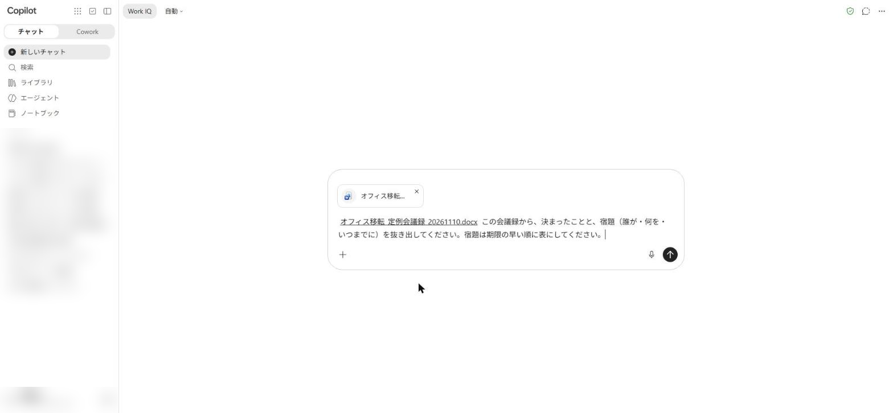
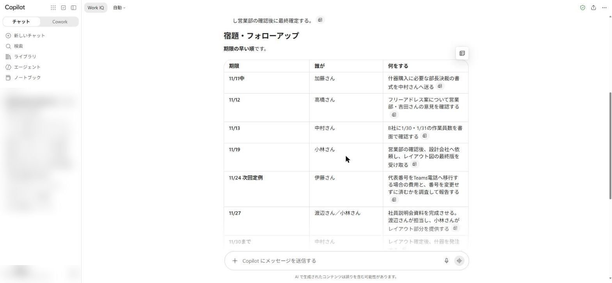
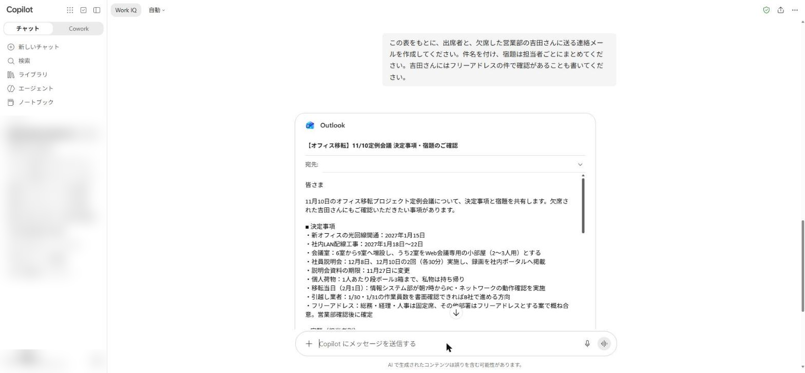
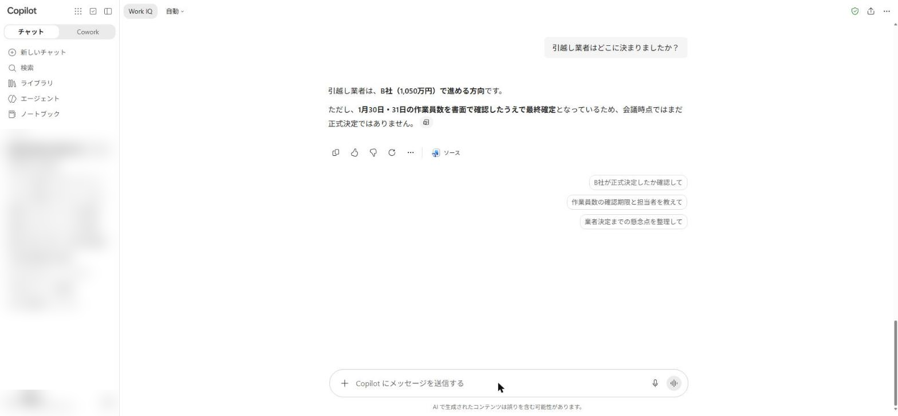

# デモ01：会議録から宿題と連絡メールを作る

## デモ シナリオ

オフィス移転プロジェクトの定例会議の議事録があります。誰が・何を・いつまでにやるか（宿題）は、表にまとまっておらず、議論の文章の中に散らばっています。手作業で読み解いて表にし、関係者への連絡メールを書くと、20〜30 分かかります。

このデモでは、Copilot に宿題を抜き出させ、連絡メールまで作ります。さらに、議事録に書かれていないことを聞いたときに AI がどう答えるかも確かめます。

このデモは、研修の第 1 章「AI とは」で講師が見せたデモです。AI は、既にある情報を読み取り、整理し、別の形に作り変える作業が得意です。

> 注：このデモでは、Microsoft 365 Copilot のライセンス（Microsoft 365 に追加するアドオン ライセンス）を使います。ライセンスがない場合は、ファイルを「/」で指定する代わりに、入力欄の「**＋**」からファイルをアップロードして試せます。詳しくは README の「必要な環境」をご覧ください。

このデモでは以下のタスクを実施します。

　**タスク１：会議録から宿題を抜き出す**

　**タスク２：連絡メールを作る**

　**タスク３：議事録に書かれていないことを聞く**

## 予想時間: 10分

## タスク1 - 会議録から宿題を抜き出す

> **このタスクの目的：** 文章の中に散らばった宿題を、担当・期限付きの表にします。

1. Microsoft 365 Copilot アプリ（`https://m365.cloud.microsoft/chat`）を開き、画面左上の「**新しいチャット**」をクリックします。

2. 入力欄に半角の「**/**」を入力し、続けて「**オフィス**」と入力して、候補から「**オフィス移転_定例会議録_20261110**」を選びます。

   > 注：ファイルを選んだあとに検索した文字が入力欄に残った場合は、削除します。

3. ファイル名の後ろに続けて、以下の文章を入力して送信します。

   ```
   この会議録から、決まったことと、宿題（誰が・何を・いつまでに）を抜き出してください。宿題は期限の早い順に表にしてください。
   ```

   

4. 回答に、次のような宿題が含まれていることを確認します（全部で 11 件）。

   | 宿題 | 担当 | 期限 |
   | ---- | ---- | ---- |
   | 決裁の書式を送る | 加藤 | 11/11 |
   | フリーアドレスについて営業部に確認 | 高橋 | 11/12 |
   | 引越し業者 B 社に作業員数を書面で確認 | 中村 | 11/13 |
   | レイアウト図の最終版を受け取る | 小林 | 11/19 |
   | 社員説明会の資料を作成 | 渡辺 | 11/27 |
   | 什器を発注 | 中村 | 11/30 |

   

5. 回答の中の参照番号をクリックし、議事録の該当箇所が表示されることを確認します。

   > 注：社員説明会の資料の期限は、会議の途中で 11/20 から 11/27 に変更されています。回答が 11/27 になっているかを確認してください。このように、話の途中で変わった内容は、人が原文で確かめる価値があります。

## タスク2 - 連絡メールを作る

> **このタスクの目的：** 抜き出した内容から、関係者に送るメールの下書きを作ります。

1. 同じチャットで、以下の文章を入力して送信します。

   ```
   この表をもとに、出席者と、欠席した営業部の吉田さんに送る連絡メールを作成してください。件名を付け、宿題は担当者ごとにまとめてください。吉田さんにはフリーアドレスの件で確認があることも書いてください。
   ```

2. 「**Outlook**」と書かれた枠で、件名、担当者ごとの宿題、吉田さんへの確認事項が入ったメールの下書きが表示されることを確認します。

   

   > 注：宛先を入力すれば、この枠から Outlook のメールとして開けます。Outlook で新しいメールを作成し、本文の「**Copilot を使用して下書き**」（**Alt+i**）に同じ文章を入力しても作れます。

## タスク3 - 議事録に書かれていないことを聞く

> **このタスクの目的：** 決まっていないことを聞いたときに、AI がどう答えるかを確認します。

1. 同じチャットで、以下の文章を入力して送信します。

   ```
   引越し業者はどこに決まりましたか？
   ```

2. 回答が「B 社で進める方向だが、作業員数の確認後に決める（まだ確定していない）」という内容になっていることを確認します。

   

   > 注：AI は、書かれていないことをもっともらしく補ってしまうことがあります。「決まった」と答えた場合は、参照番号から原文を確認してください。

以上で本デモは完了です。
