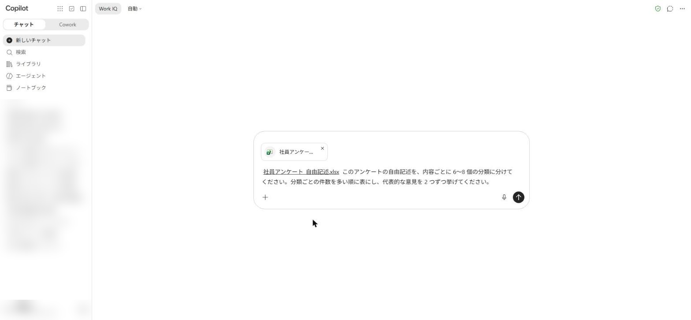
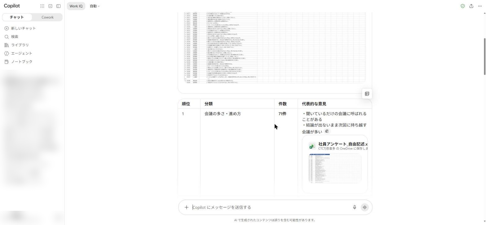
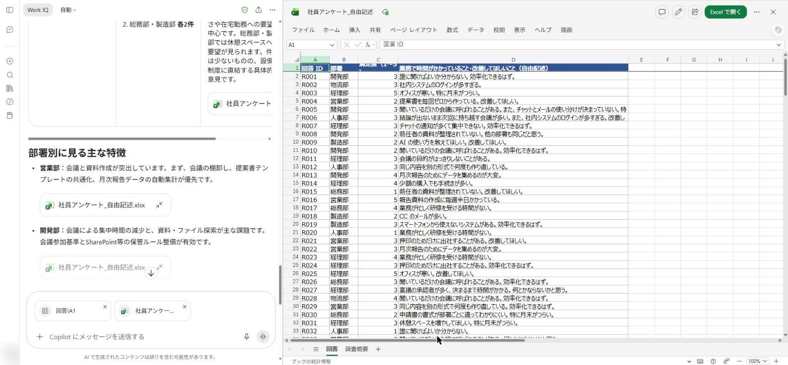
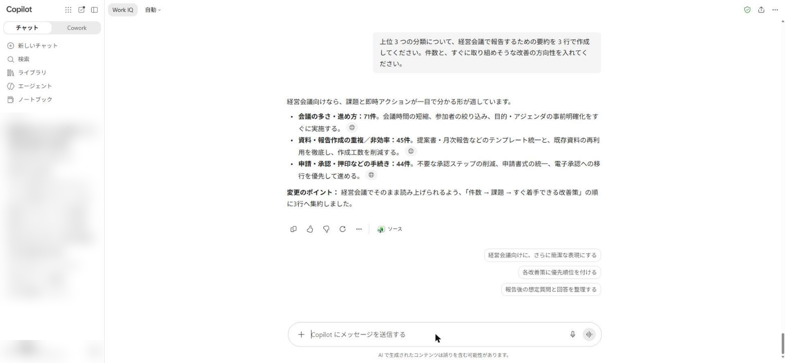

# デモ02：アンケートの自由記述を分類する

## デモ シナリオ

働き方に関する社員アンケートを行い、240 件の回答が集まりました。自由記述を 1 件ずつ読んで分類し、件数を数え、部署ごとの傾向をまとめると、半日かかります。

このデモでは、Copilot に自由記述を分類させ、件数と代表的な意見、部署ごとの傾向をまとめます。

このデモは、研修の第 2 章「職場で AI を活用する」で講師が見せたデモです。「読む・分ける・数える・まとめる」のように時間がかかっている作業は、AI に渡せる作業の代表例です。

> 注：このデモでは、Microsoft 365 Copilot のライセンス（Microsoft 365 に追加するアドオン ライセンス）を使います。ライセンスがない場合は、ファイルを「/」で指定する代わりに、入力欄の「**＋**」からファイルをアップロードして試せます。詳しくは README の「必要な環境」をご覧ください。

このデモでは以下のタスクを実施します。

　**タスク１：自由記述を分類して数える**

　**タスク２：部署ごとの傾向を見る**

　**タスク３：報告用にまとめる**

## 予想時間: 10分

## タスク1 - 自由記述を分類して数える

> **このタスクの目的：** 240 件の自由記述を、分類ごとの件数と代表的な意見にまとめます。

1. Microsoft 365 Copilot アプリ（`https://m365.cloud.microsoft/chat`）で、画面左上の「**新しいチャット**」をクリックします。

2. 入力欄に半角の「**/**」を入力し、続けて「**社員**」と入力して、候補から「**社員アンケート_自由記述**」を選びます。

3. ファイル名の後ろに続けて、以下の文章を入力して送信します。

   ```
   このアンケートの自由記述を、内容ごとに 6〜8 個の分類に分けてください。分類ごとの件数を多い順に表にし、代表的な意見を 2 つずつ挙げてください。
   ```

   

4. 回答に、次のような分類と件数が含まれていることを確認します。

   | 分類（例） | 件数の目安 |
   | ---------- | ---------- |
   | 会議の多さ・進め方 | 60〜70 件 |
   | 資料・報告作成の重複 | 約 45 件 |
   | 申請・承認などの手続き | 40〜45 件 |
   | 文書・情報の管理、問い合わせ先 | 30〜35 件 |
   | 社内システムの使い勝手 | 25〜30 件 |

   

   > 注：分類の名前と件数は、AI の分け方によって多少変わります。1 件に 2 つの話題が書かれている回答は、両方の分類に数えられるためです。上位の顔ぶれが同じであれば問題ありません。
   >
   > 注：画面の右側に、アンケートの Excel ファイルが表示されることがあります。右上の「**×**」で閉じられます。

## タスク2 - 部署ごとの傾向を見る

> **このタスクの目的：** 分類と部署を組み合わせて、傾向を見ます。

1. 同じチャットで、以下の文章を入力して送信します。

   ```
   分類ごとに、回答が多い部署を挙げてください。部署ごとの特徴があれば説明してください。
   ```

2. 回答に、次のような傾向が含まれていることを確認します。

   - 営業部：会議と資料作成の声が多い
   - 経理部・総務部：承認・手続きの声が多い
   - 製造部・物流部：社内システムの使いにくさの声が多い

   

## タスク3 - 報告用にまとめる

> **このタスクの目的：** 分析結果を、そのまま報告に使える短い文章にします。

1. 同じチャットで、以下の文章を入力して送信します。

   ```
   上位 3 つの分類について、経営会議で報告するための要約を 3 行で作成してください。件数と、すぐに取り組めそうな改善の方向性を入れてください。
   ```

2. 件数と改善の方向性が入った 3 行の要約が作られたことを確認します。

   

   > 注：件数は、報告に使う前に Excel のフィルターなどで数件確かめると安心です。AI の集計は便利ですが、数字は人が確認します。

以上で本デモは完了です。
