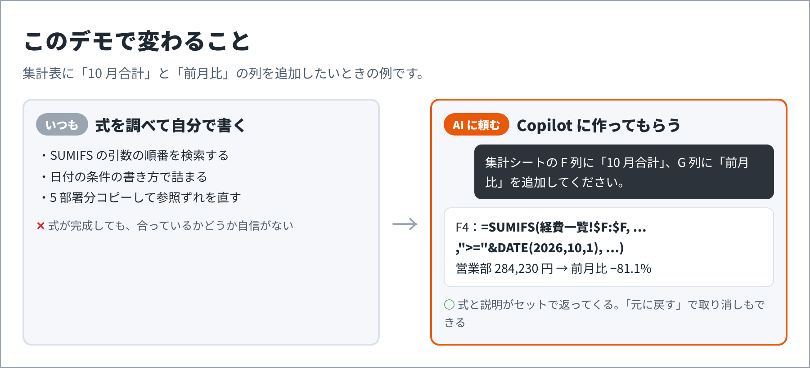
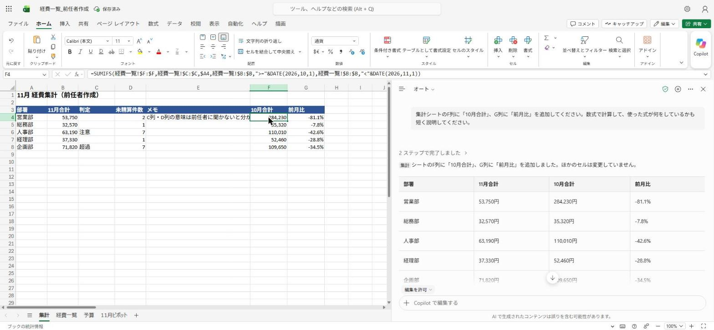

# デモ02：関数を作ってもらう

## テーマ

「先月と比べてどうだった？」と聞かれて、慌てて電卓をたたいたことはありませんか。SUMIFS で月ごとに合計すればよいのは分かっていても、条件を 3 つ並べる書き方は毎回調べ直し、という方は多いはずです。

## 目的

作りたい列を言葉で伝えるだけで、Copilot に式を作って入れてもらいます。式の書き方を覚えるのではなく、「何を出したいか」を伝える練習です。



## 必要な環境

| 項目 | 内容 |
| ---- | ---- |
| 使う場所 | Excel for the web の Copilot |
| 使うデータ | 経費一覧_前任者作成.xlsx（集計シート） |

このデモでは以下のタスクを実施します。

　**タスク１：Excel で Copilot を開く**

　**タスク２：列を追加してもらう**


## 予想時間: 4分


## 今回の頼み方

以下の文をコピーして使います。

```
集計シートのF列に「10月合計」、G列に「前月比」を追加してください。数式で計算して、使った式が何をしているかも短く説明してください。
```

## タスク1 - Excel で Copilot を開く

> **このタスクの目的：** デモ01 と同じブックを使います。すでに開いている場合は次のタスクへ進みます。

1. OneDrive の「**マイ ファイル**」→「**AI-3025お土産データ**」を開き、**経費一覧_前任者作成.xlsx** をクリックします。Excel for the web でブックが開きます。

   


2. リボンの右端にある「**Copilot**」をクリックします。画面の右側に Copilot の作業ウィンドウが開きます。

   


## タスク2 - 列を追加してもらう

> **このタスクの目的：** 作りたい列を言葉で伝え、Copilot に式を入れてもらいます。

1. 「**集計**」シートを表示した状態で、Copilot の入力欄に「今回の頼み方」の文を貼り付けて、**Enter** キーを押します。

   


2. F 列と G 列が追加され、Copilot の作業ウィンドウに結果の表が表示されることを確認します。内容がよければ「**完了**」、やり直したいときは「**元に戻す**」をクリックします。

   

   


3. **F4** セルをクリックし、数式バーに SUMIFS の式が入っていることを確認します（値の貼り付けではなく、式で計算されていることが大切です）。

   


## うまくいったかの目安

- F 列・G 列に式が入っている（数式バーで確認できる）
- 式の説明が日本語で付いている


## ここがコツ

- 「数式で計算して」と書くと、計算結果の数字だけを貼り付けるのではなく、式を入れてくれます。後でデータが増えても自動で計算し直されます。
- 営業部の 10 月合計 284,230 円には、デモ03 で見つかる「交通費 186,000 円（桁の誤り）」が含まれています。式が正しくても、元データが間違っていれば結果も間違う――デモ19 につながるポイントです。
- Excel の Copilot が編集できるのは、OneDrive や SharePoint に保存されたブックです。


## 言い換え例

同じ考え方で、次のようにも頼めます。

```
部署ごとの「未精算の金額の合計」を H 列に追加してください。
```

```
11 月合計が予算の何 % かを表示する列を追加してください。
```

```
B 列の式を、テーブルの列名を使った読みやすい式に書き換えてください。
```


---

← [デモ01：謎の関数を読み解く](./Demo01_謎の関数を読み解く.md)　｜　[README に戻る](../README.md)　｜　[デモ03：入力ミスを見つける](./Demo03_入力ミスを見つける.md) →
