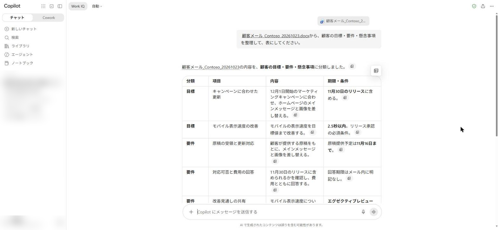
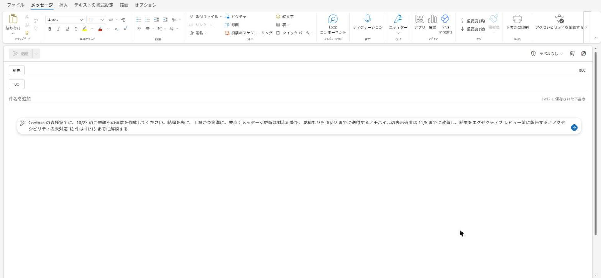
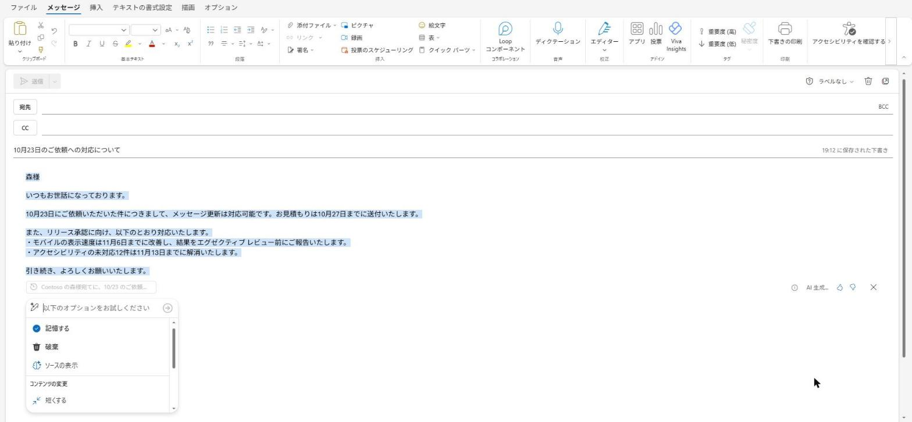
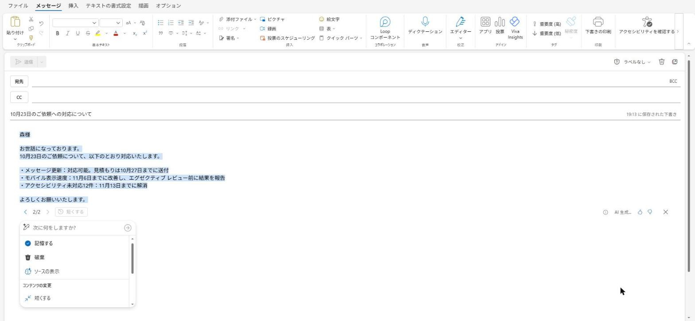
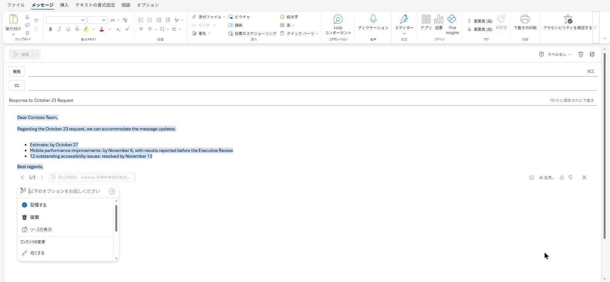

# デモ02：顧客を理解し、返信を下書きする

## デモ シナリオ

不在の間に、Contoso のマーケティング部 森様からメールが届いていました。ホームページのメッセージ更新の正式な依頼と、リリース承認の条件が書かれています。顧客の要件を整理したうえで、返信の下書きを作ります。

このデモは、研修の第 2 章「職場で AI を活用する」で講師が見せたデモです。顧客のメールから要件を整理し（情報を検索し、整理する）、返信の下書きを作ります（開始点を作成する）。送信する前に、数値と日付は必ず自分で確認します。

> 注：このデモでは、Microsoft 365 Copilot のライセンス（Microsoft 365 に追加するアドオン ライセンス）を使います。ライセンスがない場合は、ファイルを「/」で指定する代わりに、入力欄の「**＋**」からファイルをアップロードして試せます。詳しくは README の「必要な環境」をご覧ください。
>
> 注：Outlook の「Copilot を使用して下書き」の表示は、ライセンスと組織の設定によって異なります。ライセンスを割り当てた直後は、表示されるまで時間がかかる場合があります。

このデモでは以下のタスクを実施します。

　**タスク１：顧客の目標・要件・懸念事項を整理する**

　**タスク２：Outlook で返信の下書きを作成する**

　**タスク３：下書きを調整する**

　**タスク４：英語のメールにする**

## 予想時間: 10分

## タスク1 - 顧客の目標・要件・懸念事項を整理する

> **このタスクの目的：** 顧客のメールから、返信の前に押さえるべき点を整理させます。

1. Microsoft 365 Copilot アプリ（`https://m365.cloud.microsoft/chat`）で「**新しいチャット**」をクリックします。

2. 入力欄に半角の「**/**」を入力し、続けて「**顧客メール**」と入力します。候補から「**顧客メール_Contoso_20261023**」をクリックします。

3. ファイル名の後ろに続けて、以下の文章を入力して送信します。

   ```
   から、顧客の目標・要件・懸念事項を整理して、表にしてください。
   ```

4. 表に、次の内容が含まれていることを確認します。

   | 区分 | 主な内容 |
   | ---- | -------- |
   | 目標 | 12/1 開始のマーケティング キャンペーンに合わせて、ホームページのメッセージと画像を差し替える |
   | 要件 | 原稿は 11/16 までに送付、11/30 のリリースに含められるか費用とあわせて回答／モバイルの表示速度 2.5 秒以内がリリース承認の条件／アクセシビリティの未対応項目を公開前にすべて解消 |
   | 懸念事項 | キャンペーン開始前にリリースが遅れること |

   

## タスク2 - Outlook で返信の下書きを作成する

> **このタスクの目的：** 要点と、相手・目的・書き方を伝えて、返信の下書きを作成します。

1. Outlook（`https://outlook.office.com/`）を開き、「**新規メール**」をクリックします。

2. 本文に表示される「**Copilot を使用して下書きします (Alt+i)**」の左側にあるアイコンをクリックします。「**このメールで何を伝えたいですか?**」と表示された入力欄が開きます。

   > 注：**Alt** キーを押しながら **i** キーを押しても開けます。

3. 入力欄に以下の文章を貼り付けます。

   ```
   Contoso の森様宛てに、10/23 のご依頼への返信を作成してください。結論を先に、丁寧かつ簡潔に。要点：メッセージ更新は対応可能で、見積もりを 10/27 までに送付する／モバイルの表示速度は 11/6 までに改善し、結果をエグゼクティブ レビュー前に報告する／アクセシビリティの未対応 12 件は 11/13 までに解消する
   ```

   

4. 入力欄の右端の矢印をクリックして、下書きを生成します。件名と本文が作成され、本文に次の内容が正しく入っていることを確認します。

   | 項目 | 正しい内容 |
   | ---- | ---------- |
   | 見積もりの送付 | 10/27 まで |
   | モバイルの表示速度 | 11/6 までに改善、エグゼクティブ レビュー前に報告 |
   | アクセシビリティ | 未対応 12 件を 11/13 までに解消 |

   

   > 注：要点だけを渡して「返信を書いて」と頼んだ場合と比べると、相手・目的・書き方を伝えた効果が分かります。この違いは、デモ03 の「根拠づけ」につながります。

## タスク3 - 下書きを調整する

> **このタスクの目的：** 言い回しを調整し、目的に合った文面に整えます。

1. 下書きの下に表示されたメニューから「**短くする**」をクリックします。

2. 文面が短くなったことを確認します。

   

   > 注：メニューの「**記憶する**」をクリックすると、下書きが本文として確定します。「**破棄**」をクリックすると、下書きを取り消せます。

## タスク4 - 英語のメールにする

> **このタスクの目的：** 同じ内容を、海外の担当者宛ての英語のメールにします。

1. メニュー上部の入力欄（「**次に何をしますか?**」）に以下の文章を入力し、**Enter** キーを押します。

   ```
   同じ内容を、Contoso の海外本社の担当者宛てに英語で作成してください
   ```

2. 件名と本文が英語になったことを確認します。日付と件数が正しいかを確認します。

   

3. 練習なので、メールは送信しません。画面右上のごみ箱のアイコンをクリックし、「**OK**」をクリックして下書きを破棄します。

以上で本デモは完了です。
