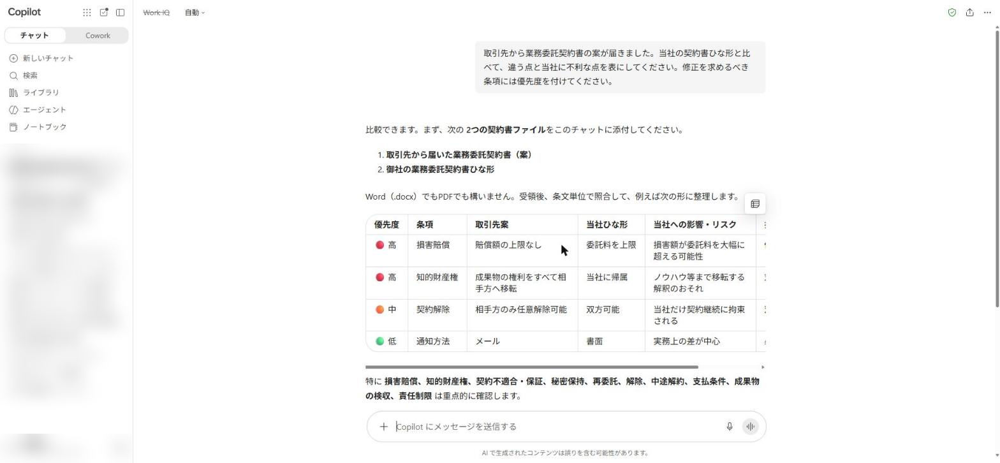
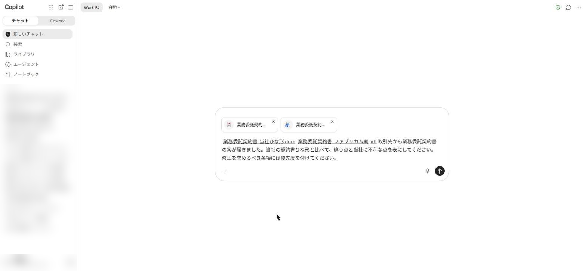
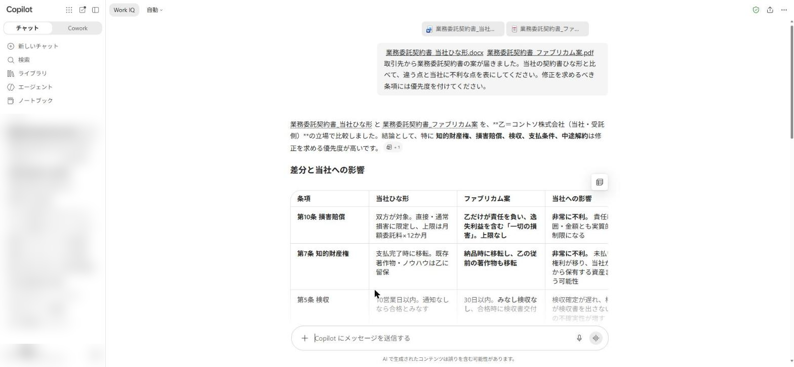

# デモ03：Word と PDF の契約書を比べる

## デモ シナリオ

取引先のファブリカムから、業務委託契約書の案が PDF で届きました。自社（コントソ）のひな形は Word です。2 つを 1 条ずつ見比べて、違う点と自社に不利な点を洗い出すと、1〜2 時間かかります。

このデモでは、同じ依頼文を 2 回送ります。1 回目は資料を渡さずに、2 回目は Word と PDF の 2 本を渡して送り、回答の違いを比べます。

このデモは、研修の第 3 章「根拠づけが重要な理由」で講師が見せたデモです。回答の質を決めるのは、言い回しよりも、AI が参照できる情報（根拠）です。

> 注：このデモでは、Microsoft 365 Copilot のライセンス（Microsoft 365 に追加するアドオン ライセンス）を使います。ライセンスがない場合は、タスク1 はファイルを付けずに送り、タスク2 は入力欄の「**＋**」から 2 本のファイルをアップロードして試せます。詳しくは README の「必要な環境」をご覧ください。

このデモでは以下のタスクを実施します。

　**タスク１：資料を渡さずに依頼する**

　**タスク２：Word と PDF を渡して同じ依頼をする**

　**タスク３：2つの回答を比べる**

## 予想時間: 10分

## タスク1 - 資料を渡さずに依頼する

> **このタスクの目的：** 根拠となる資料を渡さないと、どのような回答になるかを確認します。

1. Microsoft 365 Copilot アプリ（`https://m365.cloud.microsoft/chat`）で、画面左上の「**新しいチャット**」をクリックします。

2. 画面上部の「**Work IQ**」をクリックしてオフにします。文字に取り消し線が付き、灰色の背景が消えたことを確認します。

   > 注：Work IQ がオンのままだと、Copilot が OneDrive の練習用データを自動で探して参照するため、違いが分かりにくくなります。

3. 以下の文章を入力して送信します。

   ```
   取引先から業務委託契約書の案が届きました。当社の契約書ひな形と比べて、違う点と当社に不利な点を表にしてください。修正を求めるべき条項には優先度を付けてください。
   ```

4. 回答が、2 つの契約書ファイルを添付するよう求める内容になっていることを確認します。表が表示されることもありますが、実際の契約書とは関係のない一般的な例です。

   

## タスク2 - Word と PDF を渡して同じ依頼をする

> **このタスクの目的：** 根拠となる 2 本のファイルを渡して、同じ依頼文を送ります。

1. 「**新しいチャット**」をクリックします。画面上部の「**Work IQ**」がオフになっている場合は、クリックしてオンに戻します。

2. 入力欄に半角の「**/**」を入力し、続けて「**業務委託**」と入力して、次の2本のファイルを1本ずつ指定します。

   | 指定するファイル | 形式 |
   | ---------------- | ---- |
   | 業務委託契約書_当社ひな形 | Word |
   | 業務委託契約書_ファブリカム案 | PDF |

   > 注：1 本目を選んだあと、続けて半角スペースと「/」を入力し、もう一度「業務委託」と入力して 2 本目を選びます。

   > 注：ファイルを選んだあとに検索した文字が入力欄に残った場合は、削除します。

3. ファイル名の後ろに続けて、タスク1と同じ文章を入力して送信します。

   ```
   取引先から業務委託契約書の案が届きました。当社の契約書ひな形と比べて、違う点と当社に不利な点を表にしてください。修正を求めるべき条項には優先度を付けてください。
   ```

   

## タスク3 - 2つの回答を比べる

> **このタスクの目的：** 渡した情報によって回答がどう変わったかを確認します。

1. タスク2の回答に、次のような具体的な相違点が入っていることを確認します。

   | 条項 | 当社ひな形 | ファブリカム案 | 当社への影響 |
   | ---- | ---------- | -------------- | ------------ |
   | 第 10 条 損害賠償 | 直接かつ通常の損害、上限は委託料の 12 か月分 | 一切の損害（逸失利益を含む）、上限なし | 不利（影響が最も大きい） |
   | 第 7 条 知的財産権 | 支払完了時に移転、既存の著作物は当社に残る | 納品時に移転、既存の著作物も移転 | 不利 |
   | 第 4 条 支払 | 翌月末払い | 翌々月末払い | 不利 |
   | 第 11 条 中途解約 | 双方 30 日前通知 | 甲（ファブリカム）のみ | 不利 |
   | 第 5 条 検収 | 10 営業日、みなし合格あり | 30 日、みなし合格なし | 不利 |
   | 第 8 条 契約不適合責任 | 検収後 6 か月 | 検収後 1 年 | 不利 |
   | 第 6 条 再委託 | 事前の書面通知 | 事前の書面承諾 | 不利 |
   | 第 9 条 秘密保持 | 終了後 3 年 | 終了後 5 年 | 影響小 |
   | 第 13 条 合意管轄 | 東京地方裁判所 | 大阪地方裁判所 | 影響小 |

   

   > 注：違いは全部で 9 か所、そのうち当社に不利なのは 7 か所です。優先度の付け方は回答ごとに変わりますが、損害賠償と知的財産権が上位に来ることが多いです。

2. 画面左の履歴からタスク1の回答を開き、タスク2の回答と見比べます。依頼文は同じで、変わったのは AI が参照できた情報だけであることを確認します。

   > 注：回答が一般論に感じたときは、言い回しを変える前に「AI が何を見られたか」を確認します。

   > 注：この比較は契約の確認の下書きです。実際の契約では、法務部門など社内の決められた手続きに従ってください。

以上で本デモは完了です。
