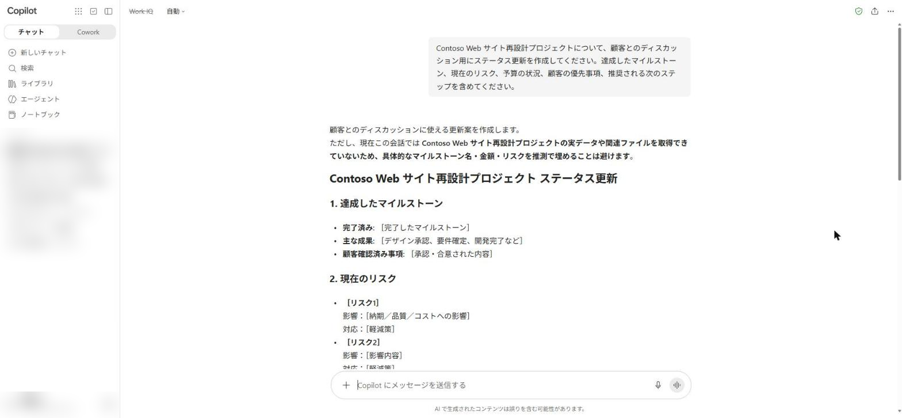
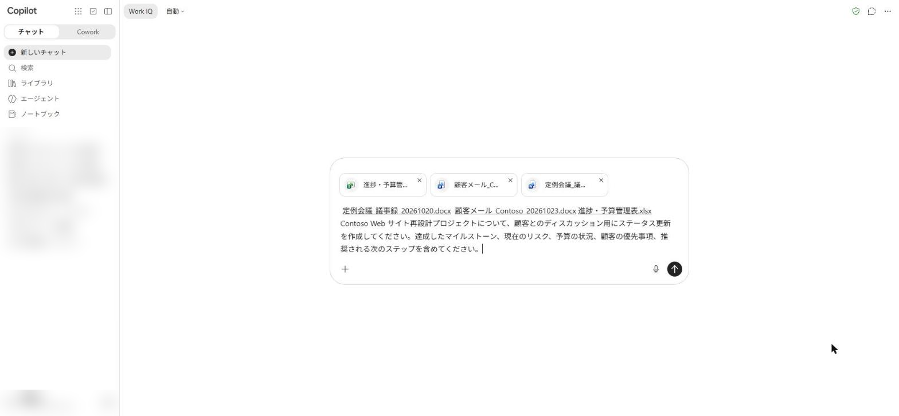
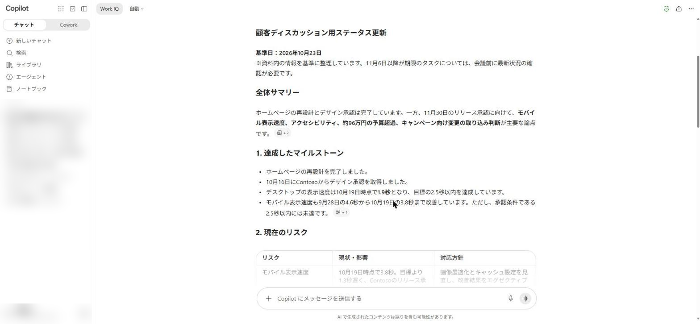

# デモ03：業務に基づく

## デモ シナリオ

顧客とのディスカッションの前に、プロジェクトのステータス更新を Copilot に作ってもらいます。同じ依頼文を、仕事の情報を参照させない場合と、ファイルを渡した場合の2回送り、回答を比べます。

このデモは、研修の第 3 章「根拠づけが重要な理由」で講師が見せたデモです。回答の質を決めるのは、言い回しよりも、AI が参照できる情報（根拠）です。

> 注：このデモでは、Microsoft 365 Copilot のライセンス（Microsoft 365 に追加するアドオン ライセンス）を使います。ライセンスがない場合は、タスク1 はそのまま試せます。タスク2 は、ファイルを「/」で指定する代わりに、入力欄の「**＋**」からファイルをアップロードして試せます。詳しくは README の「必要な環境」をご覧ください。

このデモでは以下のタスクを実施します。

　**タスク１：仕事の情報を参照させずに依頼する**

　**タスク２：ファイルを指定して同じ依頼をする**

　**タスク３：2つの回答を比べる**

## 予想時間: 10分

## タスク1 - 仕事の情報を参照させずに依頼する

> **このタスクの目的：** 根拠となる情報を渡さないと、どのような回答になるかを確認します。

1. Microsoft 365 Copilot アプリ（`https://m365.cloud.microsoft/chat`）で、画面左上の「**新しいチャット**」をクリックします。

2. 画面上部の「**Work IQ**」をクリックしてオフにします。文字に取り消し線が付き、灰色の背景が消えたことを確認します。

   > 注：Work IQ がオンのままだと、Copilot が OneDrive の練習用データを自動で探して参照するため、違いが分かりにくくなります。

3. 以下の文章を入力して送信します。

   ```
   Contoso Web サイト再設計プロジェクトについて、顧客とのディスカッション用にステータス更新を作成してください。達成したマイルストーン、現在のリスク、予算の状況、顧客の優先事項、推奨される次のステップを含めてください。
   ```

4. 回答が、「［完了したマイルストーン］」のような空欄の入った、一般的なひな形になっていることを確認します。

   

## タスク2 - ファイルを指定して同じ依頼をする

> **このタスクの目的：** 根拠となるファイルを渡して、同じ依頼文を送ります。

1. 「**新しいチャット**」をクリックします。画面上部の「**Work IQ**」がオフになっている場合は、クリックしてオンに戻します。

2. 入力欄に半角の「**/**」を入力し、次の3本のファイルを1本ずつ指定します。

   | 指定するファイル | 「/」の後に入力する文字 |
   | ---------------- | ----------------------- |
   | 定例会議_議事録_20261020 | 定例 |
   | 顧客メール_Contoso_20261023 | 顧客 |
   | 進捗・予算管理表 | 進捗 |

   > 注：ファイルを選んだあとに検索した文字が入力欄に残った場合は、削除します。

3. ファイル名の後ろに続けて、タスク1と同じ文章を入力します。

   ```
   Contoso Web サイト再設計プロジェクトについて、顧客とのディスカッション用にステータス更新を作成してください。達成したマイルストーン、現在のリスク、予算の状況、顧客の優先事項、推奨される次のステップを含めてください。
   ```

   

4. **Enter** キーを押して送信します。

## タスク3 - 2つの回答を比べる

> **このタスクの目的：** 渡した情報によって回答がどう変わったかを確認します。

1. タスク2の回答に、次のような具体的な内容が入っていることを確認します。

   | 項目 | 主な内容 |
   | ---- | -------- |
   | 達成したマイルストーン | ホームページの再設計が完了（10/16 承認）、デスクトップの表示速度 1.9 秒 |
   | 現在のリスク | モバイルの表示速度 3.8 秒（目標 2.5 秒）、アクセシビリティの未対応 12 件 |
   | 予算の状況 | 予算 2,400 万円に対し、着地見込み 2,496 万円（96 万円・4.0％超過） |
   | 顧客の優先事項 | 12/1 のキャンペーンに間に合わせること、モバイルの目標達成がリリース承認の条件 |
   | 次のステップ | 表示速度の改善（11/6）、アクセシビリティの修正（11/13）、見積もりの提示（10/27） |

   

2. 画面左の履歴からタスク1の回答を開き、タスク2の回答と見比べます。依頼文は同じで、変わったのは AI が参照できた情報だけであることを確認します。

   > 注：回答が一般論に感じたときは、言い回しを変える前に「AI が何を見られたか」を確認します。

以上で本デモは完了です。
