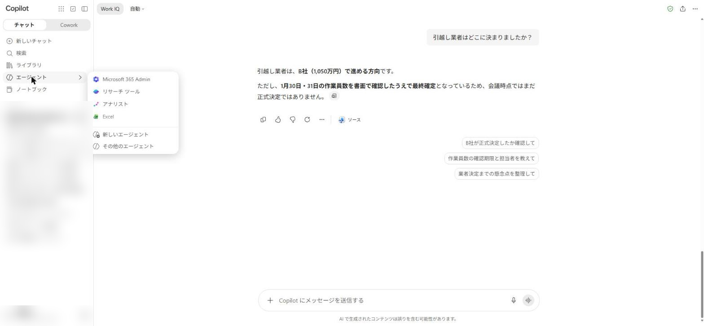
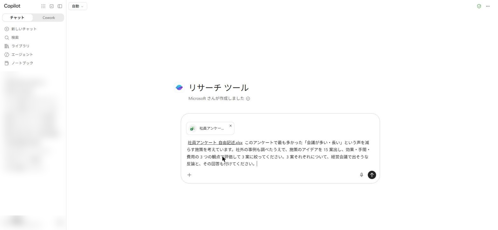
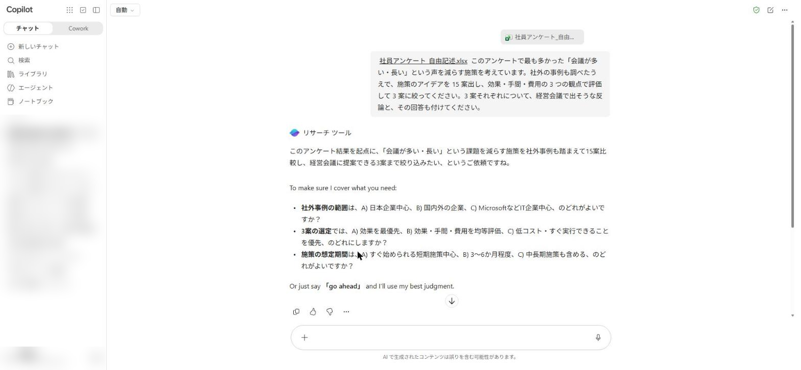
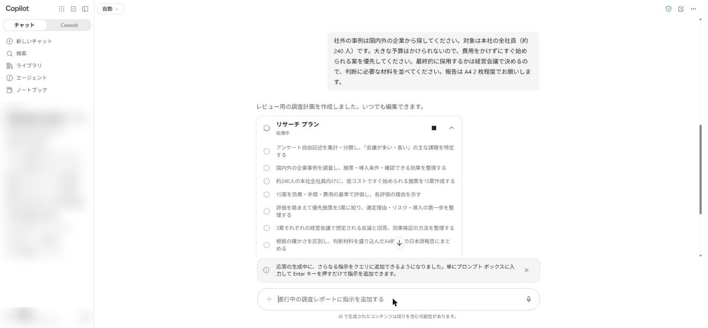
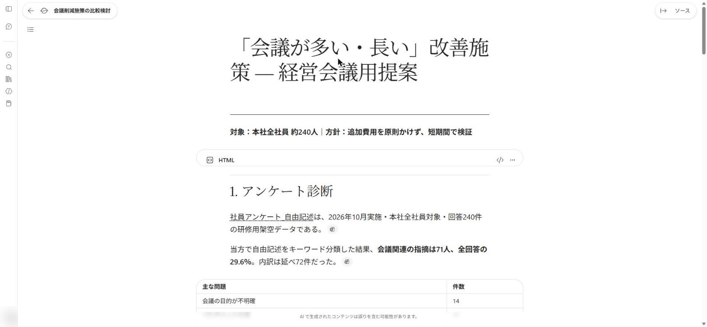
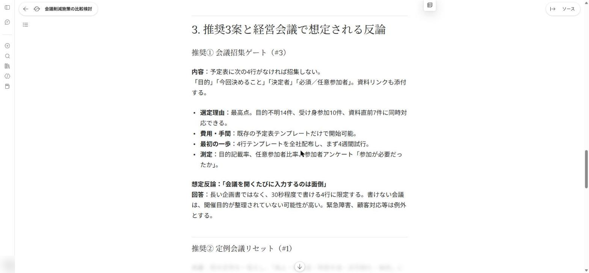

# デモ04：エージェントでアイデアを出して絞り込む

## デモ シナリオ

社員アンケートで最も多かったのは「会議が多い・長い」という声でした。これを減らす施策を考えるには、社外の事例を調べ、アイデアを出し、評価して絞り込み、経営会議で出そうな反論への答えも用意する必要があります。1 人でやると半日かかります。

このデモでは、何段階もかかるこの作業を、エージェント（リサーチ ツール）にまとめて任せます。

このデモは、研修の第 4 章「AI エージェントと連携する」で講師が見せたデモです。エージェントには、作業の手順ではなく、ほしい成果を伝えます。

> 注：このデモでは、Microsoft 365 Copilot のライセンス（Microsoft 365 に追加するアドオン ライセンス）が必要です。ライセンスがない場合、リサーチ ツールは使えません。通常のチャットに 社員アンケート_自由記述.xlsx をアップロードし、タスク2 と同じ文章を送ってください。
>
> 注：リサーチ ツールは、回答が出るまでに 5〜10 分程度かかります。

このデモでは以下のタスクを実施します。

　**タスク１：リサーチ ツールを開く**

　**タスク２：ほしい成果を伝えて任せる**

　**タスク３：結果を確認する**

## 予想時間: 15分

## タスク1 - リサーチ ツールを開く

> **このタスクの目的：** 調査と資料作成を任せられるエージェントを開きます。

1. Microsoft 365 Copilot アプリ（`https://m365.cloud.microsoft/chat`）で、画面左の「**エージェント**」をクリックします。

2. 表示された一覧から「**リサーチ ツール**」をクリックします。

   

   > 注：一覧に表示されない場合は、「**その他のエージェント**」をクリックし、エージェント ストアで「**リサーチ ツール**」の「**開く**」をクリックします。

   > 注：「リサーチ ツール」は、英語の画面では「Researcher」と表示されます。表示されない場合は、エージェント ストアの検索欄で検索してください。

## タスク2 - ほしい成果を伝えて任せる

> **このタスクの目的：** 調べる・出す・評価する・絞る・反論に備える、の一連の作業をまとめて依頼します。

1. 入力欄に半角の「**/**」を入力し、続けて「**社員**」と入力して、候補から「**社員アンケート_自由記述**」を選びます。

2. ファイル名の後ろに続けて、以下の文章を入力して送信します。

   ```
   このアンケートで最も多かった「会議が多い・長い」という声を減らす施策を考えています。社外の事例も調べたうえで、施策のアイデアを 15 案出し、効果・手間・費用の 3 つの観点で評価して 3 案に絞ってください。3 案それぞれについて、経営会議で出そうな反論と、その回答も付けてください。
   ```

   

3. リサーチ ツールから、社外の事例の範囲、3 案の選び方、施策の期間などについて確認の質問が表示されます。

   

   以下の文章を入力して送信します。

   ```
   社外の事例は国内外の企業から探してください。対象は本社の全社員（約 240 人）です。大きな予算はかけられないので、費用をかけずにすぐ始められる案を優先してください。最終的に採用するかは経営会議で決めるので、判断に必要な材料を並べてください。報告は A4 2 枚程度でお願いします。
   ```

   > 注：最後に決めるのは人です。エージェントには「判断の材料をそろえる」ところまでを任せます。

4. 「**リサーチ プラン**」が表示され、調査が進むことを確認します。完了するまで待ちます。

   

## タスク3 - 結果を確認する

> **このタスクの目的：** エージェントが作った結果を、人の目で確認します。

1. 結果として、レポート（「「会議が多い・長い」改善施策 — 経営会議用提案」など）が表示されます。レポートをクリックして開きます。

   

   > 注：レポートの下の「**以下に変換**」から、Word、PowerPoint、PDF などに変換できます。

2. レポートに、次の内容が含まれていることを確認します。

   | 項目 | 主な内容 |
   | ---- | -------- |
   | 現状 | アンケートで「会議が多い・長い」が最も多いこと（約 60 件）と、多い部署 |
   | 社外の事例 | 会議の時間や回数を減らした企業の取り組み（出典付き） |
   | アイデア | 15 案と、効果・手間・費用の評価 |
   | 3 案 | 絞り込んだ 3 案と、その理由 |
   | 反論と回答 | 経営会議で出そうな反論と、それへの回答 |

   

3. 社外の事例の出典をクリックし、参照元のページが開くことを確認します。

   > 注：エージェントの結果も下書きです。社外の事例の内容や数字は、出典で確かめてから使ってください。

以上で本デモは完了です。
