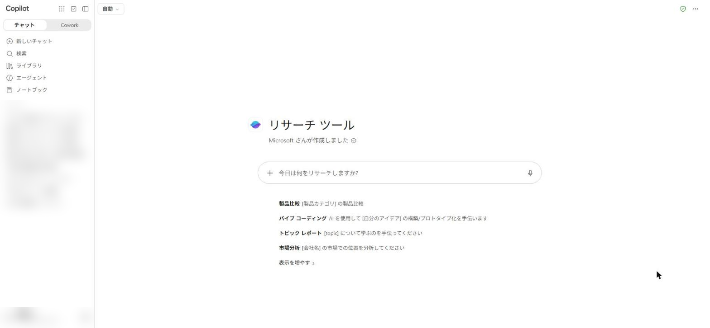
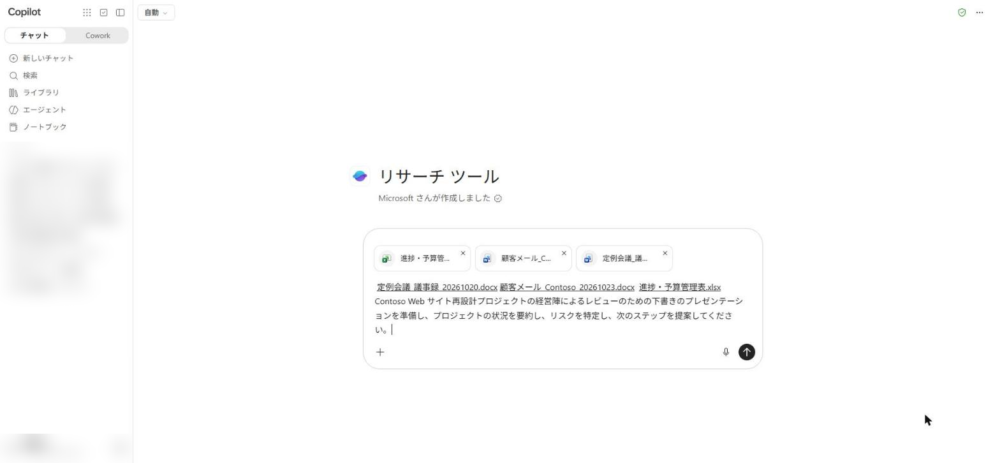
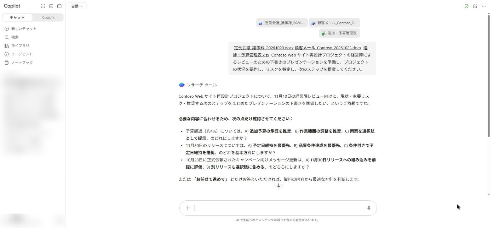
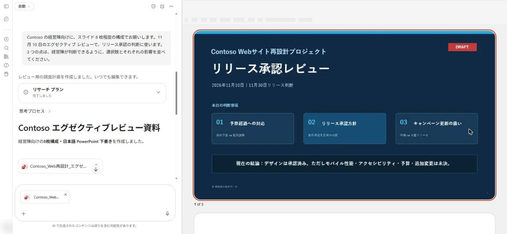
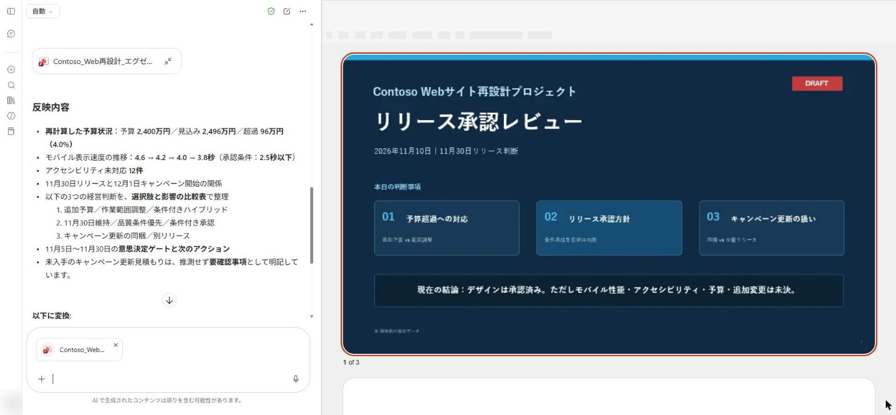

# デモ04：エージェントを使ってリサーチする

## デモ シナリオ

11 月 10 日のエグゼクティブ レビューに向けて、Contoso の経営陣に説明するプレゼンテーションの下書きを準備します。議事録、顧客のメール、進捗・予算管理表の3本から情報を集め、状況の要約、リスク、次のステップをまとめる作業を、エージェントに任せます。

このデモは、研修の第 4 章「AI エージェントと連携する」で講師が見せたデモです。単一の作業ではなく「成果」を指定して頼むと、エージェントが複数の手順で取り組み、途中で確認の質問をします。仕上げと判断は人が行います。

> 注：リサーチ ツール（Researcher）には、Microsoft 365 Copilot のライセンス（Microsoft 365 に追加するアドオン ライセンス）が必要です。ライセンスがない場合は、通常のチャットにファイルをアップロードし、同じ文章を送ってお試しください。詳しくは README の「必要な環境」をご覧ください。

このデモでは以下のタスクを実施します。

　**タスク１：リサーチ ツールに資料の準備を依頼する**

　**タスク２：確認の質問に回答する**

　**タスク３：完成した資料を確認する**

## 予想時間: 15分（完了までの待ち時間を含む）

## タスク1 - リサーチ ツールに資料の準備を依頼する

> **このタスクの目的：** 目標と情報源を伝えて、資料の下書きの作成をエージェントに任せます。

1. Microsoft 365 Copilot アプリ（`https://m365.cloud.microsoft/chat`）の画面左にある「**エージェント**」にマウスを合わせ、「**その他のエージェント**」をクリックします。

2. エージェント ストアで「**リサーチ ツール**」をクリックし、「**開く**」をクリックします。

   

   > 注：リサーチ ツールは、英語版では「Researcher」と表示されるエージェントです。一度開くと、画面左の「エージェント」の一覧から開けるようになります。

3. 入力欄に半角の「**/**」を入力し、次の3本のファイルを1本ずつ指定します。

   | 指定するファイル | 「/」の後に入力する文字 |
   | ---------------- | ----------------------- |
   | 定例会議_議事録_20261020 | 定例 |
   | 顧客メール_Contoso_20261023 | 顧客 |
   | 進捗・予算管理表 | 進捗 |

   > 注：候補にファイルが表示されないときは、最後の1文字を消して入力し直すと表示される場合があります。

4. ファイル名の後ろに続けて、以下の文章を入力して送信します。

   ```
   Contoso Web サイト再設計プロジェクトの経営陣によるレビューのための下書きのプレゼンテーションを準備し、プロジェクトの状況を要約し、リスクを特定し、次のステップを提案してください。
   ```

   

## タスク2 - 確認の質問に回答する

> **このタスクの目的：** エージェントからの確認に答えて、目的と読み手を伝えます。

1. リサーチ ツールから、確認の質問が表示されることを確認します。予算超過への対応、リリースの方針、キャンペーン向け更新の扱いなど、経営陣が判断すべき点が挙げられます。

   

2. 以下の文章を入力して送信します。

   ```
   Contoso の経営陣向けに、スライド 8 枚程度の構成でお願いします。11 月 10 日のエグゼクティブ レビューで、リリース承認の判断に使います。3 つの点は、経営陣が判断できるように、選択肢とそれぞれの影響を並べてください。
   ```

   > 注：エージェントが挙げた判断事項を、エージェントに決めさせず、経営陣が判断できる材料にするよう伝えています。判断は人が行います。
   >
   > 注：資料が完成するまで、数分から十数分かかる場合があります。研修では、第 3 章の冒頭で実行を開始し、第 4 章で結果を確認しました。

## タスク3 - 完成した資料を確認する

> **このタスクの目的：** エージェントが複数の情報源から集めて作った下書きの構成と内容を確認します。

1. PowerPoint の下書きが作成され、画面の右側にプレビューが表示されることを確認します。

   

2. 画面左の回答を下にスクロールし、「**反映内容**」に次の内容が含まれていることを確認します。

   | 項目 | 主な内容 |
   | ---- | -------- |
   | 予算の状況 | 予算 2,400 万円／見込み 2,496 万円／超過 96 万円（4.0％） |
   | モバイルの表示速度 | 4.6 → 4.2 → 4.0 → 3.8 秒の推移（承認条件は 2.5 秒以下） |
   | アクセシビリティ | 未対応 12 件 |
   | 経営陣の判断事項 | 予算超過への対応、リリース承認の方針、キャンペーン向け更新の扱いを、選択肢と影響の比較で整理 |

   

   > 注：エージェントが作るのは強力な「たたき台」です。数値や結論は原文で確かめ、自分の判断を加えてから共有します（デモ05 で確認の方法を試します）。

以上で本デモは完了です。
