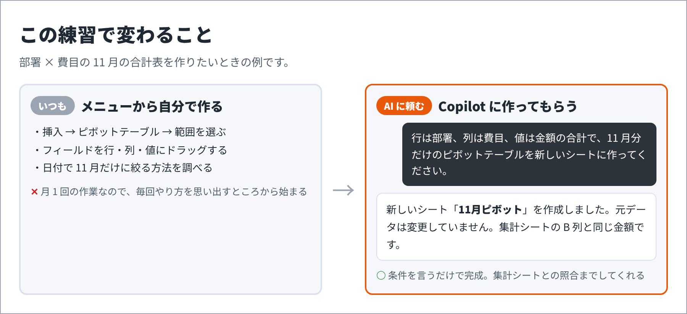
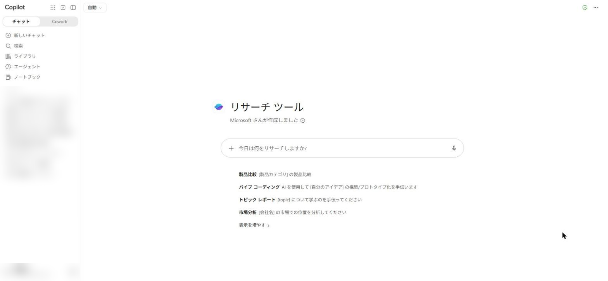

# デモ04：ピボットテーブルを作る

## テーマ

ピボットテーブルは便利だと分かっていても、「行に何を入れて、列に何を入れて……」と考えているうちに手が止まる。月に一度しか作らないので、毎回やり方を忘れてしまう――という声をよく聞きます。

## 目的

「行は部署、列は費目」と言葉で伝えるだけで、Copilot にピボットテーブルを新しいシートに作ってもらいます。



## 必要な環境

| 項目 | 内容 |
| ---- | ---- |
| 使う場所 | Excel for the web の Copilot |
| 使うデータ | 経費一覧_前任者作成.xlsx（経費一覧シート） |

このデモでは以下のタスクを実施します。

　**タスク１：Excel で Copilot を開く**

　**タスク２：ピボットテーブルを作ってもらう**


## 予想時間: 4分


## 今回の頼み方

以下の文をコピーして使います。

```
経費一覧のデータから、ピボットテーブルを新しいシートに作ってください。行は部署、列は費目、値は金額の合計で、11月分だけにしてください。元のデータは変更しないでください。
```

## タスク1 - Excel で Copilot を開く

> **このタスクの目的：** デモ01 と同じブックを使います。

1. OneDrive の「**マイ ファイル**」→「**AI-3025練習用データ**」を開き、**経費一覧_前任者作成.xlsx** をクリックします。Excel for the web でブックが開きます。

   


2. リボンの右端にある「**Copilot**」をクリックします。画面の右側に Copilot の作業ウィンドウが開きます。

   


## タスク2 - ピボットテーブルを作ってもらう

> **このタスクの目的：** 行・列・値・絞り込みの条件を言葉で伝えます。

1. Copilot の入力欄に「今回の頼み方」の文を貼り付けて、**Enter** キーを押します。

   


2. 新しいシート「**11月ピボット**」が作られ、部署 × 費目の表が表示されることを確認します。作業ウィンドウの「**完了**」をクリックします。

   

   


3. 総計が **258,660** 円であることを確認します。この数字はデモ19 で使います。

   


## うまくいったかの目安

- 新しいシートにピボットテーブルができている
- 経費一覧シートが変わっていない


## ここがコツ

- 「行は」「列は」「値は」「絞り込みは」の 4 つを言うと、ピボットテーブルの形が 1 回で決まります。
- 「新しいシートに」と書くと、元のデータの横に表が作られて見づらくなるのを防げます。
- Copilot は「集計シートと一致しています」と答えますが、両方とも同じ落とし穴（全角の金額）にはまっています。デモ19 で確かめます。


## 言い換え例

同じ考え方で、次のようにも頼めます。

```
費目ごとの割合が分かるように、値を「総計に対する比率」で表示してください。
```

```
部署ごとに、10 月と 11 月の合計を並べたピボットテーブルを作ってください。
```

```
このピボットテーブルから、部署別の棒グラフを作ってください。
```


---

← [デモ03：入力ミスを見つける](./Demo03_入力ミスを見つける.md)　｜　[README に戻る](../README.md)　｜　[デモ05：謝罪メールを書く](./Demo05_謝罪メールを書く.md) →
