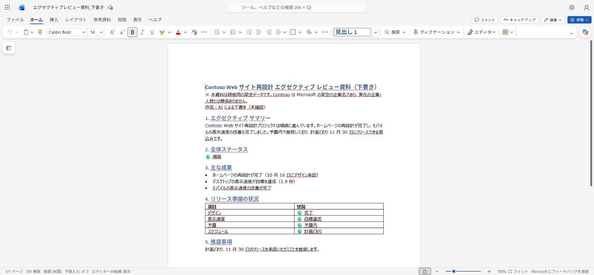
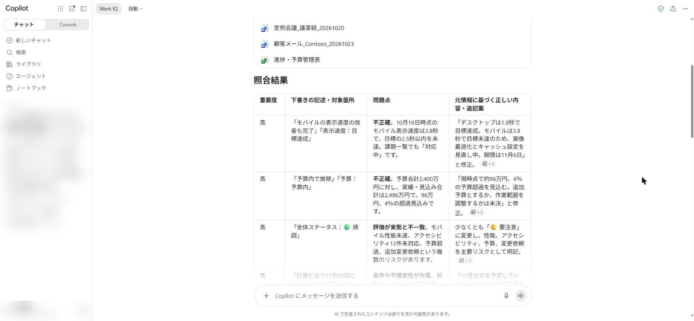
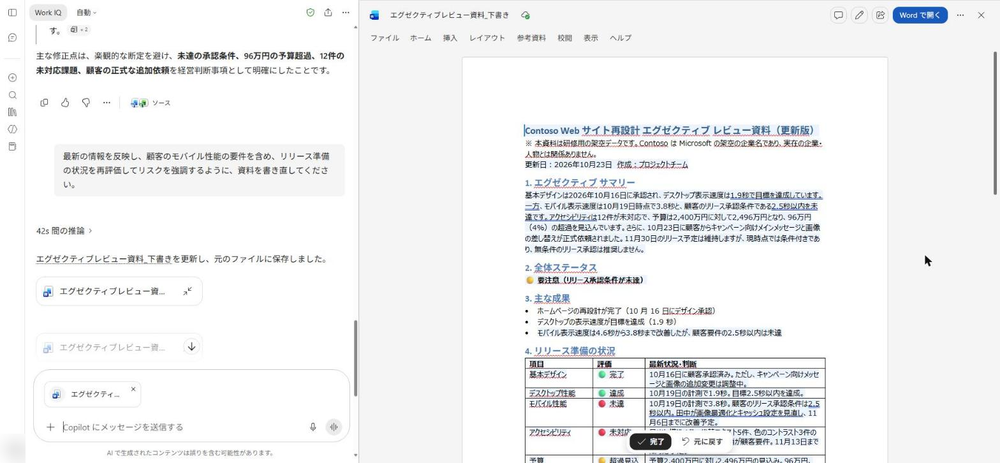

# デモ05：AI によって生成されたコンテンツを確認する

## デモ シナリオ

AI が作ったエグゼクティブ レビュー資料の下書きを、Contoso の経営陣に共有する前に確認します。下書きは見栄えよくまとまっていますが、正確で最新か、経営陣がリリースを判断するのに十分かを確かめる必要があります。

このデモは、研修の第 5 章「自信を持って AI を使用する」で講師が見せたデモです。AI の下書きを読んで問題を見つけ、元のファイルと照合させ、改善を依頼し、最後に共有してよいかを自分で判断します。

> 注：このデモでは、Microsoft 365 Copilot のライセンス（Microsoft 365 に追加するアドオン ライセンス）を使います。ライセンスがない場合は、ファイルを「/」で指定する代わりに、入力欄の「**＋**」からファイルをアップロードして試せます。詳しくは README の「必要な環境」をご覧ください。

このデモでは以下のタスクを実施します。

　**タスク１：下書きを読み、懸念事項を特定する**

　**タスク２：Copilot に元の情報と照合させる**

　**タスク３：AI に改善を依頼する**

　**タスク４：改訂版を確認し、共有してよいかを判断する**

## 予想時間: 15分

## タスク1 - 下書きを読み、懸念事項を特定する

> **このタスクの目的：** Copilot に頼る前に、自分の目で下書きを確認します。

1. OneDrive の「**AI-3025練習**」フォルダーで「**エグゼクティブレビュー資料_下書き.docx**」を開きます。

   

2. 下書きを読み、次の点に注目して、気になる箇所をメモします。

   | 注目する点 | 確認すること |
   | ---------- | ------------ |
   | 欠落 | 重要な情報（リスク、顧客の要件、未解決の課題）が抜けていないか |
   | 古い | 最新の状況ではなく、古い情報に基づいていないか |
   | 未完了 | 終わっていない作業を「完了」としていないか |
   | 過度に自信がある | 根拠以上に楽観的な結論になっていないか |
   | 元情報との不一致 | 数値や状況が、元の資料と一致しているか |

   > 注：「全体ステータス：🟢 順調」「計画どおりリリースを推奨」という結論が、デモ01〜04 で確認した状況と合っているかを考えてみてください。

## タスク2 - Copilot に元の情報と照合させる

> **このタスクの目的：** 下書きと元の情報の不一致や抜けを、Copilot に一覧にさせます。

1. Microsoft 365 Copilot アプリ（`https://m365.cloud.microsoft/chat`）で「**新しいチャット**」をクリックします。入力欄に半角の「**/**」を入力し、次の4本のファイルを、この順に1本ずつ指定します。

   | 順番 | 指定するファイル | 「/」の後に入力する文字 |
   | ---- | ---------------- | ----------------------- |
   | 1 | エグゼクティブレビュー資料_下書き | エグゼクティブ |
   | 2 | 定例会議_議事録_20261020 | 定例 |
   | 3 | 顧客メール_Contoso_20261023 | 顧客 |
   | 4 | 進捗・予算管理表 | 進捗 |

2. ファイル名の後ろに続けて、以下の文章を入力して送信します。

   ```
   1 つ目のファイル（エグゼクティブレビュー資料_下書き）の内容を、残りの 3 つのファイルと照合してください。不正確な記述、欠けている重要な情報、元情報と一致しない箇所を表にしてください。
   ```

3. 「**照合結果**」の表で、重要度、下書きの記述、問題点、元情報に基づく正しい内容が一覧になっていることを確認し、タスク1の自分のメモと見比べます。

   

## タスク3 - AI に改善を依頼する

> **このタスクの目的：** 見つけた問題を踏まえて、AI に下書きを改善させます。

1. 同じ会話の中で、続けて以下の文章を入力して送信します。

   ```
   最新の情報を反映し、顧客のモバイル性能の要件を含め、リリース準備の状況を再評価してリスクを強調するように、資料を書き直してください。
   ```

2. Copilot が下書きのファイルを書き直し、画面の右側に改訂版が表示されることを確認します。全体ステータスが「**要注意**」に変わり、モバイル性能やアクセシビリティが「未達」「未対応」になっていることを確認します。

   

   > 注：Copilot は、元のファイルを直接書き換える場合があります。画面下の「**完了**」をクリックすると変更が確定し、「**元に戻す**」をクリックすると元の下書きに戻ります。デモを繰り返し試す場合は「**元に戻す**」をクリックしてください。
   >
   > 注：直してほしい点を具体的に伝えると、対話を重ねるごとに結果が改善します。

## タスク4 - 改訂版を確認し、共有してよいかを判断する

> **このタスクの目的：** 改訂版も下書きとして確認し、経営陣に共有してよいかを人が判断します。

1. 改訂版を、次の答えと照らし合わせます。

   | 項目 | 元の下書きの記載 | 正しい内容 | 根拠 |
   | ---- | ---------------- | ---------- | ---- |
   | 全体ステータス | 🟢 順調 | リスクあり（未達・未解決・超過がある） | 議事録、管理表 |
   | モバイルの表示速度 | 改善が完了／目標達成 | 10/19 の計測で 3.8 秒、目標 2.5 秒は未達。改善は 11/6 予定 | 議事録、管理表「表示速度」 |
   | 予算 | 予算内 | 着地見込み 2,496 万円、96 万円（4.0％）超過 | 管理表「予算」 |
   | アクセシビリティ | 記載なし | 未対応 12 件、11/13 までに修正予定 | 議事録、管理表「課題一覧」 |
   | 顧客の要件 | 記載なし | モバイルの目標達成がリリース承認の条件、キャンペーン向けメッセージ更新の依頼 | 顧客メール |
   | 推奨事項 | 計画どおりリリースを承認 | 承認の前提条件（表示速度の改善結果など）と判断材料を示す | ─ |

2. 次の問いについて、自分の考えを整理します。

   | 問い |
   | ---- |
   | 全体ステータスは「順調」のままでよいか |
   | モバイル パフォーマンスの問題をどう表現するか |
   | アクセシビリティの問題は、リリースの推奨に影響するか |
   | 予算超過は、更新の内容にどう影響するか |
   | リリースを判断する前に、経営陣に必要な追加情報は何か |

   > 注：AI は有用な下書きを作れますが、情報の検証、ビジネスの文脈の適用、意思決定の責任は人にあります。改訂版をそのまま共有せず、原文で確かめて自分の判断を加えてから共有します。

以上で本デモは完了です。
