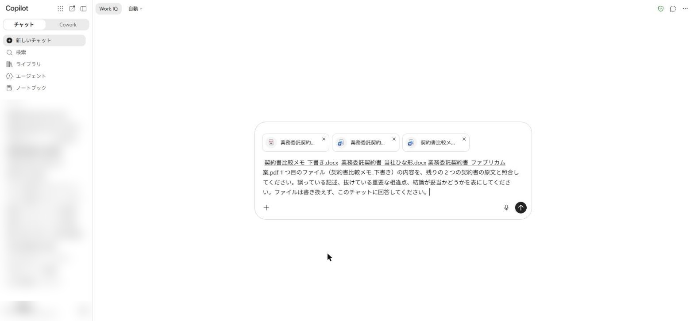
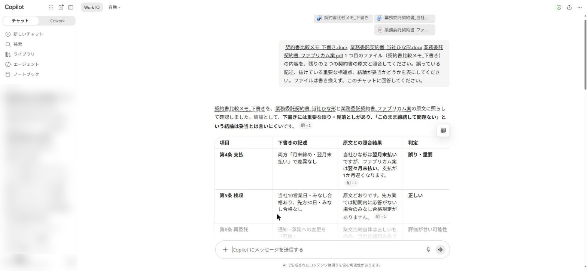
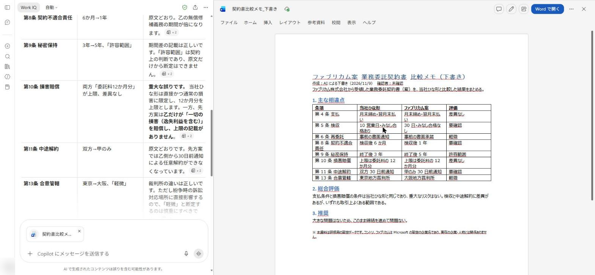
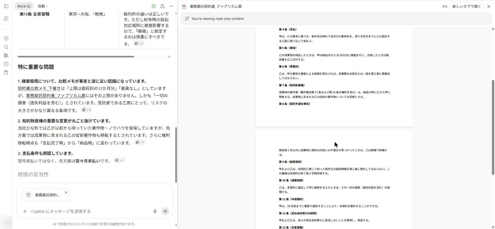

# デモ05：AI の比較結果を元の資料で確かめる

## デモ シナリオ

同僚が AI を使って、ファブリカムの契約書案と自社のひな形の比較メモを作りました。メモには「大きな問題はないため、このまま締結を進めて問題ない」と書かれています。このメモを上司に回してよいでしょうか。

このデモでは、AI が作った比較メモを、元の契約書（Word と PDF）と照らして確かめます。誤りや抜けを見つけ、共有してよいかを人が判断します。

このデモは、研修の第 5 章「自信を持って AI を使用する」で講師が見せたデモです。AI の出力は下書きです。元の資料と照らして確かめ、最後の判断は人が行います。

> 注：このデモでは、Microsoft 365 Copilot のライセンス（Microsoft 365 に追加するアドオン ライセンス）を使います。ライセンスがない場合は、ファイルを「/」で指定する代わりに、入力欄の「**＋**」から 3 本のファイルをアップロードして試せます。詳しくは README の「必要な環境」をご覧ください。

このデモでは以下のタスクを実施します。

　**タスク１：比較メモを読んで疑問点を挙げる**

　**タスク２：比較メモを元の契約書と照合させる**

　**タスク３：原文で確かめ、共有してよいかを判断する**

## 予想時間: 10分

## タスク1 - 比較メモを読んで疑問点を挙げる

> **このタスクの目的：** AI の出力を、そのまま信じずに読みます。

1. OneDrive の「**AI-3025練習**」フォルダーで、「**契約書比較メモ_下書き.docx**」を開きます。

2. 次の点を確認します。

   - 「差異なし」と書かれている条項は、本当に同じか
   - 重要な条項（損害賠償、知的財産権、支払など）が漏れていないか
   - 「このまま締結を進めて問題ない」という結論は、根拠があるか

3. ファイルを閉じます。

## タスク2 - 比較メモを元の契約書と照合させる

> **このタスクの目的：** 比較メモと元の契約書の食い違いを、AI に洗い出させます。

1. Microsoft 365 Copilot アプリ（`https://m365.cloud.microsoft/chat`）で、画面左上の「**新しいチャット**」をクリックします。

2. 入力欄に半角の「**/**」を入力し、次の3本のファイルを1本ずつ指定します。

   | 順番 | 指定するファイル |
   | ---- | ---------------- |
   | 1 | 契約書比較メモ_下書き |
   | 2 | 業務委託契約書_当社ひな形 |
   | 3 | 業務委託契約書_ファブリカム案 |

   > 注：「/」の後に「**契約書**」と入力すると、3 本とも候補に表示されます。1 本選ぶごとに、半角スペースと「/契約書」を入力して次のファイルを選びます。

   > 注：ファイルを選んだあとに検索した文字が入力欄に残った場合は、削除します。

3. ファイル名の後ろに続けて、以下の文章を入力して送信します。

   ```
   1 つ目のファイル（契約書比較メモ_下書き）の内容を、残りの 2 つの契約書の原文と照合してください。誤っている記述、抜けている重要な相違点、結論が妥当かどうかを表にしてください。ファイルは書き換えず、このチャットに回答してください。
   ```

   

   > 注：Copilot が比較メモのファイル自体を書き換えることがあります。書き換えられた場合は、画面下の「**元に戻す**」をクリックして元に戻します。

4. 回答に、次の指摘が含まれていることを確認します。

   | 種類 | 内容 |
   | ---- | ---- |
   | 誤り | 第 4 条 支払：メモは「差異なし」だが、ファブリカム案は翌々月末払い |
   | 誤り | 第 10 条 損害賠償：メモは「差異なし」だが、ファブリカム案は上限なし・逸失利益を含む |
   | 抜け | 第 7 条 知的財産権：納品時に権利が移り、既存の著作物も移る点が書かれていない |
   | 結論 | 「このまま締結を進めて問題ない」は妥当ではない。修正の交渉が必要 |

   

   > 注：第 6 条（再委託）や第 13 条（合意管轄）の「軽微」という評価についても、見直しを勧める指摘が出ることがあります。

## タスク3 - 原文で確かめ、共有してよいかを判断する

> **このタスクの目的：** AI の指摘も、人が原文で確かめます。

1. 回答の中の参照番号をクリックします。画面の右側に、参照されたファイル（比較メモなど）が表示されることを確認します。

   

2. 回答の「特に重要な問題」にある「**業務委託契約書_ファブリカム案**」のリンクをクリックし、右側に PDF の原文を表示します。

3. PDF を下にスクロールし、第 10 条（損害賠償）に「その一切の損害（逸失利益を含む）を賠償する」と書かれ、上限の定めがないことを、自分の目で確認します。

   

4. このメモを上司に回してよいかを判断します。

   > 注：判断の答え：このままでは回せません。誤りを直し、抜けを加え、結論を書き直してから回します。AI の照合結果も下書きなので、修正版も人が原文で確かめます。

5. 必要に応じて、同じチャットで以下の文章を入力し、修正版の下書きを作らせます。

   ```
   指摘を反映した比較メモの修正版を、このチャットに作成してください。修正を求めるべき条項は優先度の高い順に並べてください。
   ```

以上で本デモは完了です。
