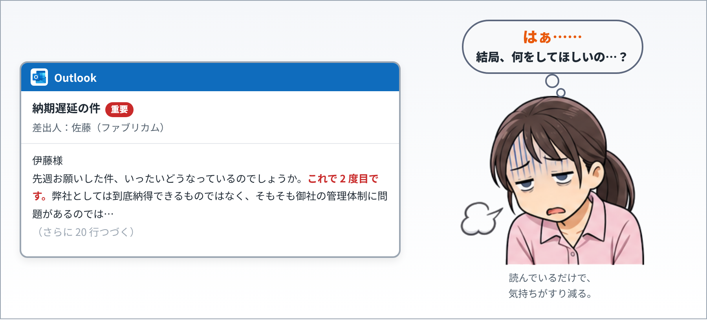
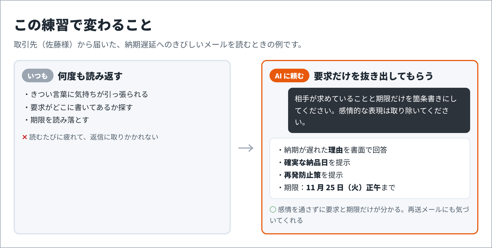
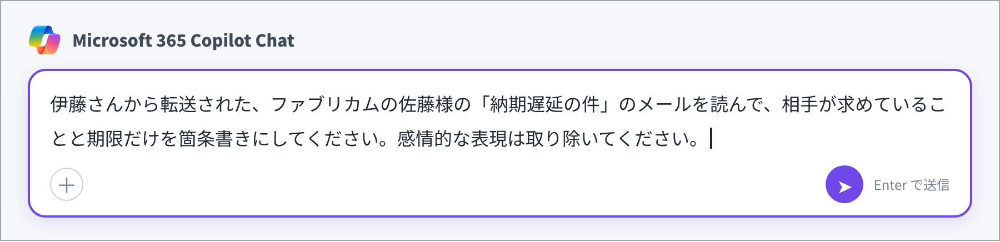
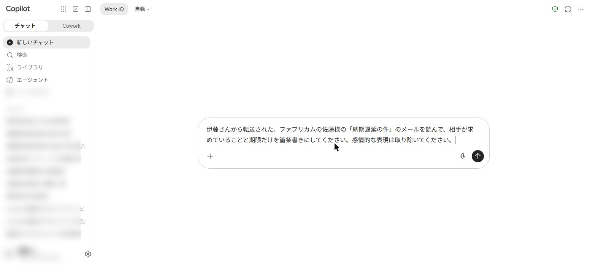
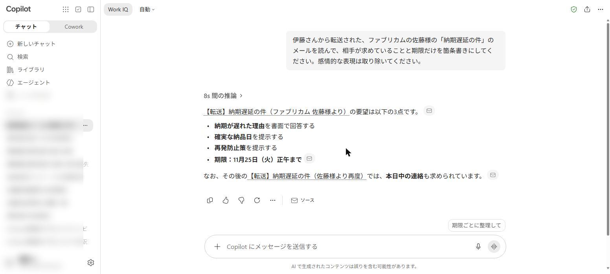

# デモ06：怒っているメールから要求を抜き出す

## テーマ

長文の、しかも明らかに怒っているメール。読んでいるだけで気持ちがすり減って、結局「相手は何をしてほしいのか」が頭に入ってこない――。

怒りの言葉に反応する前に、要求だけを取り出せたら、返信はずっと楽になります。



## 目的

Copilot にメールを読んでもらい、相手が求めていることと期限だけを箇条書きにしてもらいます。感情的な表現を取り除いて、やるべきことを冷静に把握します。



## 必要な環境

| 項目 | 内容 |
| ---- | ---- |
| 使う場所 | Microsoft 365 Copilot Chat（Work IQ オン） |
| 使うデータ | 自分の受信トレイのメール（研修では講師の環境のデモ用メール） |

このデモでは以下のタスクを実施します。

　**タスク１：要求と期限を抜き出してもらう**


## 予想時間: 3分


## 今回の頼み方

Copilot には、次のように頼みます。実際に入力する文は、タスクの手順の中にあります（コピーして貼り付けられます）。



## タスク1 - 要求と期限を抜き出してもらう

> **このタスクの目的：** メールの件名や差出人を手がかりに、Copilot にメールを探して読んでもらいます。

1. Microsoft Edge で以下の URL を開き、会社のアカウントでサインインします。画面上部の「**Work IQ**」がオンになっていることを確認します（文字に取り消し線が付いている場合はクリックしてオンにします）。

   ```
   https://m365.cloud.microsoft/chat
   ```

   


2. 入力欄に次の文を貼り付けて、**Enter** キーを押します。

   ```
   伊藤さんから転送された、ファブリカムの佐藤様の「納期遅延の件」のメールを読んで、相手が求めていることと期限だけを箇条書きにしてください。感情的な表現は取り除いてください。
   ```


   

   


3. 要求が 3 点と期限に整理されることを確認します。その後に届いた再送メール（本日中の連絡を求める内容）にも触れていることを確認します。

   

   


## うまくいったかの目安

- 要求 3 点（理由・確実な納品日・再発防止策）と期限がそろっている


## ここがコツ

- 「感情的な表現は取り除いて」と書くと、相手の言葉づかいに引きずられずに読めます。
- 件名や差出人など、メールを特定できる言葉を入れると、Copilot が目的のメールを見つけやすくなります。ご自身のメールで試すときは、件名の一部を「」で囲んで入れてください。
- 結果の下に表示される引用元（メールのアイコン）をクリックすると、元のメールを開いて確かめられます。


## 言い換え例

同じ考え方で、次のようにも頼めます。

```
このメールに返信するときに、必ず答えなければならない質問を挙げてください。
```

```
このメールで相手がいちばん怒っている点はどこですか？一文で教えてください。
```

```
このやり取りを時系列に並べてください。
```


---

← [デモ05：謝罪メールを書く](./Demo05_謝罪メールを書く.md)　｜　[README に戻る](../README.md)　｜　[デモ07：角を立てずに断る](./Demo07_角を立てずに断る.md) →
