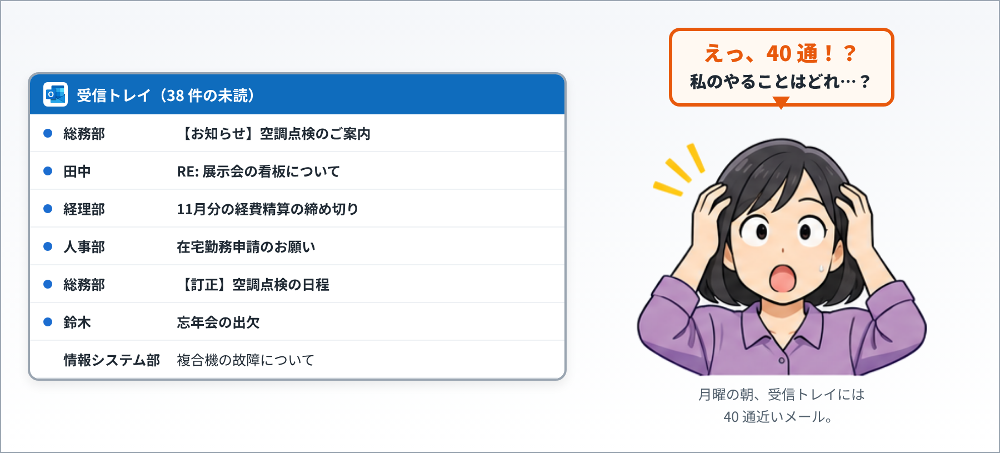
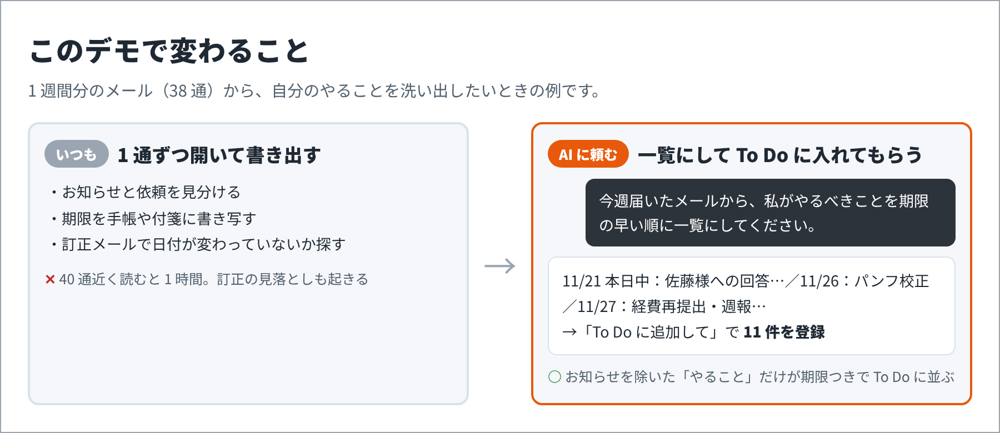
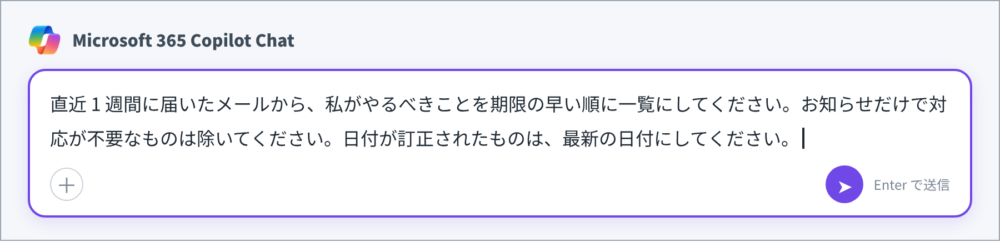
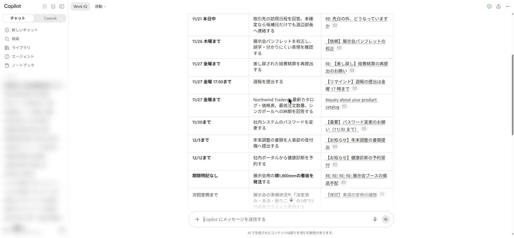
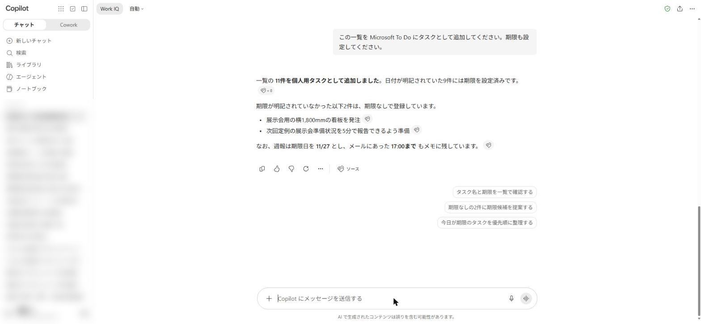
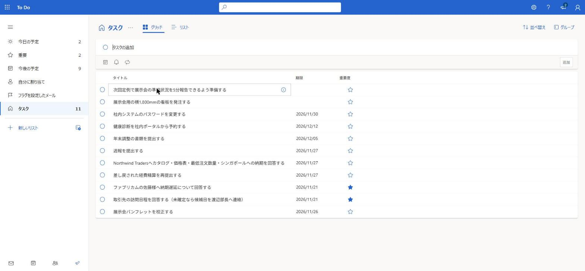

# デモ08：メールからやることリストを作る

## テーマ

月曜の朝、受信トレイには 40 通近いメール。お知らせ、依頼、訂正、雑談……。この中に「自分がやらなければならないこと」は何件あるでしょうか？

読み落としが怖くて全部開く。でも、訂正メールで日付が変わっていたことには気づかない――。



## 目的

1 週間分のメールから、自分がやるべきことだけを期限順に一覧にしてもらい、そのまま Microsoft To Do に登録します。



## 必要な環境

| 項目 | 内容 |
| ---- | ---- |
| 使う場所 | Microsoft 365 Copilot Chat（Work IQ オン）と Microsoft To Do |
| 使うデータ | 自分の受信トレイのメール（研修では講師の環境のデモ用メール） |

このデモでは以下のタスクを実施します。

　**タスク１：やることを一覧にしてもらう**

　**タスク２：Microsoft To Do に登録してもらう**


## 予想時間: 5分


## 今回の頼み方

Copilot には、次のように頼みます。実際に入力する文は、タスクの手順の中にあります（コピーして貼り付けられます）。



## タスク1 - やることを一覧にしてもらう

> **このタスクの目的：** お知らせと依頼を見分け、期限順に並べてもらいます。

1. Microsoft Edge で以下の URL を開き、会社のアカウントでサインインします。画面上部の「**Work IQ**」がオンになっていることを確認します（文字に取り消し線が付いている場合はクリックしてオンにします）。

   ```
   https://m365.cloud.microsoft/chat
   ```

   


2. 入力欄に次の文を貼り付けて、**Enter** キーを押します。

   ```
   直近 1 週間に届いたメールから、私がやるべきことを期限の早い順に一覧にしてください。お知らせだけで対応が不要なものは除いてください。日付が訂正されたものは、最新の日付にしてください。
   ```


   


3. 期限・やること・元メールの表が表示されることを確認します。お知らせ（空調点検、会議室の予約ルールなど）が除かれていることを確認します。

   

   


## タスク2 - Microsoft To Do に登録してもらう

> **このタスクの目的：** 一覧をそのままタスクとして登録します。

1. 同じチャットの入力欄に次の文を入力して、**Enter** キーを押します。

   ```
   この一覧を Microsoft To Do にタスクとして追加してください。期限も設定してください。
   ```

   


2. 「11 件を個人用タスクとして追加しました」と表示されることを確認します。期限が書かれていなかったものは「期限なし」で登録されます。

   

   


3. Microsoft To Do（https://to-do.office.com/）を開き、「**タスク**」に期限つきで登録されていることを確認します。

   

   


## うまくいったかの目安

- お知らせが除かれている
- 訂正後の日付になっている
- To Do に期限つきで登録されている


## ここがコツ

- 「日付が訂正されたものは、最新の日付にしてください」と一言添えると、訂正メールを踏まえた一覧になります。
- 「今週」ではなく「直近 1 週間」と書きます。「今週」は質問した日を基準にするため、週をまたぐと前の週のメールが対象から外れます。
- 「木曜まで」「金曜 17 時まで」のように曜日だけ書かれた期限は、Copilot が**今日の日付から**計算します。メールを受け取った日と今日がずれていると、日付が 1 週間ずれることがあります。登録後に To Do で確かめてください。
- To Do への登録は Copilot が代わりに行う操作です。登録前に一覧を見て、不要なものは「○○は除いて」と伝えてから登録します。


## 言い換え例

同じ考え方で、次のようにも頼めます。

```
今日中に返事が必要なメールだけを教えてください。
```

```
やることを「自分で作業するもの」と「返事をするだけのもの」に分けてください。
```

```
来週の月曜に見直せるように、今週やり残したことだけを一覧にしてください。
```


---

← [デモ07：角を立てずに断る](./Demo07_角を立てずに断る.md)　｜　[README に戻る](../README.md)　｜　[デモ09：長いメールのやり取りから自分への依頼を探す](./Demo09_長いメールのやり取りから自分への依頼を探す.md) →
