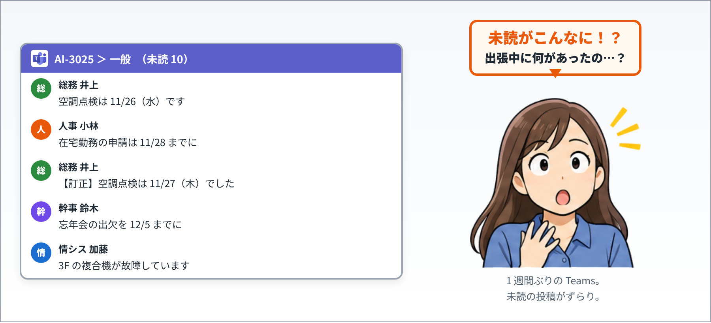
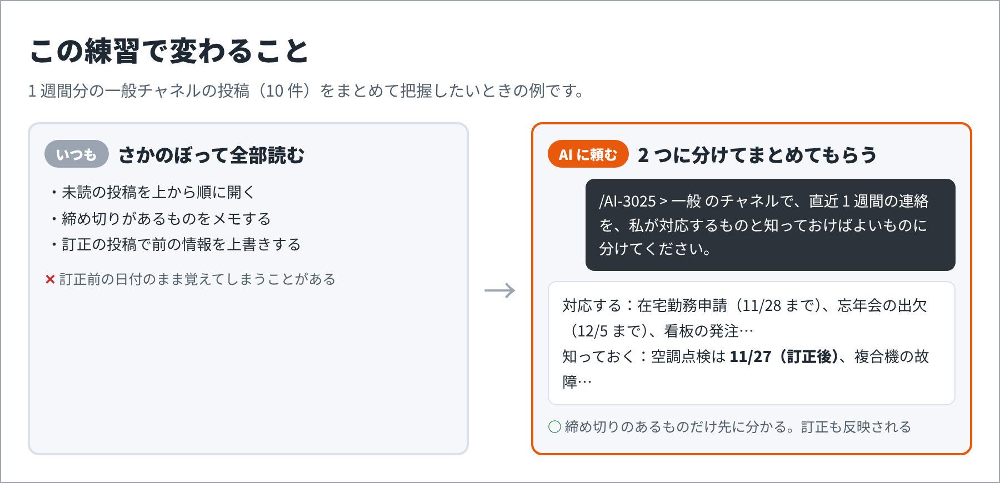
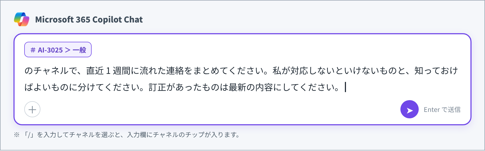

# デモ10：見逃したチャネルの連絡をまとめる

## テーマ

1 週間の出張から戻ると、Teams のチャネルには未読の投稿がずらり。在宅勤務の申請、忘年会の出欠、複合機の故障、空調点検の訂正……。全部さかのぼって読む時間はないけれど、自分に関係する締め切りだけは落としたくない。



## 目的

Teams のチャネルに流れた連絡を、「自分が対応するもの」と「知っておけばよいもの」に分けてまとめてもらいます。



## 必要な環境

| 項目 | 内容 |
| ---- | ---- |
| 使う場所 | Microsoft 365 Copilot Chat（Work IQ オン） |
| 使うデータ | 自分が参加している Teams のチャネル（研修では講師の環境のデモ用チャネル） |

このデモでは以下のタスクを実施します。

　**タスク１：チャネルの連絡をまとめてもらう**


## 予想時間: 3分


## 今回の頼み方

Copilot には、次のように頼みます。実際に入力する文は、タスクの手順の中にあります（コピーして貼り付けられます）。



## タスク1 - チャネルの連絡をまとめてもらう

> **このタスクの目的：** 「/」でチャネルを指定し、期間を区切って投稿をまとめてもらいます。

1. Microsoft Edge で以下の URL を開き、会社のアカウントでサインインします。画面上部の「**Work IQ**」がオンになっていることを確認します（文字に取り消し線が付いている場合はクリックしてオンにします）。

   ```
   https://m365.cloud.microsoft/chat
   ```

   


2. 入力欄に「**/**」を入力し、表示された候補の「**チャネル**」で **AI-3025** の「**一般**」を選びます。入力欄にチャネルが指定されたことを確認します（ご自身の環境で試すときは、自分が参加しているチャネルを選びます）。

   


3. 続けて次の文を貼り付けて、**Enter** キーを押します。

   ```
   のチャネルで、直近 1 週間に流れた連絡をまとめてください。私が対応しないといけないものと、知っておけばよいものに分けてください。訂正があったものは最新の内容にしてください。
   ```


   


4. 「対応が必要なもの」と「知っておけばよいもの」に分けて表示されることを確認します。空調点検が訂正後の **11 月 27 日（木）** になっていることを確かめます。

   


## うまくいったかの目安

- 締め切りのあるものが「対応が必要なもの」に入っている
- 空調点検が訂正後の日付になっている


## ここがコツ

- **チャネルは「/」で選んで指定する**のがコツです。チーム名を文章で書くだけだと、Copilot がチャネルを見つけても投稿を取り出せないことがあります。
- 「今週」ではなく「**直近 1 週間**」や「11 月 16 日以降」のように期間を書きます。「今週」は質問した日を基準にするため、週をまたぐと前の週の投稿が対象から外れます。
- それでも読めないときは、Teams でそのチャネルを開き、チャネルの Copilot に同じ文で頼みます。
- 作ったばかりのチームや、投稿したばかりのメッセージは、Copilot が読めるようになるまで時間がかかることがあります（数時間〜1 日程度）。「投稿を取得できませんでした」と表示されたときは、時間をおいて試してください。
- チャネルの投稿は、そのチームのメンバーだけが Copilot で参照できます。


## 言い換え例

同じ考え方で、次のようにも頼めます。

```
このチャネルで、直近 1 週間に私の名前が出てきた投稿だけを教えてください。
```

```
12 月の締め切りだけを日付順に並べてください。
```

```
このチャネルの投稿から、総務部への問い合わせが必要なものを挙げてください。
```


---

← [デモ09：長いメールのやり取りから自分への依頼を探す](./Demo09_長いメールのやり取りから自分への依頼を探す.md)　｜　[README に戻る](../README.md)　｜　[デモ11：上司への報告を結論から 3 行で書く](./Demo11_上司への報告を結論から3行で書く.md) →
