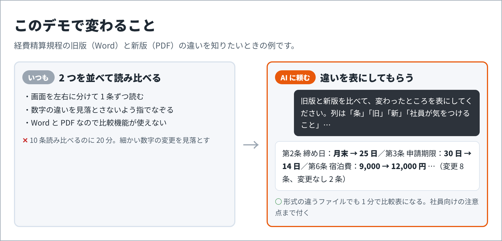
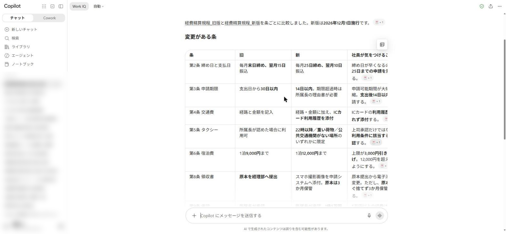

# デモ12：規程の新旧を比べる

> ★ 講師のおすすめデモです。研修の時間が限られるときは、★のデモから行います。

## テーマ

「経費精算規程を改訂しました。変更点は添付をご確認ください」――添付されているのは、新しい規程の全文だけ。どこが変わったのか、旧版と並べて 1 条ずつ読み比べるしかない。

Word と PDF でファイルの形式まで違うと、比較機能も使えません。

## 目的

旧版（Word）と新版（PDF）の 2 つのファイルを Copilot に渡し、変わったところを表にしてもらいます。



## 必要な環境

| 項目 | 内容 |
| ---- | ---- |
| 使う場所 | Microsoft 365 Copilot Chat（Work IQ オン） |
| 使うデータ | 経費精算規程_旧版.docx、経費精算規程_新版.pdf |

このデモでは以下のタスクを実施します。

　**タスク１：2 つのファイルを添付する**

　**タスク２：違いを表にしてもらう**


## 予想時間: 4分


## 今回の頼み方

以下の文をコピーして使います。

```
添付した経費精算規程の旧版と新版を比べて、変わったところを表にしてください。列は「条」「旧」「新」「社員が気をつけること」にしてください。変更がない条も最後に書いてください。
```

## タスク1 - 2 つのファイルを添付する

> **このタスクの目的：** 比べたいファイルを 2 つとも指定します。

1. Microsoft Edge で以下の URL を開き、会社のアカウントでサインインします。画面上部の「**Work IQ**」がオンになっていることを確認します（文字に取り消し線が付いている場合はクリックしてオンにします）。

   ```
   https://m365.cloud.microsoft/chat
   ```

   


2. 入力欄の左の「**＋**」をクリックし、「**クラウド ファイルを添付**」をクリックします。「**マイ ファイル**」→「**AI-3025練習用データ**」の順に開き、**経費精算規程_旧版.docx**、**経費精算規程_新版.pdf** のチェックをオンにして「**選択**」をクリックします。

   


## タスク2 - 違いを表にしてもらう

> **このタスクの目的：** 表の列を指定して、比較してもらいます。

1. 入力欄に「今回の頼み方」の文を貼り付けて、**Enter** キーを押します。

   


2. 「変更がある条」の表が表示されることを確認します。締め日、申請期限、宿泊費などの数字の変更が並びます。

   

   


3. 下までスクロールし、「変更がない条」（第1条、第7条）も書かれていることを確認します。

   


## うまくいったかの目安

- 変更 8 条がすべて挙がっている（第2・3・4・5・6・8・9・10条）
- 変更なし（第1・7条）が分かれている


## ここがコツ

- **表の列を指定する**と、そのまま社内への案内に使える形で返ってきます。「社員が気をつけること」のような列を足すと、比較だけでなく「だから何をすればよいか」まで書いてくれます。
- 「変更がない条も書いて」と頼むと、比べ漏れがないかを確かめやすくなります。
- ファイルは 2 つとも添付してから頼みます。片方だけだと、もう片方を検索で探しに行き、別のファイルと比べてしまうことがあります。


## 言い換え例

同じ考え方で、次のようにも頼めます。

```
社員への案内メールの文面にしてください。変更点は箇条書きで。
```

```
12 月 1 日以降、社員の手続きで増える作業だけを挙げてください。
```

```
旧版のままの運用だと違反になる例を 3 つ挙げてください。
```


---

← [デモ11：上司への報告を結論から 3 行で書く](./Demo11_上司への報告を結論から3行で書く.md)　｜　[README に戻る](../README.md)　｜　[デモ13：資料ありとなしで答えを比べる](./Demo13_資料ありとなしで答えを比べる.md) →
