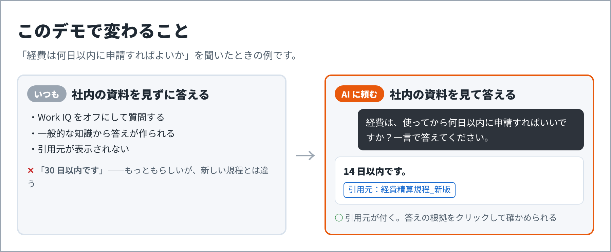
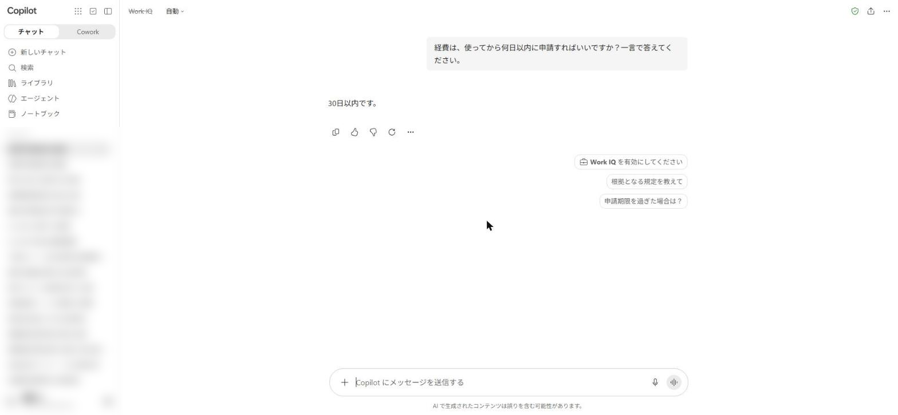
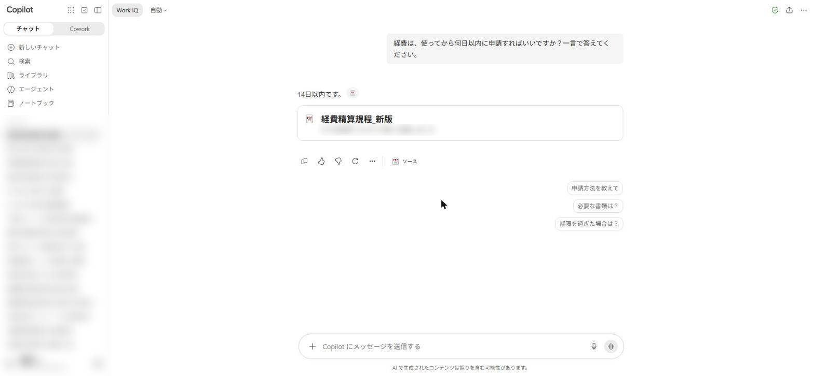

# デモ13：資料ありとなしで答えを比べる

## テーマ

AI に「経費は何日以内に申請すればいい？」と聞くと、自信たっぷりに答えが返ってきます。でも、その答えは「あなたの会社の規程」に書いてあることでしょうか？

## 目的

同じ質問を、社内の資料を参照できない状態と、参照できる状態で聞き比べます。AI の答えは「何を見て答えたか」で変わることを体験します。



## 必要な環境

| 項目 | 内容 |
| ---- | ---- |
| 使う場所 | Microsoft 365 Copilot Chat（Work IQ のオン・オフ） |
| 使うデータ | 経費精算規程_新版.pdf（OneDrive に置いてあれば添付は不要） |

このデモでは以下のタスクを実施します。

　**タスク１：社内の資料を見ずに答えてもらう**

　**タスク２：社内の資料を見て答えてもらう**


## 予想時間: 3分


## 今回の頼み方

以下の文をコピーして使います。

```
経費は、使ってから何日以内に申請すればいいですか？一言で答えてください。
```

## タスク1 - 社内の資料を見ずに答えてもらう

> **このタスクの目的：** Work IQ をオフにして、一般的な知識だけで答えてもらいます。

1. Microsoft Edge で Copilot Chat（https://m365.cloud.microsoft/chat）を開き、「**新しいチャット**」をクリックします。

   


2. 画面上部の「**Work IQ**」をクリックしてオフにします（文字に取り消し線が付きます）。

   


3. 入力欄に「今回の頼み方」の文を貼り付けて、**Enter** キーを押します。「30 日以内です」のような答えが返り、引用元が表示されないことを確認します。

   

   


## タスク2 - 社内の資料を見て答えてもらう

> **このタスクの目的：** Work IQ をオンに戻して、同じ質問をします。

1. 「**新しいチャット**」をクリックし、「**Work IQ**」をクリックしてオンに戻します。

   


2. 同じ文を貼り付けて、**Enter** キーを押します。「14 日以内です」と答え、引用元に **経費精算規程_新版** が表示されることを確認します。

   

   


## うまくいったかの目安

- オフのときに引用元が付かない
- オンのときに経費精算規程_新版が引用元に出る


## ここがコツ

- Work IQ がオンのとき、Copilot はあなたが開けるメール・ファイル・チャットを探して答えます。オフのときは、一般的な知識だけで答えます。
- **引用元が付いていない答えは、社内のルールとしては使わない**――これが一番のポイントです。
- Work IQ のオン・オフは次のチャットにも引き継がれます。試し終わったら、オンに戻しておきます。


## 言い換え例

同じ考え方で、次のようにも頼めます。

```
その答えの根拠になった資料の、該当する条文をそのまま引用してください。
```

```
旧版と新版で答えが違う場合は、両方を教えてください。
```

```
社内の資料に書いていない場合は、「書いていない」と答えてください。
```


---

← [デモ12：規程の新旧を比べる](./Demo12_規程の新旧を比べる.md)　｜　[README に戻る](../README.md)　｜　[デモ14：規程から 4 択クイズを作る](./Demo14_規程から4択クイズを作る.md) →
