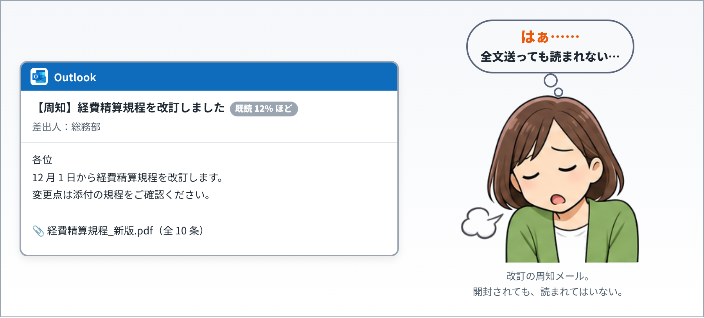
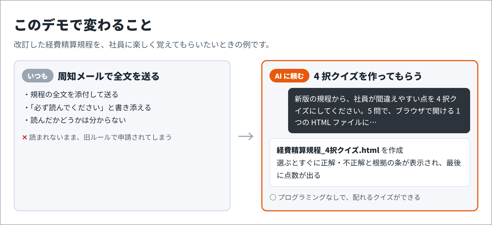
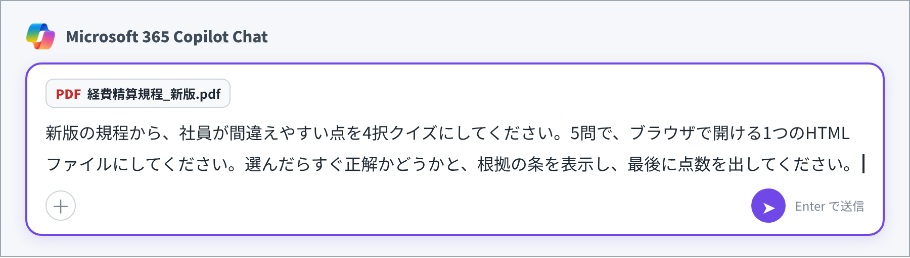
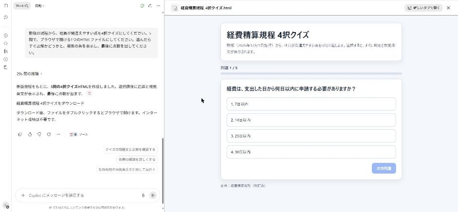
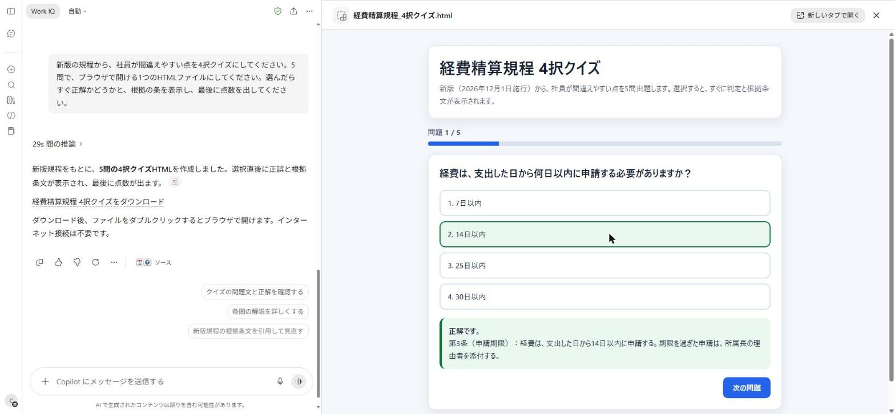

# デモ14：規程から 4 択クイズを作る

## テーマ

規程が改訂されたら、社員に周知しなければならない。でも、メールで全文を送っても読まれない。説明会を開く時間もない。「ちゃんと読んだか、楽しく確かめられたらいいのに」と思ったことはありませんか？



## 目的

新しい規程から、社員が間違えやすい点を 4 択クイズにしてもらいます。ブラウザで開ける HTML ファイルとして作ってもらい、その場で遊べることを確かめます。



## 必要な環境

| 項目 | 内容 |
| ---- | ---- |
| 使う場所 | Microsoft 365 Copilot Chat（Work IQ オン） |
| 使うデータ | 経費精算規程_新版.pdf |

このデモでは以下のタスクを実施します。

　**タスク１：クイズを作ってもらう**

　**タスク２：クイズで遊んでみる**


## 予想時間: 4分


## 今回の頼み方

Copilot には、次のように頼みます。実際に入力する文は、タスクの手順の中にあります（コピーして貼り付けられます）。



## タスク1 - クイズを作ってもらう

> **このタスクの目的：** 規程を添付して、クイズの形式を指定します。デモ12 のチャットの続きで頼んでもかまいません。

1. Microsoft Edge で以下の URL を開き、会社のアカウントでサインインします。画面上部の「**Work IQ**」がオンになっていることを確認します（文字に取り消し線が付いている場合はクリックしてオンにします）。

   ```
   https://m365.cloud.microsoft/chat
   ```

   


2. 入力欄の左の「**＋**」をクリックし、「**クラウド ファイルを添付**」をクリックします。「**マイ ファイル**」→「**AI-3025練習用データ**」の順に開き、**経費精算規程_新版.pdf** のチェックをオンにして「**選択**」をクリックします。

   


3. 入力欄に次の文を貼り付けて、**Enter** キーを押します。

   ```
   新版の規程から、社員が間違えやすい点を4択クイズにしてください。5問で、ブラウザで開ける1つのHTMLファイルにしてください。選んだらすぐ正解かどうかと、根拠の条を表示し、最後に点数を出してください。
   ```


   


## タスク2 - クイズで遊んでみる

> **このタスクの目的：** 作られたファイルを開いて、動きを確かめます。

1. 回答に表示された「**経費精算規程 4択クイズをダウンロード**」のリンクをクリックします。画面の右側にクイズが表示されます。

   

   


2. 選択肢をクリックし、正解・不正解と根拠の条（例：第3条 申請期限）が表示されることを確認します。「**次の問題**」で 5 問まで進め、最後に点数が出ることを確認します。

   

   


3. 配るときは、右上の「**新しいタブで開く**」からファイルをダウンロードし、Teams や SharePoint に置いて共有します。

   


## うまくいったかの目安

- 5 問すべてで根拠の条が表示される
- 最後に点数が出る


## ここがコツ

- 「選んだらすぐ正解かどうかと、根拠の条を表示」のように、**動きを言葉で書く**と、その通りの画面になります。
- 「1 つの HTML ファイル」と書くと、ダブルクリックするだけで開けるファイルになります。インターネットにつながっていなくても動きます。
- 問題と正解は、必ず規程と照らし合わせてから配ります（デモ20 の確かめ方が使えます）。


## 言い換え例

同じ考え方で、次のようにも頼めます。

```
問題を 10 問に増やして、出題の順番を毎回ランダムにしてください。
```

```
間違えた問題だけをもう一度出す機能を付けてください。
```

```
新人研修向けに、ひらがなを多めにしたやさしい版も作ってください。
```


---

← [デモ13：資料ありとなしで答えを比べる](./Demo13_資料ありとなしで答えを比べる.md)　｜　[README に戻る](../README.md)　｜　[デモ15：答える係のエージェントを作る](./Demo15_答える係のエージェントを作る.md) →
