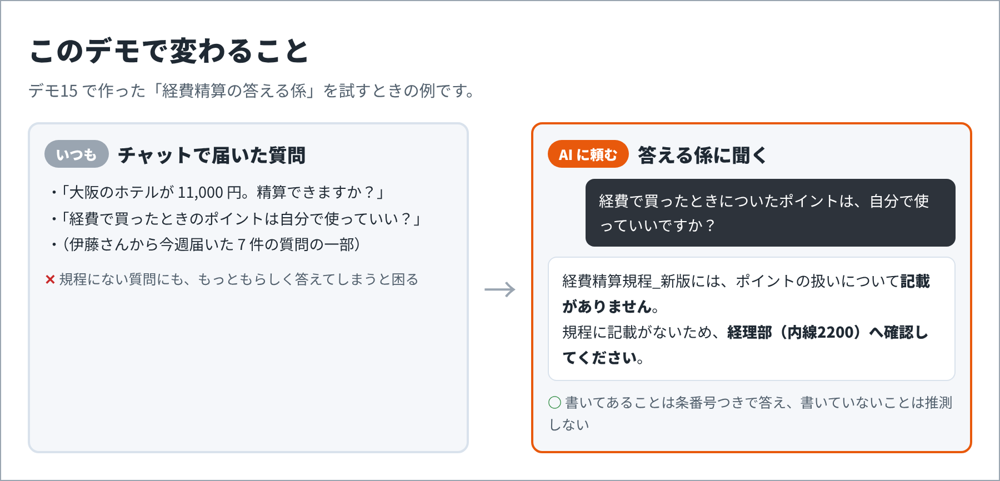
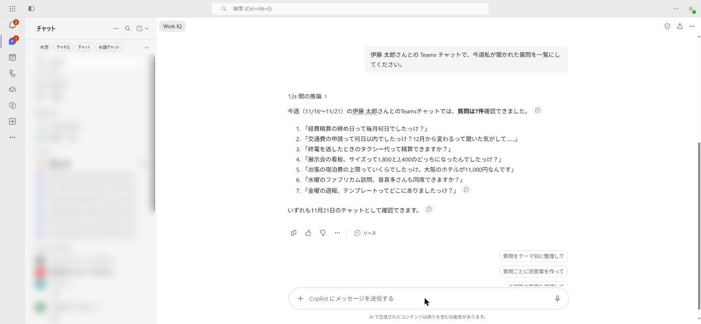
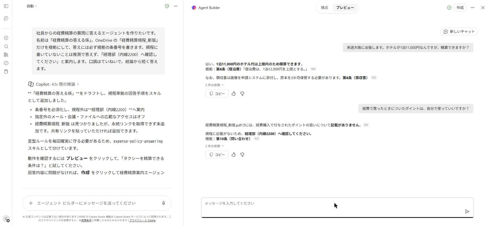

# デモ16：作ったエージェントに質問する

## テーマ

エージェントを作っただけでは、本当に使えるかどうか分かりません。規程に書いてあることにはきちんと答えるか。書いていないことを聞かれたら、勝手に答えを作ってしまわないか――。


## 目的

デモ15 で作ったエージェントに、規程に書いてあることと、書いていないことの両方を質問します。指示どおりに振る舞うかを確かめます。



## 必要な環境

| 項目 | 内容 |
| ---- | ---- |
| 使う場所 | Microsoft 365 Copilot の Agent Builder（プレビュー） |
| 使うデータ | デモ15 で作ったエージェント |

このデモでは以下のタスクを実施します。

　**タスク１：実際に届いた質問を確かめる**

　**タスク２：規程に書いてあることを聞く**

　**タスク３：規程に書いていないことを聞く**


## 予想時間: 4分


## 今回の頼み方

Copilot には、次のように頼みます。実際に入力する文は、タスクの手順の中にあります（コピーして貼り付けられます）。


## タスク1 - 実際に届いた質問を確かめる

> **このタスクの目的：** チャットで届いた質問を Copilot に一覧にしてもらい、テストに使う質問を選びます。

1. Microsoft Edge で以下の URL を開き、会社のアカウントでサインインします。画面上部の「**Work IQ**」がオンになっていることを確認します（文字に取り消し線が付いている場合はクリックしてオンにします）。

   ```
   https://m365.cloud.microsoft/chat
   ```

   


2. 入力欄に次の文を入力して、**Enter** キーを押します。

   ```
   伊藤 太郎さんとの Teams チャットで、直近 1 週間に私が聞かれた質問を一覧にしてください。
   ```

   


3. 直近 1 週間に届いた質問が一覧になることを確認します（画面は Teams の Copilot で同じ文を入力した例です）。この中から、規程で答えられる質問を選びます。

   

   


## タスク2 - 規程に書いてあることを聞く

> **このタスクの目的：** エージェントが条番号つきで答えるかを確かめます。

1. デモ15 の画面で、右上の「**プレビュー**」をクリックします（作成済みのエージェントは、画面左の「エージェント」からも開けます）。

   


2. 入力欄に次の文を貼り付けて、**Enter** キーを押します。

   ```
   来週大阪に出張します。ホテルが1泊11,000円なんですが、精算できますか？
   ```

   「精算できます」と答え、根拠に **第6条（宿泊費）** が示されることを確認します。


   


## タスク3 - 規程に書いていないことを聞く

> **このタスクの目的：** 指示どおり、推測で答えないかを確かめます。

1. 入力欄に次の文を入力して、**Enter** キーを押します。

   ```
   経費で買ったときについたポイントは、自分で使っていいですか？
   ```

   


2. 「記載がありません」「経理部（内線2200）へ確認してください」と答えることを確認します。

   

   


## うまくいったかの目安

- 宿泊費の質問に第6条を根拠に答える
- ポイントの質問に「記載がない」「経理部へ」と答える


## ここがコツ

- エージェントは「**答えられないこと**」を聞いてテストするのが大切です。規程にない質問にもっともらしく答えるようなら、指示に「規程に書いていないことは答えない」をもう一度書き足します。
- 答えがおかしいときは、「構成」に戻って指示やナレッジを直し、「更新」をクリックします。
- 質問のテスト用に、実際に届いた質問をそのまま使うと、現場で役に立つかが分かります。


## 言い換え例

同じ考え方で、次のようにも頼めます。

```
締め日は毎月何日ですか？
```

```
終電を逃したときのタクシー代は精算できますか？
```

```
交通費の申請は何日以内ですか？12 月から変わると聞きました。
```


---

← [デモ15：答える係のエージェントを作る](./Demo15_答える係のエージェントを作る.md)　｜　[README に戻る](../README.md)　｜　[デモ17：リサーチツールで社外の事例を調べる](./Demo17_リサーチツールで社外の事例を調べる.md) →
