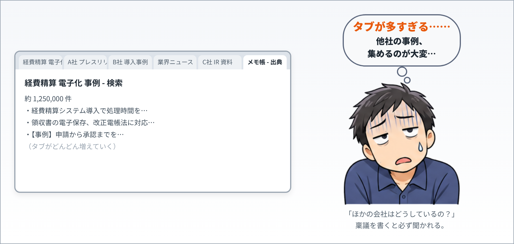
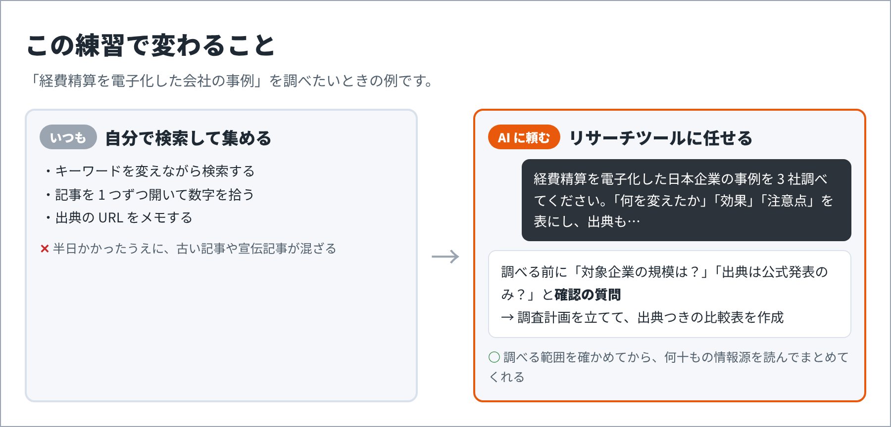
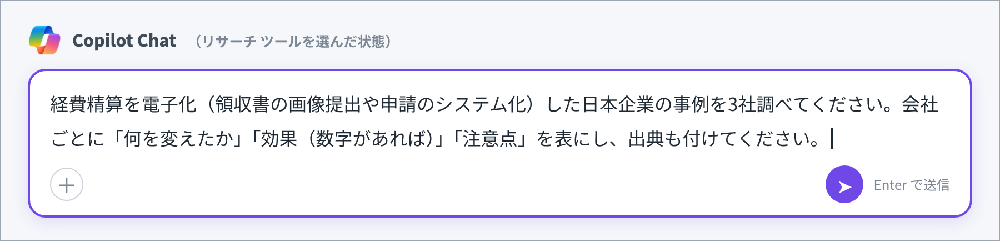
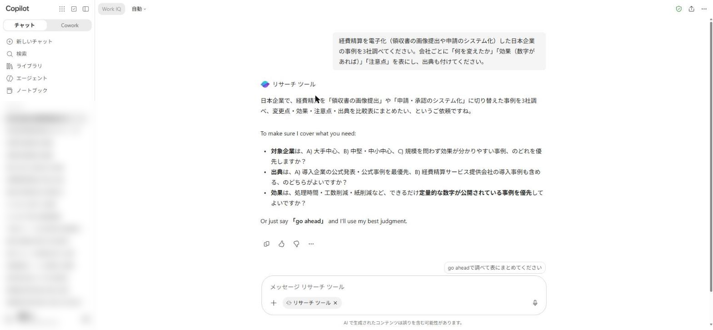
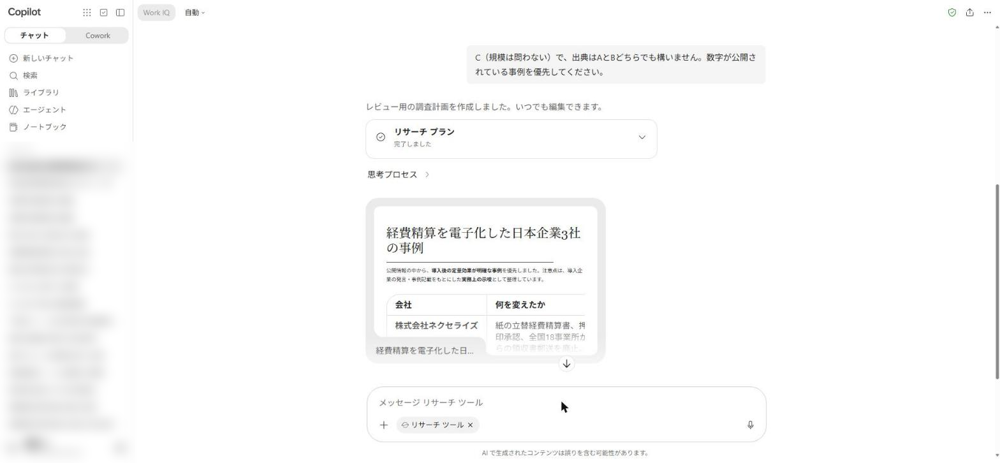
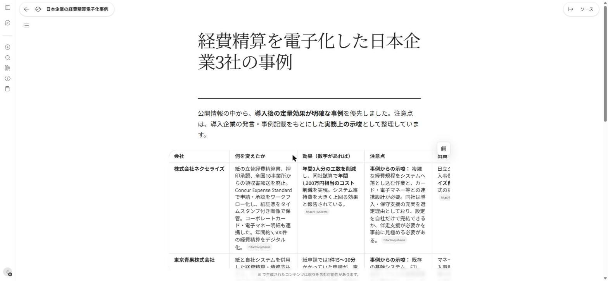

# デモ17：リサーチツールで社外の事例を調べる

## テーマ

「ほかの会社はどうしているの？」――企画書や稟議を書くと、必ず聞かれる質問です。検索して記事を開き、数字を拾い、出典をメモして……。気づけば半日がたっている。



## 目的

Copilot のリサーチツールに、社外の事例調査を任せます。調べる前に確認の質問が返ってくること、出典つきの表ができることを体験します。



## 必要な環境

| 項目 | 内容 |
| ---- | ---- |
| 使う場所 | Microsoft 365 Copilot Chat のリサーチツール |
| 使うデータ | なし（Web の情報を調べます） |

このデモでは以下のタスクを実施します。

　**タスク１：リサーチツールを選ぶ**

　**タスク２：調査を頼む**


## 予想時間: 10分


## 今回の頼み方

Copilot には、次のように頼みます。実際に入力する文は、タスクの手順の中にあります（コピーして貼り付けられます）。



## タスク1 - リサーチツールを選ぶ

> **このタスクの目的：** 通常のチャットではなく、時間をかけて調べるリサーチツールを使います。

1. Microsoft Edge で以下の URL を開き、会社のアカウントでサインインします。画面上部の「**Work IQ**」がオンになっていることを確認します（文字に取り消し線が付いている場合はクリックしてオンにします）。

   ```
   https://m365.cloud.microsoft/chat
   ```

   


2. 入力欄の左の「**＋**」をクリックし、「**リサーチ ツール**」をクリックします。入力欄に「リサーチ ツール」と表示されることを確認します。

   


## タスク2 - 調査を頼む

> **このタスクの目的：** 調べたい内容と、まとめ方を指定します。

1. 入力欄に次の文を貼り付けて、**Enter** キーを押します。

   ```
   経費精算を電子化（領収書の画像提出や申請のシステム化）した日本企業の事例を3社調べてください。会社ごとに「何を変えたか」「効果（数字があれば）」「注意点」を表にし、出典も付けてください。
   ```


   


2. すぐに調べ始めるのではなく、対象企業や出典の範囲について確認の質問が返ってくることを確認します。

   

   


3. 質問に答えて、**Enter** キーを押します（例：「規模は問いません。出典は公式発表でも導入事例でも構いません。数字が公開されている事例を優先してください。」）。迷ったときは「go ahead」と入力すると、Copilot の判断で進めます。

   


4. 調査計画が表示され、調査が進みます。完了までには数分〜10 分程度かかります。待っている間に、ほかの作業をしていてもかまいません。完了すると、レポートのカードが表示されます。

   

   


5. カードをクリックしてレポートを開きます。会社ごとの比較表と出典が表示されることを確認します。出典をクリックし、元の記事で数字を確かめます。

   

   


## うまくいったかの目安

- 調べる前に確認の質問が返ってくる
- 表に出典が付いている


## ここがコツ

- リサーチツールは、調べる前に**確認の質問をしてくる**のが特徴です。ここで範囲をしぼるほど、結果の質が上がります。
- 時間がかかるので、研修では「頼むところ」までを見せ、結果は事前に作っておいたものを紹介すると効率的です。
- 数字は必ず出典で確かめます。古い記事や、製品の宣伝記事の数字が混ざることがあります。


## 言い換え例

同じ考え方で、次のようにも頼めます。

```
同業他社 3 社の、在宅勤務の制度を比較してください。出典は各社の公式発表に限ります。
```

```
生成 AI を社内で導入した日本企業の事例を、失敗例も含めて調べてください。
```

```
社内の議事録とメールから、このプロジェクトの経緯を調べてまとめてください。
```


---

← [デモ16：作ったエージェントに質問する](./Demo16_作ったエージェントに質問する.md)　｜　[README に戻る](../README.md)　｜　[デモ18：送る前のメールを相手の立場でチェックする](./Demo18_送る前のメールを相手の立場でチェックする.md) →
