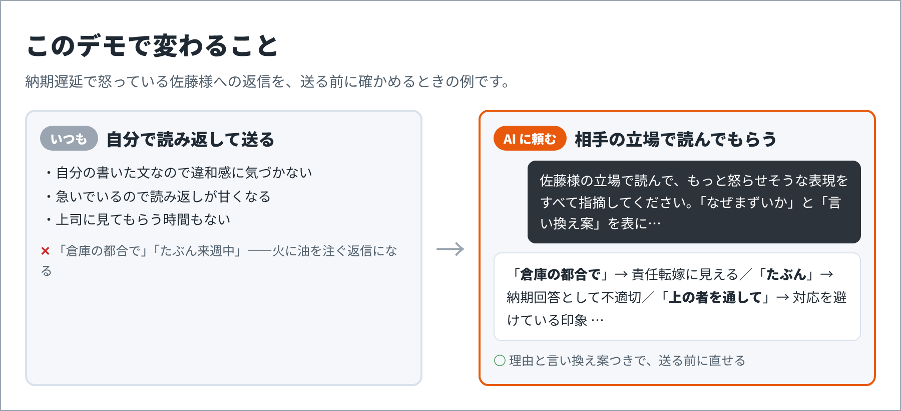
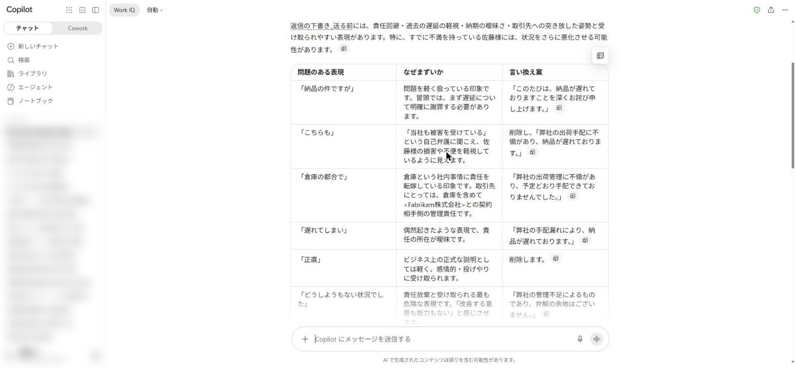

# デモ18：送る前のメールを相手の立場でチェックする

> ★ 講師のおすすめデモです。研修の時間が限られるときは、★のデモから行います。

## テーマ

書き終えた返信メール。自分では問題ないつもりでも、相手が読んだらどう感じるでしょうか。急いで書いたメールほど、言い訳や突き放した言葉が紛れ込みます。

送信ボタンを押す前に、相手の立場で読んでくれる人がいたら――。

## 目的

送る前の下書きを Copilot に渡し、相手の立場で読んで、相手を怒らせそうな表現を指摘してもらいます。



## 必要な環境

| 項目 | 内容 |
| ---- | ---- |
| 使う場所 | Microsoft 365 Copilot Chat（Work IQ オン） |
| 使うデータ | 返信の下書き_送る前.docx |

このデモでは以下のタスクを実施します。

　**タスク１：下書きを添付する**

　**タスク２：相手の立場でチェックしてもらう**


## 予想時間: 4分


## 今回の頼み方

以下の文をコピーして使います。

```
添付は、納期遅延で怒っている取引先の佐藤様へ返信する前の下書きです。佐藤様の立場で読んで、もっと怒らせそうな表現をすべて指摘してください。表現ごとに「なぜまずいか」と「言い換え案」を表にしてください。
```

## タスク1 - 下書きを添付する

> **このタスクの目的：** チェックしてほしい下書きを指定します。

1. Microsoft Edge で以下の URL を開き、会社のアカウントでサインインします。画面上部の「**Work IQ**」がオンになっていることを確認します（文字に取り消し線が付いている場合はクリックしてオンにします）。

   ```
   https://m365.cloud.microsoft/chat
   ```

   


2. 入力欄の左の「**＋**」をクリックし、「**クラウド ファイルを添付**」をクリックします。「**マイ ファイル**」→「**AI-3025練習用データ**」の順に開き、**返信の下書き_送る前.docx** のチェックをオンにして「**選択**」をクリックします。

   


## タスク2 - 相手の立場でチェックしてもらう

> **このタスクの目的：** 誰の立場で読むかを指定します。

1. 入力欄に「今回の頼み方」の文を貼り付けて、**Enter** キーを押します。

   


2. 「問題のある表現」「なぜまずいか」「言い換え案」の表が表示されることを確認します。

   

   


3. 最後にまとめられた修正の軸（最初に謝罪する、社内事情を言い訳にしない、確定した日時を示す など）を確認します。

   


## うまくいったかの目安

- 「倉庫の都合」「たぶん」「上の者を通して」などが指摘されている
- 言い換え案が付いている


## ここがコツ

- 「**佐藤様の立場で**」のように、読む人を具体的に指定します。「おかしいところはありますか？」だけだと、誤字のチェックで終わることがあります。
- 下書きに仕込んである問題は 6 つです（お詫びがない、倉庫の都合・どうしようもない、先月とは関係ない、たぶん来週中、上の者を通して、相手の 3 つの要望と期限に答えていない）。
- 直した文まで作ってほしいときは、続けて「指摘を反映した返信文を作成してください」と頼みます。


## 言い換え例

同じ考え方で、次のようにも頼めます。

```
この文を、上司が読んだらどこを直せと言いそうですか？
```

```
この提案書を、反対している部長の立場で読んで、突っ込まれそうな点を挙げてください。
```

```
このお知らせを、新入社員の立場で読んで、分かりにくい言葉を挙げてください。
```


---

← [デモ17：リサーチツールで社外の事例を調べる](./Demo17_リサーチツールで社外の事例を調べる.md)　｜　[README に戻る](../README.md)　｜　[デモ19：AI の集計を別の方法で確かめる](./Demo19_AIの集計を別の方法で確かめる.md) →
