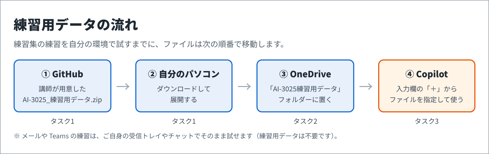

# 練習00：練習用データを準備する

## テーマ

研修で見たデモを、職場に戻ってから自分でも試してみたい。でも、同じファイルがないと同じ結果にならない――そこで、練習で使うファイルを練習用データとして用意しました。

## 目的

練習用データをダウンロードして、自分の OneDrive に置きます。OneDrive に置いたファイルは、Copilot の入力欄の「＋」から指定できるようになります。

練習用データは、研修用に作成した架空の文書です。登場する会社名・人名・金額はすべて架空のものです。

> 注：メールや Teams の練習（練習05〜11）は、ご自身の受信トレイやチャットでそのまま試せます。練習用データは不要です。件名や相手の名前を、ご自身のメールに合わせて書き換えてください。
>
> 注：Copilot がファイルやメールを参照するには、Microsoft 365 Copilot のライセンスが必要です。詳しくは README の「必要な環境」をご覧ください。



この練習では以下のタスクを実施します。

　**タスク１：練習用データをダウンロードする**

　**タスク２：OneDrive に練習用データをアップロードする**

　**タスク３：Copilot からファイルを指定できることを確認する**


## 予想時間: 10分


## タスク1 - 練習用データをダウンロードする

> **このタスクの目的：** 練習で使うファイル（4 本）を、自分のパソコンにダウンロードします。

1. 以下のリンクをクリックして、練習用データ（AI-3025_練習用データ.zip）をダウンロードします。

   **[AI-3025_練習用データ.zip をダウンロード](https://github.com/ctct-edu/AI-3025/raw/main/Allfiles/AI-3025_練習用データ.zip)**

   > 注：ダウンロードしたファイルは、パソコンの「**ダウンロード**」フォルダーに保存されます。


2. エクスプローラーで「**ダウンロード**」フォルダーを開き、**AI-3025_練習用データ.zip** を右クリックして、「**すべて展開**」をクリックします。


3. 展開したフォルダーに、次の 4 本のファイルが入っていることを確認します。

   | ファイル名 | 内容 | 使う練習 |
   | ---------- | ---- | -------- |
   | 経費一覧_前任者作成.xlsx | 前任者が作った経費の集計表。「集計」「経費一覧（121 行）」「予算」の 3 シート。入力ミスが 6 か所仕込んである | 01〜04、19 |
   | 経費精算規程_旧版.docx | 経費精算規程の改訂前の版（Word） | 12 |
   | 経費精算規程_新版.pdf | 経費精算規程の改訂後の版（PDF、2026 年 12 月 1 日施行） | 12〜16、20 |
   | 返信の下書き_送る前.docx | 納期遅延で怒っている取引先への返信の下書き。まずい表現が 6 か所ある | 18 |


## タスク2 - OneDrive に練習用データをアップロードする

> **このタスクの目的：** Copilot が参照できるように、練習用データを自分の OneDrive に置きます。

1. Microsoft Edge で以下の URL を開き、会社のアカウントでサインインします。

   ```
   https://www.office.com/
   ```


2. 画面左の「**OneDrive**」をクリックし、「**マイ ファイル**」を開きます。「**＋ 作成またはアップロード**」→「**フォルダー**」をクリックし、以下の名前でフォルダーを作成します。

   ```
   AI-3025練習用データ
   ```


3. 作成した「**AI-3025練習用データ**」フォルダーを開きます。タスク1 で展開した 4 本のファイルを選択し、ブラウザーの画面にドラッグ アンド ドロップしてアップロードします。


4. 4 本のファイルが一覧に表示されることを確認します。

   > 注：Excel の練習（01〜04）では、Copilot がブックを直接編集します。何度も試したいときは、元のファイルを残しておき、アップロードし直してください。


## タスク3 - Copilot からファイルを指定できることを確認する

> **このタスクの目的：** アップロードしたファイルを、Copilot Chat で指定できることを確かめます。

1. Microsoft Edge で以下の URL を開きます。

   ```
   https://m365.cloud.microsoft/chat
   ```


2. 入力欄の左の「**＋**」をクリックし、「**クラウド ファイルを添付**」をクリックします。


3. 「**マイ ファイル**」→「**AI-3025練習用データ**」を開き、4 本のファイルが表示されることを確認します。確認できたら「**キャンセル**」をクリックします。

   > 注：アップロードしたばかりのファイルは、Copilot が内容を検索できるようになるまで少し時間がかかることがあります。「＋」から添付すれば、すぐに使えます。


---

[README に戻る](../README.md)　｜　[練習01：謎の関数を読み解く](./Practice01_謎の関数を読み解く.md) →
