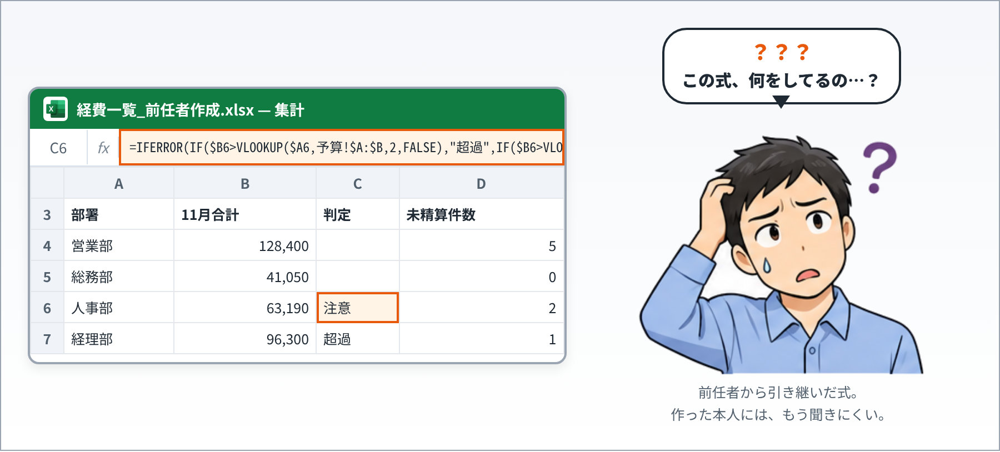

# 練習01：謎の関数を読み解く

> ★ 講師のおすすめの練習です。研修の時間が限られるときは、★の練習から行います。

## テーマ

異動してきたら、前任者が作った Excel が引き継がれていた。セルをクリックすると `=IFERROR(IF($B6>VLOOKUP(...` という長い式が出てきて、何をしているのか誰にも分からない――そんな経験はありませんか？

作った本人に聞ければ早いのですが、もう別の部署に移っていて聞きにくい。かといって、式を自分で分解するのは時間がかかります。



## 目的

Excel の Copilot に、ブックの中の式が何をしているのかを日本語で説明してもらいます。式を「読む」作業を AI に任せ、人は説明が実際の数字と合っているかを確かめます。


## 必要な環境

| 項目 | 内容 |
| ---- | ---- |
| 使う場所 | Excel for the web の Copilot |
| 使うデータ | 経費一覧_前任者作成.xlsx（集計シート） |

この練習では以下のタスクを実施します。

　**タスク１：Excel で Copilot を開く**

　**タスク２：式の意味を説明してもらう**

　**タスク３：説明が正しいか 1 行だけ確かめる**


## 予想時間: 3分


## 今回の頼み方

Copilot には、次のように頼みます。実際に入力する文は、タスクの手順の中にあります（コピーして貼り付けられます）。


## タスク1 - Excel で Copilot を開く

> **このタスクの目的：** 練習用データのブックを開き、Copilot の作業ウィンドウを表示します。

1. OneDrive の「**マイ ファイル**」→「**AI-3025練習用データ**」を開き、**経費一覧_前任者作成.xlsx** をクリックします。Excel for the web でブックが開きます。

   


2. リボンの右端にある「**Copilot**」をクリックします。画面の右側に Copilot の作業ウィンドウが開きます。

   


## タスク2 - 式の意味を説明してもらう

> **このタスクの目的：** C 列（判定）と D 列（未精算件数）の式を、Copilot に日本語で説明してもらいます。

1. 「**集計**」シートの **C6** セル（人事部の「注意」）をクリックします。数式バーに長い式が表示されることを確認します。

   


2. Copilot の入力欄に次の文を貼り付けて、**Enter** キーを押します。

   ```
   集計シートのC列とD列の式は、それぞれ何をしていますか？Excelに詳しくない人にも分かるように、日本語で説明してください。シートは変更しないでください。
   ```


   


3. C 列は「予算に対する使いすぎの警告」、D 列は「精算状況が『未』の件数」と説明されることを確認します。

   

   


## タスク3 - 説明が正しいか 1 行だけ確かめる

> **このタスクの目的：** AI の説明をうのみにせず、数字で確かめる習慣をつけます。

1. 「**予算**」シートを開き、人事部の予算が **70,000** 円であることを確認します。

   


2. 人事部の 11 月合計は **63,190** 円で、70,000 円の 80%（56,000 円）を超えているため「注意」になっている――と、説明どおりであることを確かめます。

   


## うまくいったかの目安

- C 列の 3 つの判定（超過・注意・予算未登録）がすべて説明されている
- D 列が「未」の件数だと説明されている
- シートの中身が変わっていない（Copilot が「シートは変更していません」と答える）


## ここがコツ

- 「シートは変更しないでください」と書くと、説明だけで止まります。Excel の Copilot はブックを直接編集できるため、読むだけのときは一言添えると安心です。
- 「Excel に詳しくない人にも分かるように」と相手を指定すると、関数名の羅列ではなく、業務の言葉で説明してくれます。
- 説明を引き継ぎ資料にしたいときは、続けて「この説明を、シートの E 列のメモ欄に書いてください」と頼めます。


## 言い換え例

同じ考え方で、次のようにも頼めます。

```
この式の中の「0.8」は何を意味していますか？
```

```
このブックの各シートの役割と、シート同士のつながりを図のように説明してください。
```

```
この式を、もっと短く分かりやすい式に書き直す案を出してください。まだ変更はしないでください。
```


---

[README に戻る](../README.md)　｜　[練習02：関数を作ってもらう](./Practice02_関数を作ってもらう.md) →
