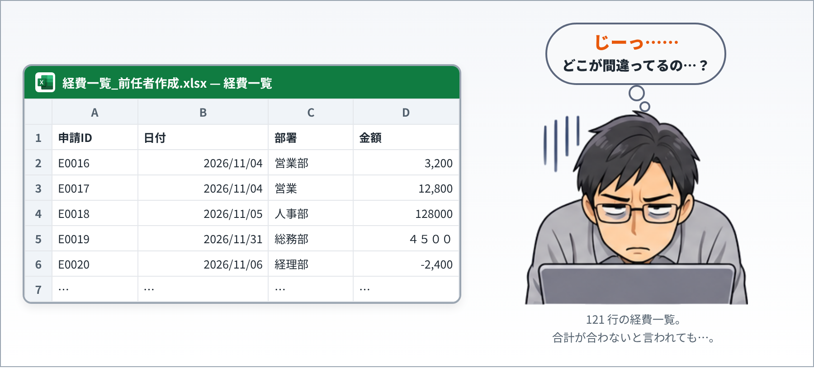
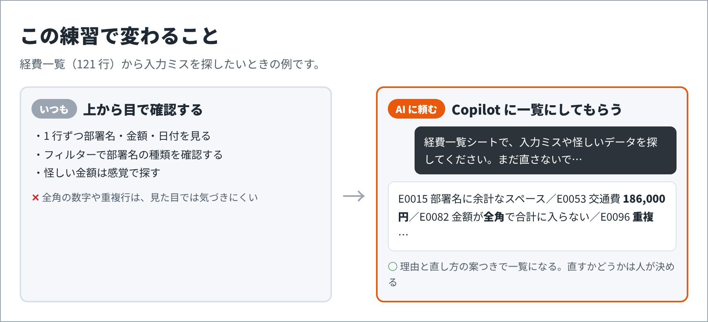
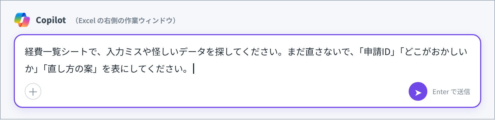
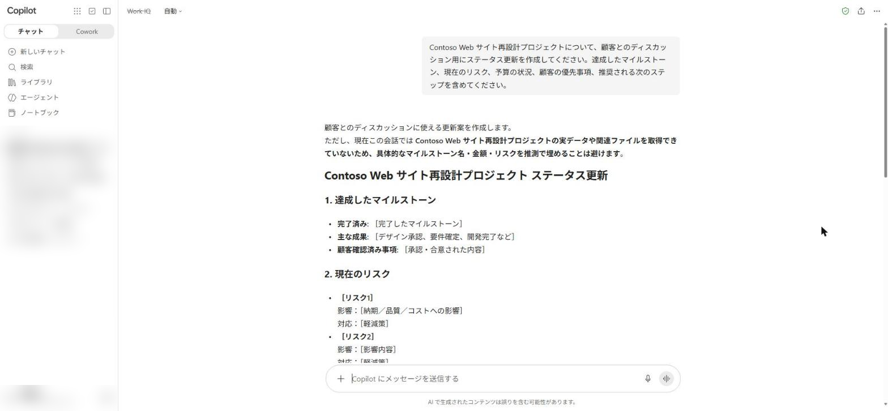
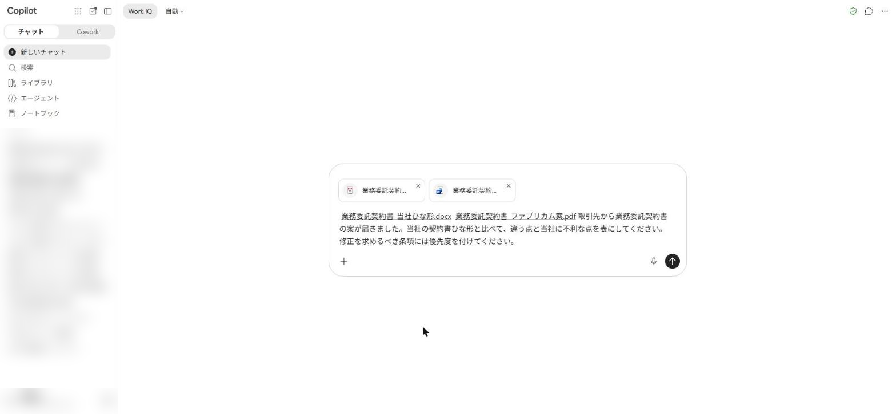
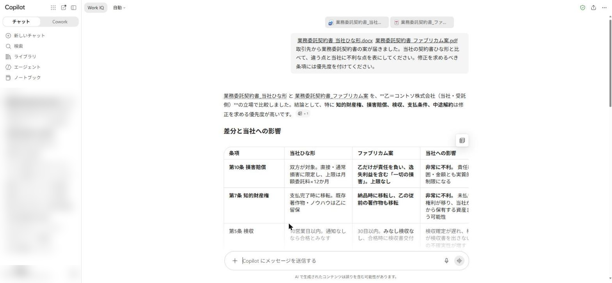

# 練習03：入力ミスを見つける

## テーマ

121 行の経費一覧。合計が合わないと言われても、どこが間違っているのか、上から目で追うしかない――そう思っていませんか？

全角の数字、余計なスペース、同じ行が 2 回。人の目では見落としやすい入力ミスほど、合計を静かに狂わせます。



## 目的

Copilot に表全体をチェックしてもらい、怪しいデータを一覧にしてもらいます。直す前に「どこがおかしいか」を把握するのがねらいです。



## 必要な環境

| 項目 | 内容 |
| ---- | ---- |
| 使う場所 | Excel for the web の Copilot |
| 使うデータ | 経費一覧_前任者作成.xlsx（経費一覧シート） |

この練習では以下のタスクを実施します。

　**タスク１：Excel で Copilot を開く**

　**タスク２：怪しいデータを一覧にしてもらう**


## 予想時間: 4分


## 今回の頼み方

Copilot には、次のように頼みます。実際に入力する文は、タスクの手順の中にあります（コピーして貼り付けられます）。



## タスク1 - Excel で Copilot を開く

> **このタスクの目的：** 練習01 と同じブックを使います。

1. OneDrive の「**マイ ファイル**」→「**AI-3025練習用データ**」を開き、**経費一覧_前任者作成.xlsx** をクリックします。Excel for the web でブックが開きます。

   


2. リボンの右端にある「**Copilot**」をクリックします。画面の右側に Copilot の作業ウィンドウが開きます。

   


## タスク2 - 怪しいデータを一覧にしてもらう

> **このタスクの目的：** 直す前に、どこがおかしいかを表にしてもらいます。

1. Copilot の入力欄に次の文を貼り付けて、**Enter** キーを押します。

   ```
   経費一覧シートで、入力ミスや怪しいデータを探してください。まだ直さないで、「申請ID」「どこがおかしいか」「直し方の案」を表にしてください。
   ```


   


2. 「申請ID」「どこがおかしいか」「直し方の案」の表が表示されることを確認します。

   

   


3. 作業ウィンドウをスクロールし、金額の桁の誤り、承認日の前後、全角の数字、重複行が挙がっていることを確認します。

   

   


4. 最後に「集計への影響」がまとめられていることを確認します。全角の 4,500 円が集計から漏れていることに気づかせてくれます。

   

   


## うまくいったかの目安

- 6 種類の入力ミスがすべて挙がっている
- シートはまだ変更されていない


## ここがコツ

- 「まだ直さないで」が大切です。いきなり直させると、何を直したのか後から追えなくなります。まず一覧、次に「確実なものだけ直して」と 2 回に分けます。
- 仕込んである入力ミスは 6 種類です（部署名の表記ゆれ 2 件、交通費の桁、承認日の前後、全角の金額、重複行）。Copilot はこれ以外に「同じ日・同じ人・同じ金額の疑い」や「今日より先の承認日」も挙げることがあります。それが本当にミスかどうかは、人が判断します。
- 直してよいものが決まったら「確実なもの（E0015 のスペース、E0038、E0082）だけ直してください」のように、ID を指定して頼みます。


## 言い換え例

同じ考え方で、次のようにも頼めます。

```
金額が極端に大きい・小さい行だけを探してください。
```

```
部署名の書き方がそろっていない行を探して、正しい部署名の案を出してください。
```

```
見つかったミスを直すと、集計シートの数字はどう変わりますか？
```


---

← [練習02：関数を作ってもらう](./Practice02_関数を作ってもらう.md)　｜　[README に戻る](../README.md)　｜　[練習04：ピボットテーブルを作る](./Practice04_ピボットテーブルを作る.md) →
