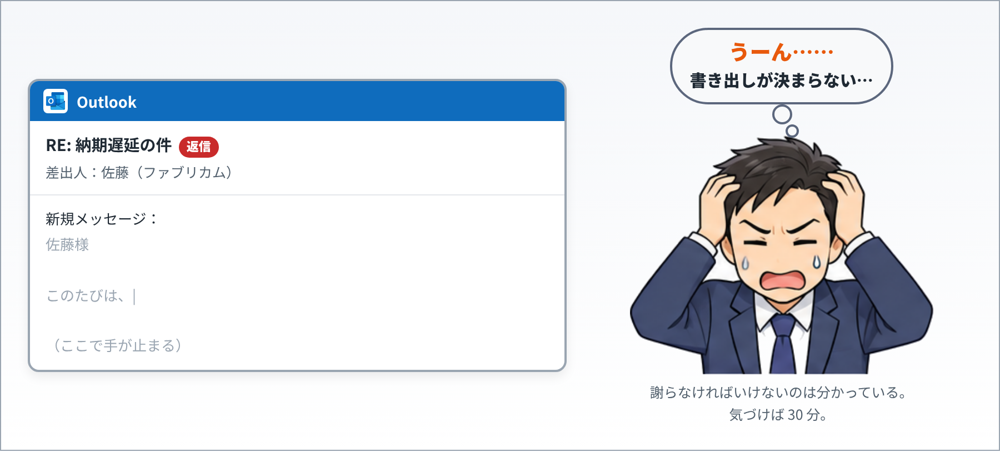
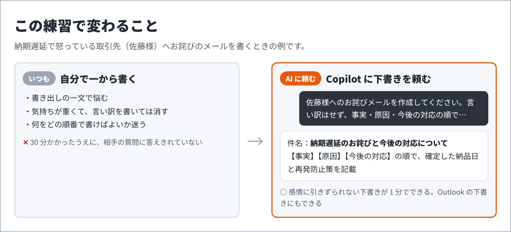
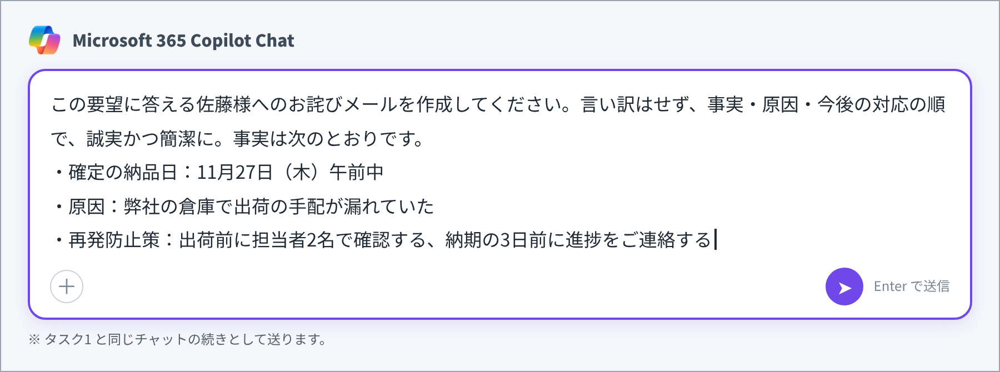
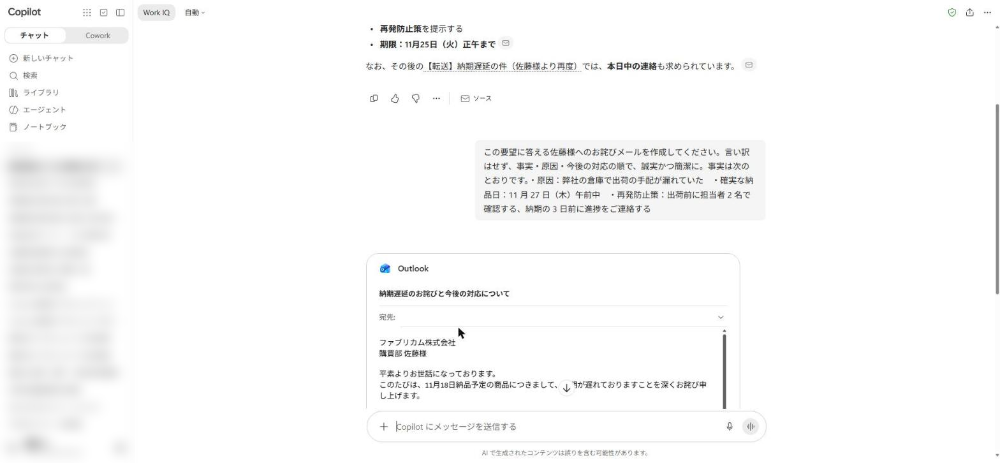
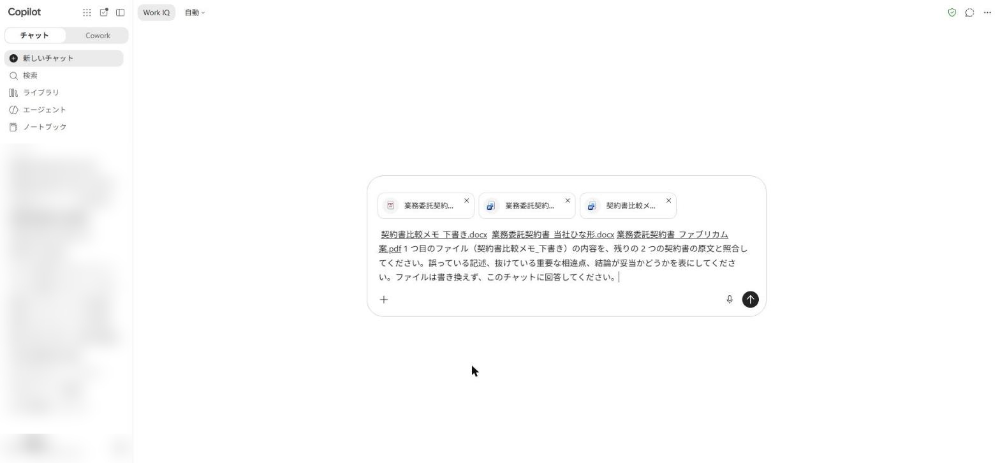

# 練習05：謝罪メールを書く

> ★ 講師のおすすめの練習です。研修の時間が限られるときは、★の練習から行います。

## テーマ

取引先から、納期遅延へのきびしいメール。謝らなければならないのは分かっている。でも、書き出しの一文で手が止まり、気がつけば 30 分――。

謝罪メールが難しいのは、文章力の問題ではなく、気持ちが重くなって筆が進まないからです。AI には感情がないので、言い訳をせず、淡々と、必要なことを順番に書いてくれます。



## 目的

相手のメールと、こちらが伝えるべき事実を渡して、Copilot に謝罪メールの下書きを作ってもらいます。人は「事実が正しいか」「送ってよいか」の判断に集中します。



## 必要な環境

| 項目 | 内容 |
| ---- | ---- |
| 使う場所 | Microsoft 365 Copilot Chat（Work IQ オン） |
| 使うデータ | 自分の受信トレイのメール（研修では講師の環境のデモ用メール） |

この練習では以下のタスクを実施します。

　**タスク１：相手の要望を整理する**

　**タスク２：お詫びメールの下書きを作ってもらう**


## 予想時間: 4分


## 今回の頼み方

Copilot には、次のように頼みます。実際に入力する文は、タスクの手順の中にあります（コピーして貼り付けられます）。



## タスク1 - 相手の要望を整理する

> **このタスクの目的：** いきなり書かせる前に、相手が何を求めているかを確認します（練習06 と同じ操作です）。

1. Microsoft Edge で以下の URL を開き、会社のアカウントでサインインします。画面上部の「**Work IQ**」がオンになっていることを確認します（文字に取り消し線が付いている場合はクリックしてオンにします）。

   ```
   https://m365.cloud.microsoft/chat
   ```

   


2. 入力欄に次の文を入力して、**Enter** キーを押します。

   ```
   伊藤さんから転送された、ファブリカムの佐藤様の「納期遅延の件」のメールを読んで、相手が求めていることと期限だけを箇条書きにしてください。感情的な表現は取り除いてください。
   ```

   


## タスク2 - お詫びメールの下書きを作ってもらう

> **このタスクの目的：** 伝えるべき事実を自分で書き添えて、下書きを作ってもらいます。

1. 同じチャットの入力欄に次の文を貼り付けて、**Enter** キーを押します。

   ```
   この要望に答える佐藤様へのお詫びメールを作成してください。言い訳はせず、事実・原因・今後の対応の順で、誠実かつ簡潔に。事実は次のとおりです。
   ・確定の納品日：11月27日（木）午前中
   ・原因：弊社の倉庫で出荷の手配が漏れていた
   ・再発防止策：出荷前に担当者2名で確認する、納期の3日前に進捗をご連絡する
   ```


   


2. 「Outlook」の下書きカードが表示されることを確認します。

   

   


3. カードをスクロールし、【事実】【原因】【今後の対応】の順になっていること、確定した納品日と再発防止策が入っていることを確認します。「**開く**」をクリックすると Outlook で編集・送信できます。

   

   


## うまくいったかの目安

- お詫び・事実・原因・今後の対応がそろっている
- 自分が渡した事実（日付・原因・対策）だけが使われている


## ここがコツ

- **事実は自分で書く**のが最大のコツです。納品日や原因を AI に推測させると、それらしい嘘が入ります。AI に任せるのは「文章にすること」だけです。
- 「言い訳はせず」「誠実かつ簡潔に」のように、トーンを一言で指定します。
- 送る前に、練習18 の「相手の立場でチェック」を組み合わせると安心です。


## 言い換え例

同じ考え方で、次のようにも頼めます。

```
もう少しやわらかい表現にしてください。ただし、お詫びの言葉は残してください。
```

```
上司の名前でも送れるように、部長名義の版も作ってください。
```

```
電話でお詫びするときの話す順番を、箇条書きで作ってください。
```


---

← [練習04：ピボットテーブルを作る](./Practice04_ピボットテーブルを作る.md)　｜　[README に戻る](../README.md)　｜　[練習06：怒っているメールから要求を抜き出す](./Practice06_怒っているメールから要求を抜き出す.md) →
