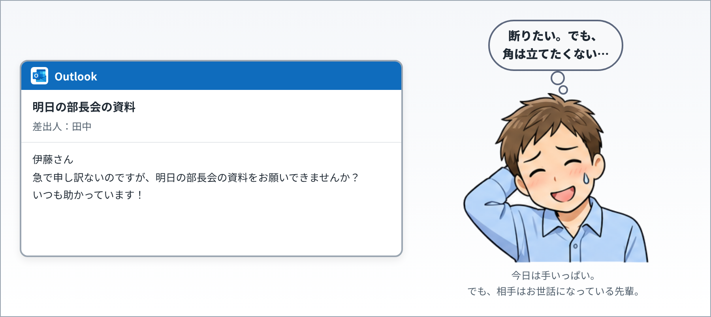
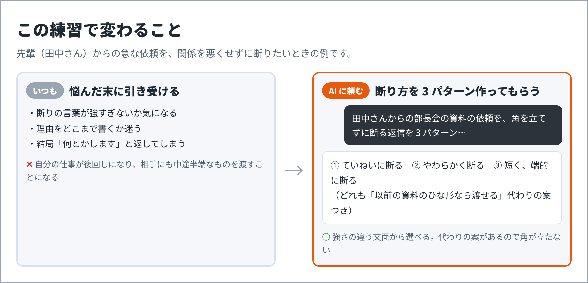
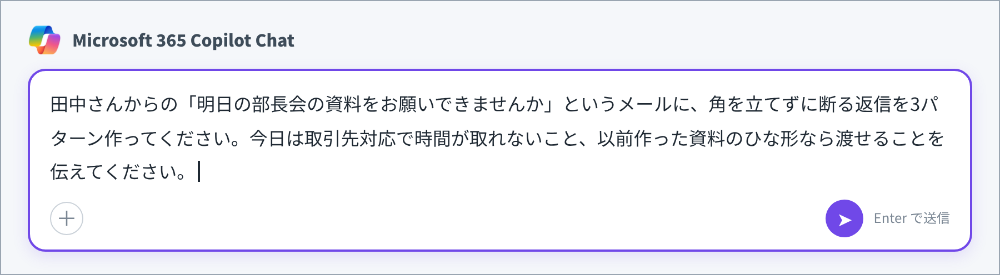
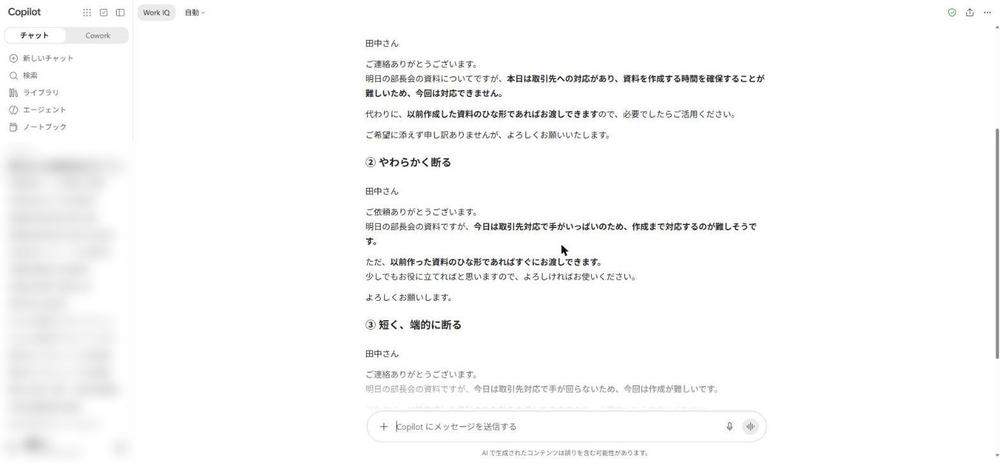

# 練習07：角を立てずに断る

## テーマ

「明日の部長会の資料、お願いできませんか？」――今日は手いっぱい。でも、相手は普段お世話になっている先輩。断り方を考えているうちに、引き受けてしまったことはありませんか？



## 目的

依頼を断る返信を、Copilot に何パターンか作ってもらいます。代わりに出せる案を添えて、関係を悪くせずに断る文面を選べるようにします。



## 必要な環境

| 項目 | 内容 |
| ---- | ---- |
| 使う場所 | Microsoft 365 Copilot Chat（Work IQ オン） |
| 使うデータ | 自分の受信トレイのメール（研修では講師の環境のデモ用メール） |

この練習では以下のタスクを実施します。

　**タスク１：断りの返信を作ってもらう**


## 予想時間: 3分


## 今回の頼み方

Copilot には、次のように頼みます。実際に入力する文は、タスクの手順の中にあります（コピーして貼り付けられます）。



## タスク1 - 断りの返信を作ってもらう

> **このタスクの目的：** 断る理由と、代わりに出せるものを自分で書き添えます。

1. Microsoft Edge で以下の URL を開き、会社のアカウントでサインインします。画面上部の「**Work IQ**」がオンになっていることを確認します（文字に取り消し線が付いている場合はクリックしてオンにします）。

   ```
   https://m365.cloud.microsoft/chat
   ```

   


2. 入力欄に次の文を貼り付けて、**Enter** キーを押します。

   ```
   田中さんからの「明日の部長会の資料をお願いできませんか」というメールに、角を立てずに断る返信を3パターン作ってください。今日は取引先対応で時間が取れないこと、以前作った資料のひな形なら渡せることを伝えてください。
   ```


   


3. 強さの違う 3 つの文面が表示されることを確認します。いちばん自分らしいものを選び、コピーして Outlook の返信に貼り付けます。

   

   


## うまくいったかの目安

- 3 つの文面の強さが違う
- 自分が渡した理由と代わりの案が入っている


## ここがコツ

- **代わりに出せるもの**（ひな形・別の日なら可能・ほかの人の紹介など）を 1 つ入れると、断っても関係が悪くなりにくくなります。
- 「3 パターン」と頼むと、強さの違う文面を見比べて選べます。1 つだけだと、合わないときに頼み直しが必要です。
- 社外の相手に断るときは「社外の取引先向けに」と書き添えると、敬語の度合いが変わります。


## 言い換え例

同じ考え方で、次のようにも頼めます。

```
来週なら引き受けられる、という条件付きの返信にしてください。
```

```
上司にも CC で入れて送る前提の文面にしてください。
```

```
チャットで返す短い版も作ってください。
```


---

← [練習06：怒っているメールから要求を抜き出す](./Practice06_怒っているメールから要求を抜き出す.md)　｜　[README に戻る](../README.md)　｜　[練習08：メールからやることリストを作る](./Practice08_メールからやることリストを作る.md) →
