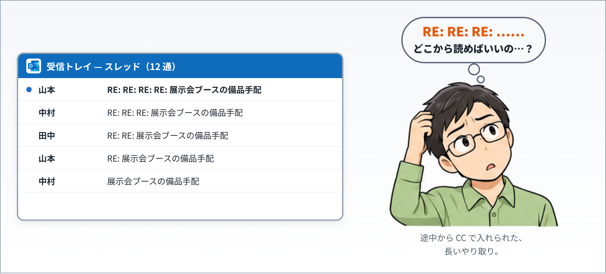
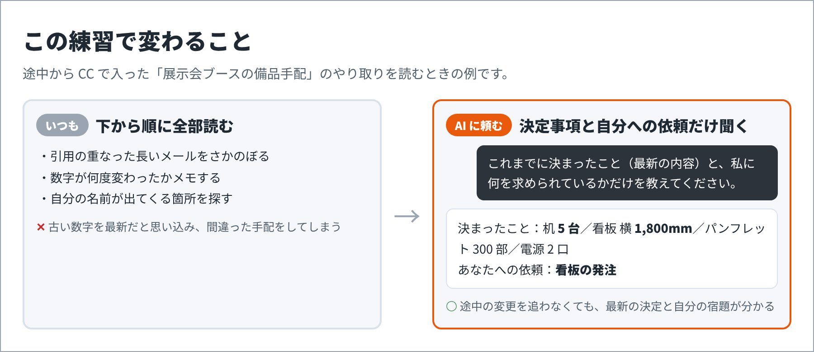
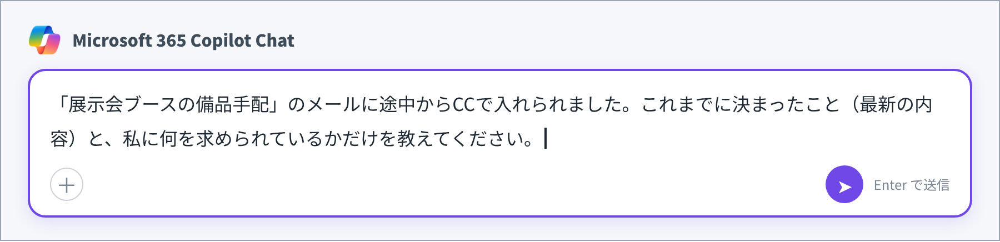
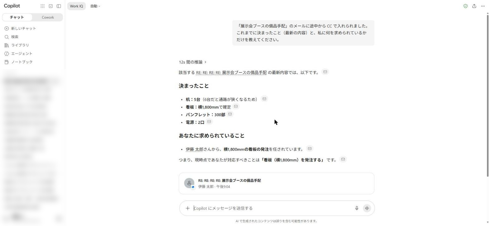

# 練習09：長いメールのやり取りから自分への依頼を探す

## テーマ

件名が「RE: RE: RE: RE:」。途中から CC で入れられたメールのやり取りは、どこから読めばよいのか分かりません。しかも、机の台数は 4 台、6 台、やっぱり 5 台……と、途中で何度も変わっている。



## 目的

長いメールのやり取りから、最終的に決まったことと、自分に求められていることだけを取り出してもらいます。



## 必要な環境

| 項目 | 内容 |
| ---- | ---- |
| 使う場所 | Microsoft 365 Copilot Chat（Work IQ オン） |
| 使うデータ | 自分の受信トレイのメール（研修では講師の環境のデモ用メール） |

この練習では以下のタスクを実施します。

　**タスク１：決定事項と依頼を取り出してもらう**


## 予想時間: 3分


## 今回の頼み方

Copilot には、次のように頼みます。実際に入力する文は、タスクの手順の中にあります（コピーして貼り付けられます）。



## タスク1 - 決定事項と依頼を取り出してもらう

> **このタスクの目的：** 件名を手がかりに、やり取り全体を読んでもらいます。

1. Microsoft Edge で以下の URL を開き、会社のアカウントでサインインします。画面上部の「**Work IQ**」がオンになっていることを確認します（文字に取り消し線が付いている場合はクリックしてオンにします）。

   ```
   https://m365.cloud.microsoft/chat
   ```

   


2. 入力欄に次の文を貼り付けて、**Enter** キーを押します。

   ```
   「展示会ブースの備品手配」のメールに途中からCCで入れられました。これまでに決まったこと（最新の内容）と、私に何を求められているかだけを教えてください。
   ```


   


3. 「決まったこと」と「あなたに求められていること」に分けて表示されることを確認します。机は 4 → 6 → 5 台と変わっていますが、最新の **5 台** になっていることを確かめます。

   

   


## うまくいったかの目安

- 机が 5 台（最新）になっている
- 自分への依頼（看板の発注）が分かる


## ここがコツ

- 「最新の内容」と書くと、途中で変わった数字を最後の値にそろえてくれます。
- 「だけを教えて」と範囲をしぼると、経緯の説明が長くならず、要点だけが返ってきます。
- 経緯も知りたいときは、続けて「机の台数がどう変わったか、経緯を時系列で教えてください」と頼みます。


## 言い換え例

同じ考え方で、次のようにも頼めます。

```
このやり取りで、まだ決まっていないことは何ですか？
```

```
このやり取りに返信するとき、私が書くべき内容を 3 行で下書きしてください。
```

```
このやり取りに出てくる人と、それぞれの担当を表にしてください。
```


---

← [練習08：メールからやることリストを作る](./Practice08_メールからやることリストを作る.md)　｜　[README に戻る](../README.md)　｜　[練習10：見逃したチャネルの連絡をまとめる](./Practice10_見逃したチャネルの連絡をまとめる.md) →
