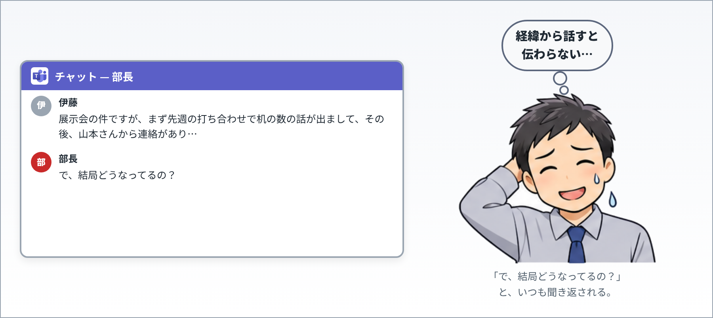
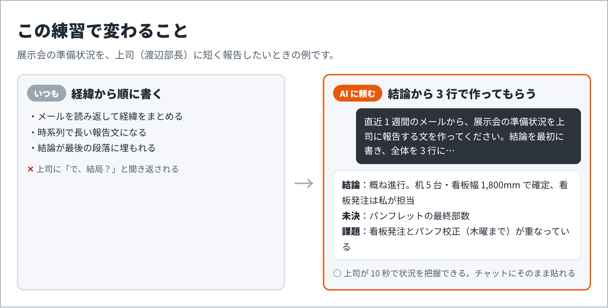
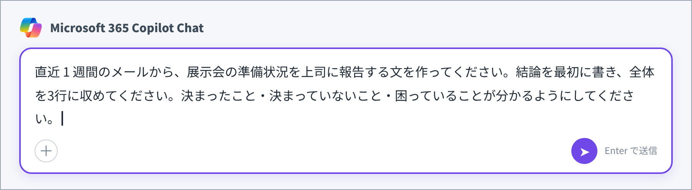
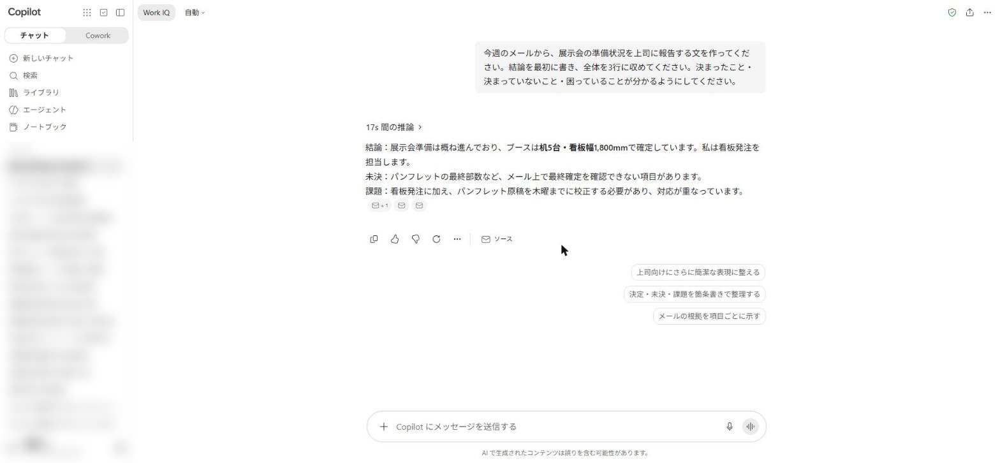

# 練習11：上司への報告を結論から 3 行で書く

## テーマ

「で、結局どうなってるの？」――上司に報告すると、いつもこう聞き返されてしまう。経緯から話し始めて、結論にたどり着く前に上司の顔が曇る。そんな経験はありませんか？



## 目的

直近 1 週間のメールの内容をもとに、上司への報告文を「結論から 3 行」で作ってもらいます。決まったこと・決まっていないこと・困っていることが一目で分かる形にします。



## 必要な環境

| 項目 | 内容 |
| ---- | ---- |
| 使う場所 | Microsoft 365 Copilot Chat（Work IQ オン） |
| 使うデータ | 自分の受信トレイのメール（研修では講師の環境のデモ用メール） |

この練習では以下のタスクを実施します。

　**タスク１：報告文を作ってもらう**


## 予想時間: 3分


## 今回の頼み方

Copilot には、次のように頼みます。実際に入力する文は、タスクの手順の中にあります（コピーして貼り付けられます）。



## タスク1 - 報告文を作ってもらう

> **このタスクの目的：** 報告の形（結論から・3 行・3 つの観点）を指定します。

1. Microsoft Edge で以下の URL を開き、会社のアカウントでサインインします。画面上部の「**Work IQ**」がオンになっていることを確認します（文字に取り消し線が付いている場合はクリックしてオンにします）。

   ```
   https://m365.cloud.microsoft/chat
   ```

   


2. 入力欄に次の文を貼り付けて、**Enter** キーを押します。

   ```
   直近 1 週間のメールから、展示会の準備状況を上司に報告する文を作ってください。結論を最初に書き、全体を3行に収めてください。決まったこと・決まっていないこと・困っていることが分かるようにしてください。
   ```


   


3. 「結論」「未決」「課題」の 3 行で表示されることを確認します。

   

   


## うまくいったかの目安

- 1 行目が結論になっている
- 3 行に収まっている


## ここがコツ

- 「結論を最初に」「3 行に収めて」と、**形を数字で指定**すると、長い報告文になりません。
- 「決まったこと・決まっていないこと・困っていること」の 3 つは、どんな報告にも使える型です。
- 数字（台数・サイズ・期限）は、元のメールと合っているか必ず確かめてから送ります。


## 言い換え例

同じ考え方で、次のようにも頼めます。

```
同じ内容を、口頭で 30 秒で報告するときの話し方にしてください。
```

```
部長が判断しなければならないことだけを 1 行で書いてください。
```

```
この報告を Teams のチャットで送る前提で、もう少しくだけた文にしてください。
```


---

← [練習10：見逃したチャネルの連絡をまとめる](./Practice10_見逃したチャネルの連絡をまとめる.md)　｜　[README に戻る](../README.md)　｜　[練習12：規程の新旧を比べる](./Practice12_規程の新旧を比べる.md) →
