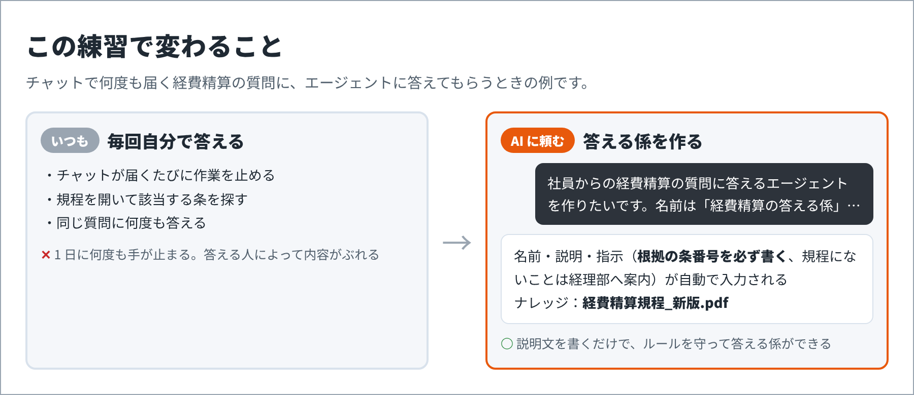
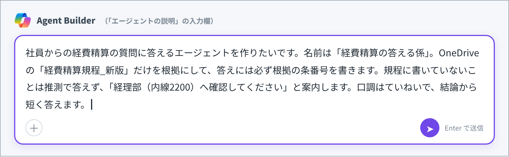
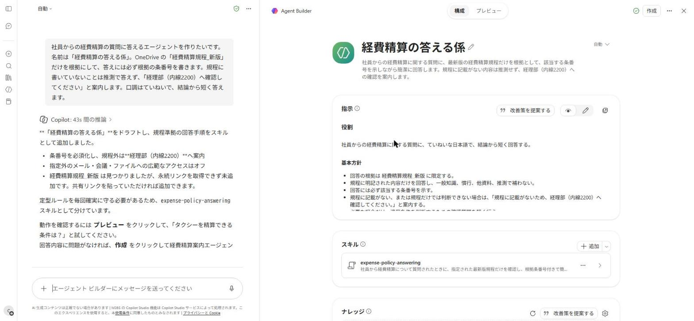
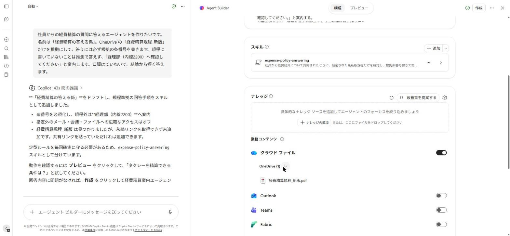
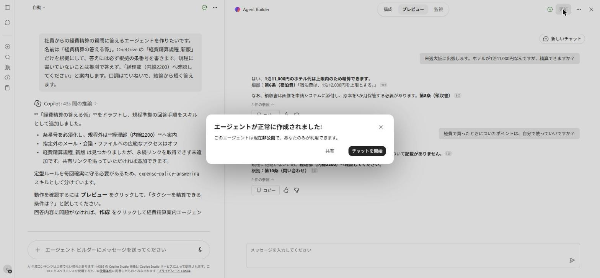

# 練習15：答える係のエージェントを作る

> ★ 講師のおすすめの練習です。研修の時間が限られるときは、★の練習から行います。

## テーマ

「締め日って何日でしたっけ？」「タクシー代って精算できます？」――規程が変わると、同じ質問が何度もチャットで届きます。答えるのは簡単。でも、1 日に何度も手が止まります。

規程を読んで代わりに答えてくれる「答える係」がいたら、どうでしょうか。


## 目的

Agent Builder で、経費精算の質問に答えるエージェントを作ります。作りたいものを日本語で説明し、ナレッジ（根拠にする資料）として新版の規程を登録します。



## 必要な環境

| 項目 | 内容 |
| ---- | ---- |
| 使う場所 | Microsoft 365 Copilot の Agent Builder |
| 使うデータ | 経費精算規程_新版.pdf |

この練習では以下のタスクを実施します。

　**タスク１：Agent Builder を開く**

　**タスク２：作りたいエージェントを説明する**

　**タスク３：ナレッジに規程を登録する**

　**タスク４：エージェントを作成する**


## 予想時間: 6分


## 今回の頼み方

Copilot には、次のように頼みます。実際に入力する文は、タスクの手順の中にあります（コピーして貼り付けられます）。



## タスク1 - Agent Builder を開く

> **このタスクの目的：** Copilot Chat から、新しいエージェントの作成画面を開きます。

1. Microsoft Edge で以下の URL を開き、会社のアカウントでサインインします。画面上部の「**Work IQ**」がオンになっていることを確認します（文字に取り消し線が付いている場合はクリックしてオンにします）。

   ```
   https://m365.cloud.microsoft/chat
   ```

   


2. 画面左の「**エージェント**」にマウスを合わせ、表示されたメニューの「**新しいエージェント**」をクリックします。「自分だけのエージェントを構築する」画面が表示されます。

   


## タスク2 - 作りたいエージェントを説明する

> **このタスクの目的：** 日本語で説明するだけで、名前・説明・指示が作られます。

1. 入力欄に次の文を貼り付けて、**Enter** キーを押します。

   ```
   社員からの経費精算の質問に答えるエージェントを作りたいです。名前は「経費精算の答える係」。OneDrive の「経費精算規程_新版」だけを根拠にして、答えには必ず根拠の条番号を書きます。規程に書いていないことは推測で答えず、「経理部（内線2200）へ確認してください」と案内します。口調はていねいで、結論から短く答えます。
   ```


   


2. しばらく待つと、右側に「経費精算の答える係」の構成が表示されます。「指示」に、条番号を必ず書くことや、規程にないことは経理部へ案内することが入っていることを確認します。

   

   


## タスク3 - ナレッジに規程を登録する

> **このタスクの目的：** 根拠にする資料を登録します。

1. 右側の構成画面を下にスクロールし、「**ナレッジ**」の「**＋ ナレッジの追加**」をクリックします。

   


2. 一覧から **経費精算規程_新版** をクリックします。「クラウド ファイル」の下に **経費精算規程_新版.pdf** が追加されたことを確認します。

   

   


## タスク4 - エージェントを作成する

> **このタスクの目的：** 作成すると、自分のエージェントとして保存されます。

1. 右上の「**作成**」をクリックします。「エージェントが正常に作成されました！」と表示されることを確認します。作成したエージェントは非公開で、自分だけが使えます。

   

   


2. ダイアログの「**×**」をクリックして閉じます。続けて練習16 で質問します。

   


## うまくいったかの目安

- 指示に「条番号を書く」「規程にないことは経理部へ」が入っている
- ナレッジに経費精算規程_新版.pdf が入っている


## ここがコツ

- 説明文には「**名前**」「**何を根拠にするか**」「**根拠にないときどうするか**」「**口調**」の 4 つを入れると、1 回で使える指示になります。
- Agent Builder が「資料のリンクを取得できなかった」と言った場合は、ナレッジの追加から自分でファイルを選びます（タスク3）。
- 同僚にも使ってもらうときは、作成後のダイアログで「**共有**」を選びます。共有された人も、規程のファイルを開ける権限が必要です。


## 言い換え例

同じ考え方で、次のようにも頼めます。

```
会議室の予約ルールの質問に答えるエージェントを作りたいです。根拠は「会議室利用ルール」だけにしてください。
```

```
新人からの PC の設定の質問に答えるエージェントを作りたいです。手順は番号付きで答えてください。
```

```
このエージェントに、よくある質問のボタンを 4 つ付けてください。
```


---

← [練習14：規程から 4 択クイズを作る](./Practice14_規程から4択クイズを作る.md)　｜　[README に戻る](../README.md)　｜　[練習16：作ったエージェントに質問する](./Practice16_作ったエージェントに質問する.md) →
