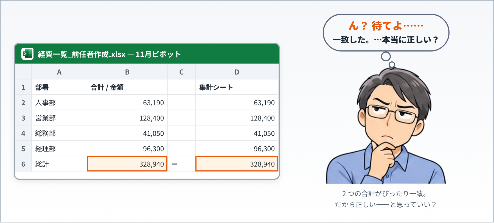
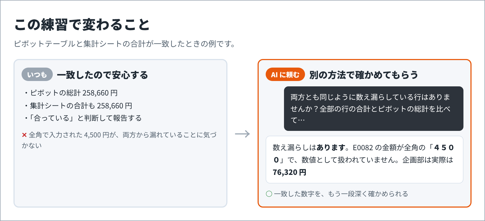
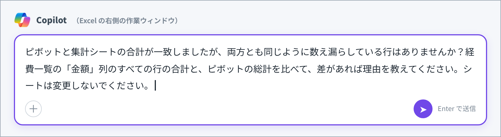
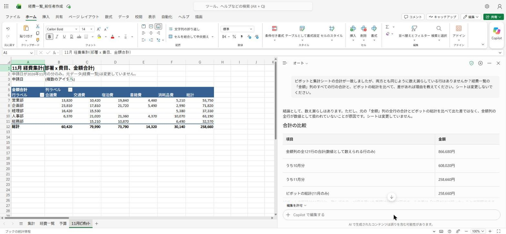
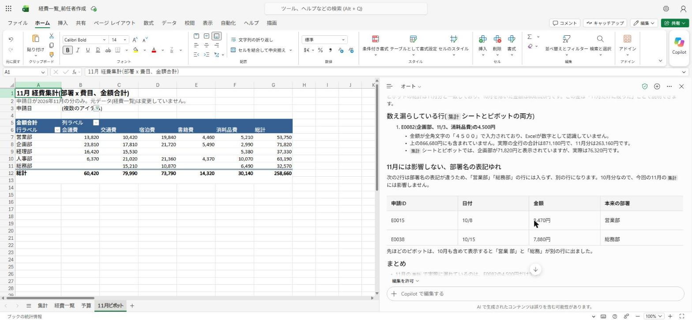

# 練習19：AI の集計を別の方法で確かめる

## テーマ

練習04 で作ったピボットテーブルと、前任者の集計表。2 つの合計がぴったり一致した。だから正しい――本当にそうでしょうか？

同じデータを、同じ落とし穴のある方法で数えれば、答えは一致します。一致したことは、正しいことの証明にはなりません。



## 目的

AI が作った集計を、「全部の行の合計」という別の方法で確かめてもらいます。どちらも数え漏らしている行がないかを見つけます。



## 必要な環境

| 項目 | 内容 |
| ---- | ---- |
| 使う場所 | Excel for the web の Copilot |
| 使うデータ | 経費一覧_前任者作成.xlsx（練習04 のピボットを作った後） |

この練習では以下のタスクを実施します。

　**タスク１：ピボットテーブルを用意する**

　**タスク２：別の方法で確かめてもらう**


## 予想時間: 4分


## 今回の頼み方

Copilot には、次のように頼みます。実際に入力する文は、タスクの手順の中にあります（コピーして貼り付けられます）。



## タスク1 - ピボットテーブルを用意する

> **このタスクの目的：** 練習04 で作った「11月ピボット」シートを使います。まだ作っていない場合は、先に練習04 を行います。

1. OneDrive の「**マイ ファイル**」→「**AI-3025練習用データ**」を開き、**経費一覧_前任者作成.xlsx** をクリックします。Excel for the web でブックが開きます。

   


2. リボンの右端にある「**Copilot**」をクリックします。画面の右側に Copilot の作業ウィンドウが開きます。

   


## タスク2 - 別の方法で確かめてもらう

> **このタスクの目的：** 「全部の行の合計」と比べて、差がないかを確かめてもらいます。

1. 「**11月ピボット**」シートを表示した状態で、Copilot の入力欄に次の文を貼り付けて、**Enter** キーを押します。

   ```
   ピボットと集計シートの合計が一致しましたが、両方とも同じように数え漏らしている行はありませんか？経費一覧の「金額」列のすべての行の合計と、ピボットの総計を比べて、差があれば理由を教えてください。シートは変更しないでください。
   ```


   


2. 合計の比較表が表示され、「数え漏らしはあります」と答えることを確認します。

   

   


3. 作業ウィンドウをスクロールし、E0082 の全角の金額が原因であること、企画部の正しい合計が 76,320 円であることを確認します。

   

   


## うまくいったかの目安

- 全角の 4,500 円（E0082）が見つかる
- シートが変更されていない


## ここがコツ

- 検算は「**同じ方法でもう一度**」ではなく「**別の方法で**」行います。今回は「部署ごとの合計」ではなく「全部の行の合計」で比べました。
- 「両方とも同じように数え漏らしている行はないか」と、疑う方向を指定するのがコツです。
- 企画部は予算 70,000 円を超えて「超過」のままですが、営業部の 10 月には交通費 186,000 円（桁の誤り）が含まれています（練習02・03）。数字は元データまでさかのぼって確かめます。


## 言い換え例

同じ考え方で、次のようにも頼めます。

```
この集計の結果を、電卓で確かめるとしたら、どのセルを足せばよいですか？
```

```
集計から漏れている可能性がある行を、理由ごとに挙げてください。
```

```
この表の数字の中で、いちばん疑わしいものはどれですか？理由も教えてください。
```


---

← [練習18：送る前のメールを相手の立場でチェックする](./Practice18_送る前のメールを相手の立場でチェックする.md)　｜　[README に戻る](../README.md)　｜　[練習20：AI の答えを原文で確かめる](./Practice20_AIの答えを原文で確かめる.md) →
