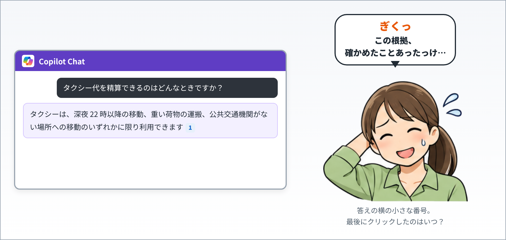
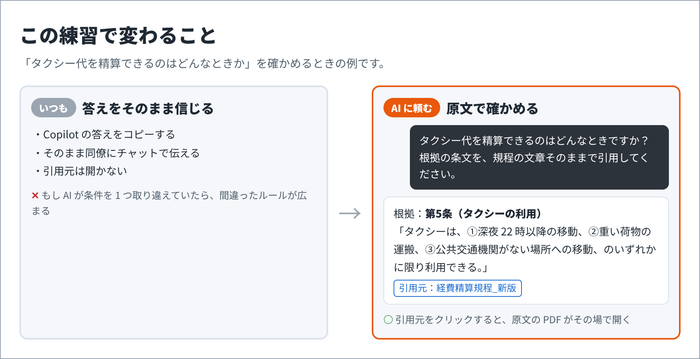
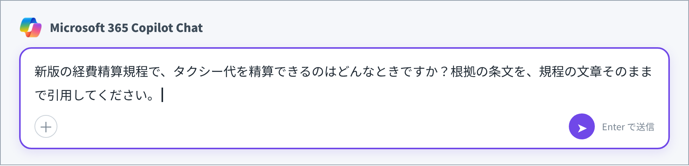
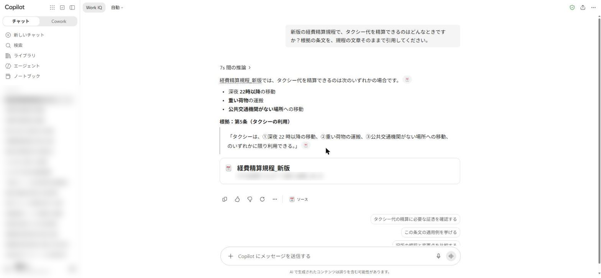
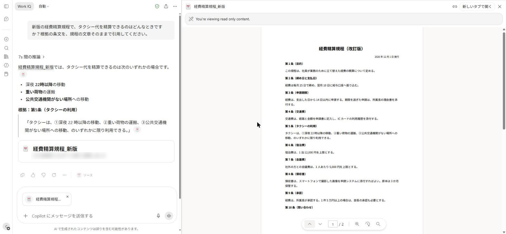

# 練習20：AI の答えを原文で確かめる

## テーマ

Copilot の答えには、小さな番号やアイコンが付いています。あれを最後にクリックしたのはいつでしょうか？

AI の答えが正しいかどうかを確かめる一番確実な方法は、答えの元になった資料――原文を自分の目で見ることです。



## 目的

規程について質問し、答えに付いた引用元をクリックして、原文の該当箇所を確かめます。



## 必要な環境

| 項目 | 内容 |
| ---- | ---- |
| 使う場所 | Microsoft 365 Copilot Chat（Work IQ オン） |
| 使うデータ | 経費精算規程_新版.pdf（OneDrive に置いてあれば添付は不要） |

この練習では以下のタスクを実施します。

　**タスク１：根拠つきで答えてもらう**

　**タスク２：原文を開いて確かめる**


## 予想時間: 3分


## 今回の頼み方

Copilot には、次のように頼みます。実際に入力する文は、タスクの手順の中にあります（コピーして貼り付けられます）。



## タスク1 - 根拠つきで答えてもらう

> **このタスクの目的：** 「そのまま引用して」と頼み、原文と照らし合わせやすくします。

1. Microsoft Edge で以下の URL を開き、会社のアカウントでサインインします。画面上部の「**Work IQ**」がオンになっていることを確認します（文字に取り消し線が付いている場合はクリックしてオンにします）。

   ```
   https://m365.cloud.microsoft/chat
   ```

   


2. 入力欄に次の文を貼り付けて、**Enter** キーを押します。

   ```
   新版の経費精算規程で、タクシー代を精算できるのはどんなときですか？根拠の条文を、規程の文章そのままで引用してください。
   ```


   


3. 3 つの条件と、根拠の第5条の引用が表示されることを確認します。

   

   


## タスク2 - 原文を開いて確かめる

> **このタスクの目的：** 引用元をクリックして、原文の該当箇所を自分の目で見ます。

1. 引用文の後ろにある小さなアイコン（引用元）をクリックします。画面の右側に **経費精算規程_新版** が開きます。

   


2. 原文の「第5条（タクシーの利用）」を探し、Copilot の引用と一字一句同じであることを確かめます。

   

   


## うまくいったかの目安

- 第5条の引用が原文と一致している
- 引用元をクリックして原文が開く


## ここがコツ

- 「**規程の文章そのままで引用して**」と頼むと、AI が言い換えた文ではなく、原文の文が返ってきます。原文と照らし合わせやすくなります。
- 引用元のアイコンにマウスを合わせると、どのファイルのどこから引用したかが表示されます。
- 引用元が付いていない答えや、引用元が古い版のファイルになっている答えは、そのまま使わないようにします。


## 言い換え例

同じ考え方で、次のようにも頼めます。

```
その答えの根拠になったファイルの名前と、更新日を教えてください。
```

```
旧版の規程では、同じ条はどう書かれていましたか？原文のまま引用してください。
```

```
この答えの中で、規程に書かれていない部分はありますか？
```


---

← [練習19：AI の集計を別の方法で確かめる](./Practice19_AIの集計を別の方法で確かめる.md)　｜　[README に戻る](../README.md)
