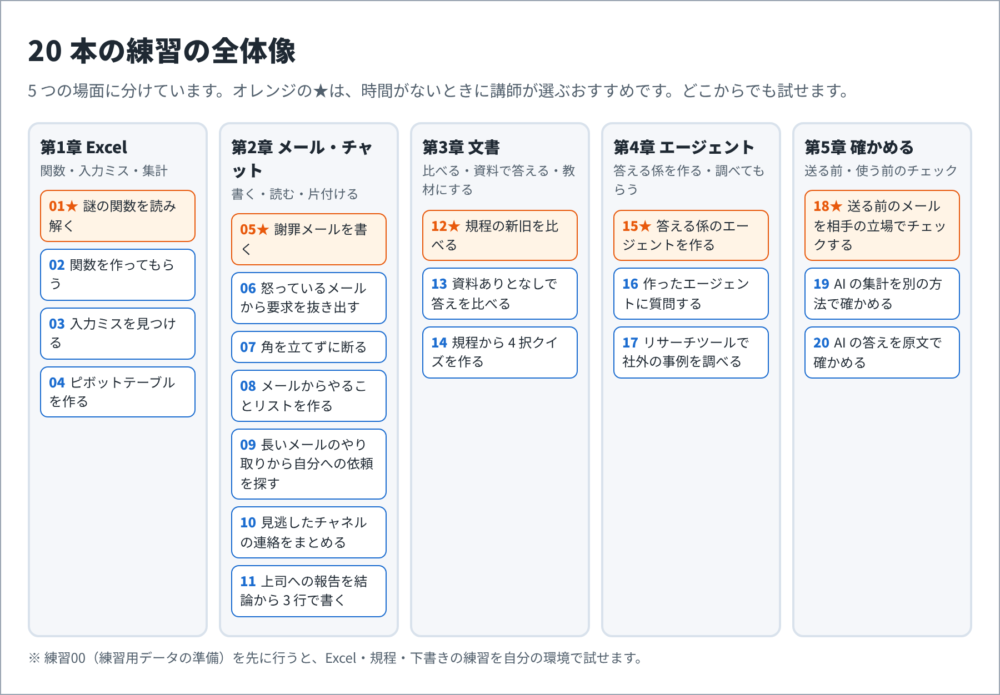

# AI-3025：AI を使用してよりスマートに作業する ― デモ集

## このリポジトリについて

研修で紹介したデモを、職場に戻ってからご自身で試せるようにまとめた「事例集・便利プロンプト集」です。

研修の時間内に行うのは、20 本のうちの一部（講師が選んだデモ）です。残りのデモも、すべて同じ形で手順をまとめていますので、気になるものから試してください。

各デモは 1 本ずつ独立しています。どれからでも始められます。

## 各デモの読み方

どのデモも、同じ順番で書いています。

| 見出し | 書いてあること |
| ------ | -------------- |
| テーマ | どんな場面で困るか |
| 目的 | このデモで何ができるようになるか（図「このデモで変わること」） |
| 必要な環境 | 使う場所と、使うデータ |
| タスク | 画面の操作手順 |
| うまくいったかの目安 | 結果を確かめるポイント |
| ここがコツ | 頼み方の工夫と、気をつけること |
| 言い換え例 | 同じ考え方で、ほかの仕事に使える依頼文 |

## デモの一覧

★は講師のおすすめです。

| おすすめ | デモ | 場面 | 予想時間 |
| :------: | ---- | ---- | -------- |
| | [デモ00：練習用データを準備する](./LabManual/Demo00_練習用データを準備する.md) | 準備 | 10分 |
| ★ | [デモ01：謎の関数を読み解く](./LabManual/Demo01_謎の関数を読み解く.md) | Excel | 3分 |
|  | [デモ02：関数を作ってもらう](./LabManual/Demo02_関数を作ってもらう.md) | Excel | 4分 |
|  | [デモ03：入力ミスを見つける](./LabManual/Demo03_入力ミスを見つける.md) | Excel | 4分 |
|  | [デモ04：ピボットテーブルを作る](./LabManual/Demo04_ピボットテーブルを作る.md) | Excel | 4分 |
| ★ | [デモ05：謝罪メールを書く](./LabManual/Demo05_謝罪メールを書く.md) | メール・チャット | 4分 |
|  | [デモ06：怒っているメールから要求を抜き出す](./LabManual/Demo06_怒っているメールから要求を抜き出す.md) | メール・チャット | 3分 |
|  | [デモ07：角を立てずに断る](./LabManual/Demo07_角を立てずに断る.md) | メール・チャット | 3分 |
|  | [デモ08：メールからやることリストを作る](./LabManual/Demo08_メールからやることリストを作る.md) | メール・チャット | 5分 |
|  | [デモ09：長いメールのやり取りから自分への依頼を探す](./LabManual/Demo09_長いメールのやり取りから自分への依頼を探す.md) | メール・チャット | 3分 |
|  | [デモ10：見逃したチャネルの連絡をまとめる](./LabManual/Demo10_見逃したチャネルの連絡をまとめる.md) | メール・チャット | 3分 |
|  | [デモ11：上司への報告を結論から 3 行で書く](./LabManual/Demo11_上司への報告を結論から3行で書く.md) | メール・チャット | 3分 |
| ★ | [デモ12：規程の新旧を比べる](./LabManual/Demo12_規程の新旧を比べる.md) | 文書 | 4分 |
|  | [デモ13：資料ありとなしで答えを比べる](./LabManual/Demo13_資料ありとなしで答えを比べる.md) | 文書 | 3分 |
|  | [デモ14：規程から 4 択クイズを作る](./LabManual/Demo14_規程から4択クイズを作る.md) | 文書 | 4分 |
| ★ | [デモ15：答える係のエージェントを作る](./LabManual/Demo15_答える係のエージェントを作る.md) | エージェント | 6分 |
|  | [デモ16：作ったエージェントに質問する](./LabManual/Demo16_作ったエージェントに質問する.md) | エージェント | 4分 |
|  | [デモ17：リサーチツールで社外の事例を調べる](./LabManual/Demo17_リサーチツールで社外の事例を調べる.md) | エージェント | 10分 |
| ★ | [デモ18：送る前のメールを相手の立場でチェックする](./LabManual/Demo18_送る前のメールを相手の立場でチェックする.md) | 確かめる | 4分 |
|  | [デモ19：AI の集計を別の方法で確かめる](./LabManual/Demo19_AIの集計を別の方法で確かめる.md) | 確かめる | 4分 |
|  | [デモ20：AI の答えを原文で確かめる](./LabManual/Demo20_AIの答えを原文で確かめる.md) | 確かめる | 3分 |

### あわせて使える資料

- [依頼文の例（職種別）](./LabManual/Tips_職種別の依頼文の例.md)
- [メールの文例集](./LabManual/文例集_メール.md)

## 必要な環境

| 項目 | 内容 |
| ---- | ---- |
| アカウント | Microsoft 365 の職場のアカウント |
| ライセンス | Microsoft 365 Copilot（メール・ファイル・チャットを参照するデモ、Excel・Agent Builder・リサーチツールのデモで必要） |
| ブラウザー | Microsoft Edge（最新版） |
| 練習用データ | [AI-3025_練習用データ.zip](./Allfiles/AI-3025_練習用データ.zip)（デモ00 で準備します） |

> 注：Microsoft 365 Copilot Chat（無料版）でも、ファイルを直接アップロードすれば、デモ12〜14・18 の考え方を試せます。メール・チャット・OneDrive の内容を探して答えるデモ（デモ05〜11、13、16、20）は、Microsoft 365 Copilot のライセンスが必要です。
>
> 注：Copilot の画面や回答は、更新によって変わることがあります。手順の画面と完全に同じにならなくても、「うまくいったかの目安」を満たしていれば問題ありません。

## AI に頼むときの 3 つの型

20 本のデモで使っている頼み方は、次の 3 つの型の組み合わせです。

1. **材料を渡す**：ファイル・メール・事実を、自分で指定して渡す（推測させない）
2. **形を決める**：表の列、行数、3 パターン、結論から、などを数字や言葉で指定する
3. **確かめる**：引用元・原文・別の計算方法で、人が最後に確かめる

## 練習用データについて

練習用データに登場する会社名・人名・金額は、すべて研修用に作成した架空のものです。実在の企業・人物とは関係ありません。
